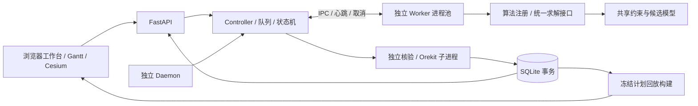

# EOS-Course-Project · 地球观测卫星调度实验系统

《操作系统课程设计》小组项目。基于开源 [EOS-Bench](https://github.com/Ethan19YQ/EOS-Bench)，构建集实验配置、独立进程调度、进程间通信、结果核验、数据库管理和可视化回放于一体的课程实验平台。

**组长：李泽同　｜　组员：何明涛、刘懋兴、梁兆榮**

> 当前使用方式：Windows 浏览器 + Ubuntu 22.04 LTS（WSL2）后端，也支持原生 Linux。日常实验使用工程物理核验；采样通过不等于严格连续区间认证。大型场景、模型权重和运行数据库另行分发，不随 Git clone 下载。

2026-10-23交接入口：[项目总览与后续开发交接](docs/phase2/project_development_handoff_20261023.md)。当前19个比较算法、96核心＋7附加Canonical场景，以及本轮尚未提交的代码/数据范围、启动与修复优先级均在其中说明。

## 目录

- [背景与目标](#背景与目标)
- [成员与分工](#成员与分工)
- [功能概览](#功能概览)
- [系统架构](#系统架构)
- [算法与比较规则](#算法与比较规则)
- [部署与启动](#部署与启动)
- [网页使用](#网页使用)
- [数据与模型交付](#数据与模型交付)
- [实验结果导出](#实验结果导出)
- [开发、测试与协作](#开发测试与协作)
- [常见问题与边界](#常见问题与边界)
- [文档导航](#文档导航)
- [开源来源与致谢](#开源来源与致谢)

## 背景与目标

地球观测卫星需要在有限可见窗口内安排观测任务，满足曝光时长、任务唯一性、姿态切换、载荷及资源约束，必要时还要安排地面站下传。本项目复用 EOS-Bench 的场景结构与调度内核，在此基础上完成课程系统和自主算法。

课程重点是让一次实验真实经历“配置提交→队列→独立 Worker→IPC→Controller 核验→SQLite 事务保存→查询/导出/回放”，展示进程管理、同步互斥、通信、取消超时及故障恢复。算法效果通过同场景、同约束和可追溯配置比较，不以网页动画代替可行性核验。

## 成员与分工

| 成员 | 角色与系统职责 | 算法及实验职责 |
|---|---|---|
| **李泽同** | **组长**；总体架构、公共接口、FastAPI、Controller、SQLite、模块集成与交付 | 主导机器学习算法 **LAVIS / LAVIS-OC**，负责学习方案、模型接入与验证 |
| **何明涛** | Worker、IPC、队列同步、取消/超时与进程回收；维护相关设计和故障演示 | 负责传统算法 A **DARTIS**；参与机器学习算法 |
| **刘懋兴** | 场景数据准备、来源谱系与哈希、训练/验证/测试划分、基线复现与成对实验协议 | 负责传统算法 C **CAABS**；参与机器学习算法，提供全组统一数据 |
| **梁兆榮** | 前端、实验监控、结果比较、Cesium/交互甘特图、独立 Daemon 与故障恢复 | 负责传统算法 B **RABAS**，整合可视化与运行展示 |

以上是协作责任边界；公共接口变更、数据口径和集成影响由组长协调。具体实现记录与验收范围以各模块专题文档为准。

## 功能概览

| 模块 | 当前能力 |
|---|---|
| 实验配置 | 登记数据源和输出位置；选择场景、多算法、初始模型、种子、预算及算法专属参数 |
| 工作台 | 新建实验、实验管理、结果比较三个页面；电脑全屏适配，长列表/详情/宽表格内部滚动 |
| 并行运行 | 默认2个独立 Worker，网页可设1—8并保存；实验队列、事件、心跳、取消与超时处理 |
| IPC与同步 | Controller/Worker协议、任务与运行身份、文件/进程锁、槽位隔离、终态事务控制 |
| 结果核验 | 独立重放候选计划，检查来源、时间、资源、姿态切换和地球遮挡；Orekit曝光采样核验 |
| 持久化 | SQLite保存实验及运行、配置快照、状态、计划、指标与相关事件；按实验查询和管理 |
| 管理与清理 | 取消运行、移除实验内算法、删除不需要的实验；涉及历史/文件的范围以页面提示为准 |
| 比较 | 同条件分组、选择参与比较的结果、点击数值表头排序；再次点击切换升降序 |
| 对照 | 同场景不同初始模型的对照；临时对照用于当前页面及临时Gantt，不写入持久实验 |
| 导出 | 单运行JSON/逐任务CSV、统计汇总CSV、批量统计ZIP及配置的目录输出 |
| 可视化 | 交互甘特图、Cesium三维轨道/任务回放、固定载荷视图、观察区间、实验内算法管理与比较 |
| 故障恢复 | 独立Linux/WSL Daemon监护、有界退避重启和可核对身份的恢复；不承诺无条件恢复所有任务 |

算法选择界面保留后端Registry全部条目，包括MIP/PPO；缺依赖或模型时显示原因并禁用。结果比较不显示RV，原数据库/结果格式的兼容字段仍保留。

## 系统架构



- Worker负责求解；Controller负责可信终态和入库，Worker自报“成功”不能直接成为实验成功。
- 同一Experiment包含多个算法Run，每个Run记录实际配置、场景SHA、模型身份、预算与种子。
- 回放读取冻结的场景与计划，不会重新执行调度算法；显示采样、几何示意和调度核验是不同概念。
- 输入场景保持只读。数据库、锁、模型、派生数据与回放缓存放在独立运行目录。

### 目录组织

```text
EOS-Course-Project/
├─ eos_system/          # API、Controller、Worker/IPC、SQLite、导出、Daemon、网页
├─ algorithms/          # 自主算法及模型/训练相关代码
├─ core/                # 调度问题、约束、目标和结果等公共模型
├─ schedulers/          # 原有调度器与基线
├─ utils/               # 轨道、物理核验、来源与公共工具
├─ input/               # 原始输入与数据来源
├─ data/                # Canonical场景、Registry与派生统计
├─ draw/                # Cesium及可视化资源
├─ replay/              # 回放构建与资源发布
├─ replay_configs/      # 版本化回放配置
├─ experiments/         # 数据协议、划分配置、小型验收摘要
├─ scripts/             # 训练、比较、审计及集成验收工具
├─ tests/               # Python / Node专项与集成测试
├─ docs/phase2/         # 设计、交接、算法与验收文档
├─ COURSE_SETUP.md      # 版本迭代及实测记录
└─ requirements-*.txt   # 系统、可视化、机器学习依赖
```

## 算法与比较规则

### 小组自主算法

| ID | 名称 | 主要机制 |
|---|---|---|
| `dartis` | DARTIS · 截止期感知动态可行插入 | 以截止期/松弛度选择任务，每次插入后重算可行机会 |
| `rabas` | RABAS · 资源感知任务包竞价调度 | 构造任务包、评估资源与机会成本、中标后更新全局计划并重新报价 |
| `caabs` | CAABS · 冲突感知限时束搜索 | 同时保留多条部分计划，通过有界扩展与剪枝搜索 |
| `lavis` | LAVIS · 学习型分配价值引导插入调度 | 离线学习候选排序，在线仍通过共享约束构造计划；LAVIS-OC学习机会成本 |

此外提供收益/时效/均衡启发式、冲突压力修复、SA、GA、ACO等对照入口。实际可运行状态以 `/api/algorithms` 和网页提示为准。`completion_first` / `adaptive_repair`是初始排程模型，不能重复计为新的自主算法；不同算法是否使用初始解见其卡片说明。

### 基础调度算法

网页和旧命令行均可使用以下六种非抢占式基线，可与现有算法加入同一实验：

| ID | 名称 | 当前可执行任务的选择规则 |
|---|---|---|
| `fcfs` | 先来先服务（兼容 `fcfo`、`fifo`） | 到达时间最早，同到达时间保持数据集任务顺序 |
| `sjf` | 短作业优先 | 观测时长最短 |
| `priority` | 优先级调度 | `priority` 数值最大 |
| `edf` | 最早截止期优先 | 截止期最早 |
| `llf` | 最小松弛度优先 | 截止期−当前时刻−观测时长最小 |
| `hrrn` | 高响应比优先 | `(等待时间+观测时长)/观测时长` 最大，每轮重算 |

数据没有独立的CPU到达/截止字段，统一使用首个可见窗口开始时间和最后窗口结束时间；只在当前受检可行机会中派发。观测不分割，继续遵守来源窗口、姿态切换、存储/功率及地面站下传约束。基础基线独立构建计划，公共权重只用于同一任务、同一开始时刻的放置择优，不执行R1目标重排，因此保留各基础策略的含义。详见[基础调度接入说明](docs/phase2/algorithms/basic_scheduling.md)。

重启后端并刷新网页后，在“新建实验”的算法列表中勾选即可；实验追加算法、临时对照、比较、导出、Gantt和Cesium继续共用原接口。单次实验和默认待运行队列上限均为32，并发Worker数量仍由原设置控制。旧CLI示例：`python main_scheduler.py --algos fcfs sjf priority edf llf hrrn`。

### 指标与预算

- TP：任务收益；TCR：任务完成率；BD：负载均衡度；TM：归一化等待时间；RT：算法耗时（秒）。
- 综合分：`70*TCR + 20*(TP/场景总优先级) + 10*(1-TM)`；总优先级为0时收益项为0，RT不计入综合分。
- 只在相同场景、约束、预算、初始模型、物理口径和并发条件内排序。失败或缺失指标不冒充零分。
- 点击“完成任务、综合分、TP、TCR、BD、TM、RT”表头排序，再次点击反向；TM/RT首次点击优先升序，其余优先降序。
- 算法预算是求解阶段的时间上限；加载、Worker启动、核验和回放构建还需要额外时间。严格耗时对照请设并发为1，并统一机器与预算。

新模型 `lavis-v4-opportunity`在本轮冻结加载的52个开发验证场景全部通过独立物理采样，高冲突完成数1849/2944；旧v3同策略为1808/2944。固定四个高冲突场景30秒多分支完成数208→218，存在单场景退步，不宣称全面优于传统算法或最终泛化领先。完整协议、失败配置与边界见[LAVIS-OC报告](docs/phase2/algorithms/lavis_learning_v2.md)。

新增简单对照：`random_feasible`（固定seed的随机可行插入）、`satellite_round_robin`（非抢占式卫星轮询，不是CPU时间片RR）。两者不叠加全局目标优化，仍经公共约束核验；定义与开发筛选协议见[简单基线说明](docs/phase2/simple_baselines_pilot_20261028.md)。

## 部署与启动

### 1. 运行环境

- 推荐Windows 10/11 + WSL2 Ubuntu 22.04 LTS，后端使用Ubuntu的Python 3.10；原生Linux也可按相同步骤准备。
- Windows负责编辑代码、Git协作及浏览器；Linux负责Worker、锁、Daemon、SQLite、物理计算与模型运行。后端使用Linux进程接口，不直接用Windows Python启动。
- 场景、数据库、虚拟环境和Orekit数据优先放Linux文件系统；代码可位于Windows挂载目录。按场景规模和Worker数准备内存，不把8并发作为任何机器的推荐值。

未安装WSL时在管理员PowerShell执行，按系统提示重启并创建Ubuntu账户：

```powershell
wsl --install -d Ubuntu-22.04
wsl -l -v
```

### 2. 获取代码与安装依赖

在**Ubuntu终端**执行。以下是可替换的目录示例，不依赖某位组员的盘符：

```bash
sudo apt-get update
sudo apt-get install -y git git-lfs python3-venv python3-pip
mkdir -p ~/projects
cd ~/projects
git clone https://github.com/TonyLizt/EOS-Course-Project.git
cd EOS-Course-Project
git lfs install
git lfs pull

export EOS_RUNTIME_DIR="$HOME/eos-course-runtime"
mkdir -p "$EOS_RUNTIME_DIR"
python3 -m venv "$EOS_RUNTIME_DIR/.venv"
source "$EOS_RUNTIME_DIR/.venv/bin/activate"
python -m pip install --upgrade pip
python -m pip install -r requirements-system.txt -r requirements-visualization.txt
```

日常工程物理核验也需要Orekit依赖；不能把它仅当作三维回放的可选安装。需要LAVIS或重训时，在**同一个虚拟环境**执行：

```bash
python -m pip install -r requirements-ml.txt
```

确认 `utils/orekit-data.zip` 为真实ZIP，不能是未下载的LFS指针。物理核验可使用Linux中的副本：

```bash
cp utils/orekit-data.zip "$EOS_RUNTIME_DIR/orekit-data.zip"
export EOS_OREKIT_DATA="$EOS_RUNTIME_DIR/orekit-data.zip"
python -c "import orekit_jpype, fastapi, numpy; print('依赖导入成功')"
```

Orekit-JPype的JDK由安装额外项`jdk4py`提供；若本机使用自备JDK，遵循对应环境配置。浏览器CesiumJS及底图等外部资源还需要网络访问，后端安装完成不代表离线底图已准备。

### 3. 准备场景与模型

当前统一Canonical数据位于`data/scenarios/eos-v1/`，含96核心＋7附加可用实例；使用本轮数据时设置`EOS_SCENARIO_DIR="$PWD/data/scenarios/eos-v1"`。完整来源、v3计划、场景搭建、PPO/LAVIS新模型安装和实跑结果见[场景目录](docs/phase2/scenario_catalog.md)及[建设报告](docs/phase2/scenario_dataset_build_report.md)。这些本地数据和本轮未跟踪代码尚未全部纳入当前HEAD，接收时须一并交付。

原有80份公开开发数据继续兼容。使用该旧数据包时解压到运行目录，保留 `provenance/`、manifest、来源谱系和划分文件。仅登记实际场景目录，不把数据说明JSON当场景：

```bash
export EOS_SCENARIO_DIR="$EOS_RUNTIME_DIR/datasets/eos-course-v1/development/scenarios"
```

上述目录应含公开80份场景；未取得包时可使用自己已有的合规场景目录，并在网页登记。仓库样例不等于完整小组数据交付。最终冻结测试单独保管，不登记到日常开发后端。

LAVIS还需复制完整模型目录（至少包含 `manifest.json` 和 `model.joblib`）到：

```text
<EOS_RUNTIME_DIR>/models/lavis/<model_id>/
```

例如 `lavis-v4-opportunity`。必须使用可信组内制品，保留模型SHA、依赖和代码身份；不手改manifest绕过不匹配提示。没有权重时仍可运行已就绪的传统算法。

### 4. 启动、访问与停止

在项目根目录、已激活的同一Ubuntu环境运行：

```bash
export EOS_RUNTIME_DIR="$HOME/eos-course-runtime"
export EOS_SCENARIO_DIR="$EOS_RUNTIME_DIR/datasets/eos-course-v1/development/scenarios"
export EOS_OREKIT_DATA="$EOS_RUNTIME_DIR/orekit-data.zip"
python -m eos_system
```

- 工作台：<http://127.0.0.1:8765/>
- OpenAPI交互文档：<http://127.0.0.1:8765/docs>
- 健康检查：<http://127.0.0.1:8765/api/health>
- Gantt实验入口：<http://127.0.0.1:8765/visualization/gantt>

前台按Ctrl+C正常停止，等待退出再启动。**不要删除controller.lock，也不要使用Uvicorn多Web worker或`--reload`来实现实验并发。** 求解并发由系统Worker池控制。

常用配置：

| 环境变量 | 用途与默认行为 |
|---|---|
| `EOS_RUNTIME_DIR` | 运行目录，默认 `~/eos-course-runtime` |
| `EOS_SCENARIO_DIR` | 显式设置优先；未指定且项目Canonical已建成时使用Canonical，否则保留运行目录scenarios/仓库Legacy回退 |
| `EOS_OREKIT_DATA` | Orekit数据ZIP位置；未指定时使用仓库默认数据 |
| `EOS_PORT` | 本机HTTP端口，默认8765 |
| `EOS_MAX_WORKERS` | 可选1—8；未指定时读网页已保存设置，首次默认2 |

已设置 `EOS_MAX_WORKERS` 时它优先于网页保存值。数据源与输出方案也可通过页面动态登记，无需改源码。

### 5. Daemon守护启动

需要故障演示或后台守护时，先正常停止前台服务，保持同样的环境变量与解释器：

```bash
python -m eos_system.daemon start
python -m eos_system.daemon status
python -m eos_system.daemon stop
```

前台观察守护日志可用 `python -m eos_system.daemon run`。同一运行目录只允许一个Controller；端口、运行目录隔离和有界恢复策略见[Daemon说明](docs/phase2/daemon_implementation_and_validation.md)。当前HTTP服务绑定本机，不提供面向公网的账号认证与生产部署保证，不应直接暴露到公网。

## 网页使用

1. **新建实验→选择场景**：从已登记数据源选择JSON。新增目录在“目录管理”填写；接受Windows绝对路径或WSL绝对路径，实际由后端检查。
2. **选择算法**：可多选；点击卡片三角查看说明及类型化参数。LAVIS显式选择已分发模型，例如 `lavis-v4-opportunity`，并按需要选择 `expanded`候选与`multistart`搜索。
3. **确认并运行**：统一种子、预算、初始模型和目标，选择输出方案，提交一个多算法实验。
4. **实验管理**：列表选择实验，详情切换算法，查看状态、事件、计划、核验及实际参数；需要时取消或清理不再使用的数据。
5. **结果比较**：勾选参与比较的算法，点击表头排序；创建持久对照用于留档，临时对照用于当前页面探索。
6. **导出与回放**：下载单运行或统计包，打开Gantt/Cesium。Cesium首次请求会按冻结计划构建回放资源；失败后通过页面重试，不能通过动画判断任务核验成功。

浏览器按F11可全屏，窗口变化自动适配；更新前端后按Ctrl+F5刷新。输出目录必须已存在并可写，按运行隔离；浏览器下载位置由浏览器设置决定。

## 数据与模型交付

- 本轮新增统一Canonical核心为8种规模×4种难度×3种子，共96实例；另有7附加可用实例，旧80份开发数据与本轮核心不能混计。全量3,914比较组合已实跑，106次MIP超时、2次并发异常保留；不宣称全算法全部通过。详见[总交接](docs/phase2/project_development_handoff_20261023.md)。

- 公共原始集合：100份任务来源，60训练/开发、20验证、20冻结测试；日常公开目录只有80份。
- 已有高冲突扩充：48个来源家族、96份场景，64训练、32验证；兄弟变体按同一家族划分，不跨训练/验证。
- LAVIS-OC本轮使用既有124训练场景/92来源组、52开发验证场景；没有新增场景或读取最终20测试。
- 原公共集合存在共享星座/历元，不能仅凭任务来源划分就声称已证明跨轨道泛化；谱系与场景SHA必须一起保留。
- 用U盘分发公开开发ZIP、说明和SHA；另行分发可信模型目录，不复制个人SQLite、锁、虚拟环境或全部运行缓存。

交付结构及网页接入见[U盘交付](docs/phase2/scenario_usb_handoff.md)、[高冲突数据协议](experiments/datasets/lavis-conflict-v1/README.md)。重训使用新模型ID，不覆盖已验收制品；完整标签生成、训练、验证与重新冻结命令见[LAVIS-OC](docs/phase2/algorithms/lavis_learning_v2.md)。训练/验证白名单及来源隔离是算法实验的一部分。

## 实验结果导出

### 单运行

成功且通过对应核验门禁后可下载JSON或逐任务CSV，保留原API及Gantt/Cesium入口。历史无可信凭据的结果不能直接当成当前有效计划。

### 统计CSV与ZIP

实验管理勾选实验，可跨分页选择后下载；详情与比较页也可导出当前实验。

| 文件 | 用途 |
|---|---|
| `summary.csv` | 每次算法运行一行，包含状态、条件、身份、种子、预算、指标和评分 |
| `aggregates.csv` | 同条件/算法参数/权重分组的样本数、均值与样本标准差 |
| `assignments.csv` | 有效结果逐任务明细，不重复汇总指标 |
| `configurations.json` | 配置快照，省略输入/输出本机绝对路径 |
| `manifest.json` | 范围、数量、时间及文件SHA-256 |
| `README.md` | 包内使用与统计口径 |

CSV为UTF-8 BOM，Excel可直接打开；列名稳定英文，比例保留原始值。失败/取消/未完成记录保留一行、指标留空，真实0仍是0。样本标准差至少需要2个有效值；同种子重跑不自动视为独立随机重复。默认不含已移除算法历史，可显式勾选包含并按 `removed_at`筛选；临时对照不进入持久统计包。

API：`POST /api/statistics/export`，请求示例：

```json
{"experiment_ids":["实验ID"],"format":"zip","include_removed":false}
```

一次最多100个实验、500次运行、10万条明细、64MiB，超限分批导出。不要用任务明细的行数重复累加运行级TCR/TP。完整字段、门禁和验收见[工作台交付说明](docs/phase2/delivery_workbench_handoff.md)。

## 开发、测试与协作

Python测试在WSL项目根目录执行；部分集成测试需要Orekit和机器学习依赖：

```bash
source "$HOME/eos-course-runtime/.venv/bin/activate"
PYTHONPATH=tests:. python -B -m unittest discover -s tests -v
```

安装Node.js后可在项目根目录运行前端单元测试；Windows PowerShell示例：

```powershell
node --test (Get-ChildItem tests/*.test.cjs).FullName
```

专项命令与已验证范围记录在专题文档；不把一次专项通过称作全仓全部测试通过。新增算法接入公共注册表及 `solve(problem, constraints, context)`边界，内部策略可以独立设计，输出须满足统一计划格式与核验要求。

团队流程：从最新main开功能分支→代码及对应文档同时修改→本地验证→PR→非作者组员审核→合并。不要直接向main推送；公共契约变更需组长确认。见[协作规范](docs/phase2/team_collaboration.md)。

## 常见问题与边界

| 现象 | 检查方法 |
|---|---|
| 没有场景 | 检查完整数据包、解压层级及登记目录；只登记scenarios，保留来源侧车 |
| LAVIS不可选/模型不匹配 | 核对同一环境的ML依赖、完整模型目录、SHA和代码指纹；不编辑manifest放行 |
| 工程核验缺少物理配置/来源 | 核对场景谱系、当前兼容合同、Orekit数据；旧窗口不能自动当成真实物理可见 |
| `NO_CONTINUITY_CERTIFICATE`等正式拒绝 | 日常网页使用工程物理核验；严格formal仍需真实连续证明，不能改PASS字段绕过 |
| 页面与新代码不一致 | 正常重启后端，浏览器Ctrl+F5；无需删除数据库或锁 |
| “已有Controller” | 原服务仍在运行，直接访问；需重启时在原终端正常停止 |
| 回放轨迹/视锥与预期不一致 | 核对时间/历元/来源、回放版本、采样与几何假设，不能只归因于前端或只看动画 |
| 并行时RT波动 | 资源争用会影响耗时，严肃对照设并发1，保留预算和资源设置 |

本系统使用课程仿真规则，不是实际卫星任务指令系统。工程曝光采样通过只说明记录的采样与约束口径通过，不能据此声称严格连续物理证明、硬件标定或真实观测成功。旧 `orbit.czml` GET兼容入口继续保留，待前端迁移复核完成再决定移除。

## 文档导航

| 文档 | 内容 |
|---|---|
| [项目总交接](docs/phase2/project_development_handoff_20261023.md) | 当前整体状态、换机部署、场景搭建、已知问题、分工与验收清单 |
| [Canonical场景目录](docs/phase2/scenario_catalog.md) / [建设报告](docs/phase2/scenario_dataset_build_report.md) | 96核心＋7附加、来源与难度、统一入口、全量实跑及限制 |
| [COURSE_SETUP](COURSE_SETUP.md) | 历次版本、原因、验证与限制 |
| [工作台交付](docs/phase2/delivery_workbench_handoff.md) | 全屏界面、导出、表头排序、Cesium修复 |
| [并行/评分/搜索](docs/phase2/parallel_ranking_lavis_handoff.md) | Worker池、固定评分和可选候选扩展 |
| [接口接入](docs/phase2/algorithm_integration.md) | 算法公共接口与注册 |
| [数据库与ER图](docs/phase2/database_current_v03.md) | 已落地数据库设计；后续增量见各交接文档 |
| [实验管理API](docs/phase2/experiment_management_handoff.md) | Experiment/Run组织、管理与对照 |
| [Daemon](docs/phase2/daemon_implementation_and_validation.md) | 守护生命周期、恢复与故障边界 |
| [DARTIS](docs/phase2/algorithms/deadline_insertion.md) | 传统算法A |
| [RABAS](docs/phase2/algorithms/auction_bundle.md) | 传统算法B |
| [CAABS](docs/phase2/algorithms/conflict_beam.md) | 传统算法C及历史变更 |
| [LAVIS](docs/phase2/algorithms/lavis.md) / [LAVIS-OC](docs/phase2/algorithms/lavis_learning_v2.md) | 机器学习算法、模型与训练验证 |
| [统一兼容修复](docs/phase2/unified_compatibility_repair.md) | 旧课程姿态、场景与模型兼容边界 |
| [U盘交付](docs/phase2/scenario_usb_handoff.md) | 全组场景数据分发与接入 |
| [团队协作](docs/phase2/team_collaboration.md) | 分支、PR、审核与文档要求 |

历史设计审核稿包含规划目标，不代表全部实现；当前行为以源码、`/docs`和最新专题验收为准。

## 开源来源与致谢

- **EOS-Bench**：[上游仓库](https://github.com/Ethan19YQ/EOS-Bench)。复用其场景结构、调度问题/约束模型、基线算法、指标计算和早期Cesium/Gantt页面，课程项目在其基础上增补系统框架、自主算法与实验管理。本仓库不是EOS-Bench官方仓库。
- 上游论文：*EOS-Bench: A Comprehensive Benchmark for Earth Observation Satellite Scheduling*；继承的[CITATION.cff](CITATION.cff)记录上游作者及引用信息。小组成员信息与贡献见本README，不冒认上游研究成果。
- **Orekit / orekit-jpype**：轨道传播与物理几何；**CesiumJS**：三维展示；**FastAPI / Uvicorn**：HTTP服务；**SQLite**：本地持久化；**NumPy / SciPy / scikit-learn / joblib**：数值计算与学习模型；以及仓库中保留来源信息的相关可视化资源。

保留原始作者署名、引用和资源说明。各项目及数据/模型的许可按其原发布条款执行，本README不另行授予第三方代码、数据或资源的使用许可。课程实验结论仅适用于所记录的场景、代码、预算与数据身份。
