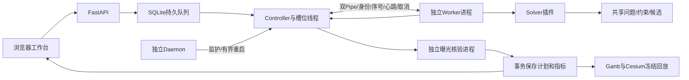
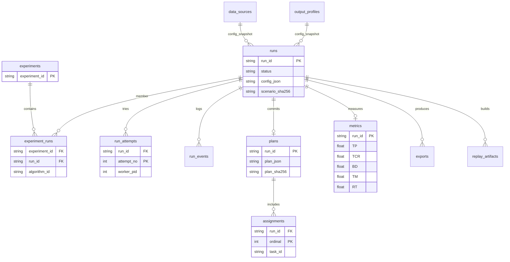

# 架构、算法、接口与数据库

## 场景模型与执行模型

任务含唯一ID、地面经纬度/高度、优先级、完整曝光时长，以及卫星/传感器可观测窗口。卫星含六根数和轨道历元、载荷模式、机动速度/稳定时间、每轨存储及课程功率预算；可选地面站有通信窗口。时间统一按UTC解析，轨道历元不是程序启动时间。

Orekit按Keplerian轨道传播，目标地固坐标转到惯性系，窗口是采样和边界细化的派生数据。调度不只信任JSON窗口：候选、公共约束与Controller会核对来源、资源、姿态和物理曝光。旧课程姿态与Nadir固定镜头合同按来源识别，不能互换解释；本次最终场景采用已审查旧课程合同以兼容冻结LAVIS。

OS类比：请求是作业，卫星载荷是处理资源，可见机会是就绪条件，曝光是服务时长，转向/稳定是切换开销。观测不可任意拆分抢占，卫星轮询不是CPU时间片轮转。真正的本机进程则是Controller、Worker和Daemon。

Worker只求解，不写业务数据库；Controller核验后决定终态。一个Worker处理一整份卫星计划，多Worker是多个算法运行并发，不是按卫星分进程。

## 代码职责

| 路径 | 内容 |
|---|---|
| `ops/eos.py`、`eos` | 安装、自检、前台/守护启动；标准库校验组内资源包 |
| `eos_system/api.py`、`contracts.py` | HTTP边界、Pydantic配置及稳定结果格式 |
| `controller.py`、`worker_reference.py` | 持久队列派发、进程启动/IPC、取消、超时、可信终态 |
| `worker_process.py`、`worker_recovery.py` | session/后代身份、pidfd、有界回收和崩溃恢复日志 |
| `daemon.py`、`process_state.py` | 独立监护、真实进度心跳、身份复核、文件锁及原子状态侧车 |
| `daemon_demo/` | 隔离演示实例、受控等待Worker及固定故障动作；不接入科研统计 |
| `storage.py`、`experiments.py` | SQLite表、事务、Experiment内多算法关系、取消/删除仲裁 |
| `verification.py`、`preview_audit_process.py`、`planning_preview.py` | 候选重放、Orekit独立采样、凭据和可导出性核验 |
| `scenario_catalog.py`、`dataset_registry.py`、`provenance.py` | 数据源、相对路径计划、SHA和来源合同 |
| `statistics_export.py`、`result_scoring.py` | 可信统计行、成对条件指纹、综合分、CSV/ZIP |
| `replay_service.py`、`visualization.py`、`replay/` | 冻结回放制品、轨道采样、构建状态/限额、相机与载荷数据 |
| `web/`、`draw/` | 工作台及两个可视化页面，采用已有API，界面不自行判定物理成功 |
| `core/`、`schedulers/` | 场景对象、加载、assignment、公共约束、目标与指标 |
| `algorithms/` | 小组算法、OS迁移、既有基线、Solver合同和目标适配器 |
| `scripts/`、`tests/` | 离线生成/训练/维护及机制/真实进程回归 |

## 四种小组方法

| 方法 | 核心决策机制 | 边界 |
|---|---|---|
| DARTIS | 按截止期、松弛度等推进，动态寻找可行插入点；局部修复、交换及续排挽回冲突任务 | 有限候选与时间预算，非全局最优保证 |
| RABAS | 构造资源可行的任务包并评估竞价值，迭代分配到卫星；可选多起点及跨星修复 | 中标/替换仍检查共享约束，不是独立资源模型 |
| CAABS | 同时保留有限宽度的部分计划，按冲突和机会代价扩展/剪枝；网格补点及候选多样性 | 束宽、候选数及预算限制搜索，非穷举 |
| LAVIS-OC | 24维候选/部分计划特征输入监督排序器，预测相对分配价值，再通过共享可行性检查插入；可选扩展时刻和模型引导多分支 | v4为机会损失代理监督，不是最优回报或概率；当前冻结模型域为无地面站、完成率目标及规定约束 |

LAVIS v4冻结制品为HGB排序回归，模型SHA `9a2a454f85b41bc948a43ffcc2bbf6d20b7359ec500a81cc8f69841a20ec078d`。模型、manifest、数值依赖及推理代码身份一起核对，不能只复制权重或修改SHA绕过检查。CAABS注册ID为`caabs`。

其他方法：FCFS/SJF/Priority/EDF/LLF/HRRN迁移OS选择原则；随机可行插入与卫星轮询从空计划建解；SA/GA/ACO及四种启发式是既有基线。初始模型与比较算法分开；SA使用初始解，其他方法按各自实现建解/保留候选，不能一概说全部从相同初始计划开始。R1目标适配器的实际身份和搜索目标随配置保存。

## 进程、同步和恢复

- 同一运行目录有Controller独占flock；Daemon也有自己的锁，正常退出不删除占用锁文件。
- IPC信封带协议版本、run/attempt、序号及类型；小控制消息和候选传输有界，不能让任意JSON改变成功状态。
- 槽位租约按真实内核身份记录；发信号复核PID、boot ID、starttime及pidfd，不能只凭历史PID杀进程。
- 取消先协作，再按期限回收。候选还须重放核验，状态、计划、assignment和metrics以事务保存，避免半成功或重复提交。
- Daemon只监护自己的服务进程，不重算算法、不写业务表。Controller崩溃后，新实例先清理可确认的旧Worker；中断Run失败，QUEUED保留，已成功结果不重算。
- 监护默认最多恢复3次，首次退避2秒、上限30秒，健康后不清零恢复预算；无法确认归属时停止自动接管。
- 网页`/daemon-demo`另起临时实例，四个固定按钮不接受PID/命令/路径；同源控制，按实际日志展示。受控作业不执行卫星算法；宿主退出或十分钟期限会停止演示。

## HTTP接口

完整字段、参数和错误响应以运行中的`/docs`、`/openapi.json`及配套[OpenAPI快照](reference/openapi.json)为准。

| 资源 | 主要操作 |
|---|---|
| `/api/health` | 服务/数据库及Controller真实线程/进度信息；HTTP200不能单独证明Daemon健康 |
| `/api/data-sources`、`/api/scenarios` | 登记绝对目录，列出场景；实验请求使用登记ID，不传任意待执行路径 |
| `/api/algorithms`、`/api/models` | 可用性、参数Schema、模型身份及不可用原因 |
| `/api/output-profiles`、`/api/execution-settings` | 输出登记、1—8并发设置与实际槽位 |
| `/api/experiments`、`/{id}/algorithms` | 多算法实验、追加/移除及查询/比较；幂等请求保留身份 |
| `/api/runs/{id}`及取消/导出子资源 | 实际状态、事件、尝试、计划、指标、JSON/CSV |
| `/api/statistics/export` | CSV或ZIP；每次最多500个算法运行，应分批导出大矩阵 |
| 回放/可视化子资源 | 按Run构建、查询和读取冻结制品；临时对照有租约，不当持久实验 |
| `/api/daemon-demo`、`/{action}` | 只控制当前隔离实例，与业务Run/数据库分开 |

请求校验失败422，重复/状态冲突409，资源不存在404；语义以实际OpenAPI和处理函数为准。算法扩展通过Registry、类型化参数、Solver上下文和统一assignment接入，不限制内部搜索/学习结构，但最终计划必须遵守公共模型及核验。

## 数据库与ER图

实际SQLite DDL见[数据库结构快照](reference/database_schema.sql)，由当前实例只读导出，不包含用户数据。下面表示主要逻辑关系；部分跨表关系通过代码及事务维护，不能把图中所有边都理解为SQL外键。

Experiment组织同场景/条件下多算法，Run对应一次算法配置；attempt记录真实进程尝试，event记录通信和控制事件。一个任务在同一计划内唯一；失败无有效成功指标，取消/删除/终态写入受事务和进程锁仲裁。回放与导出有独立制品状态，删除文件不能绕开数据库状态。

两份`docs/phase2`历史数据库材料仅供字节身份测试，当前设计以此文、DDL和代码为准。整理期间未改变业务表、物理规则和模型字节。
