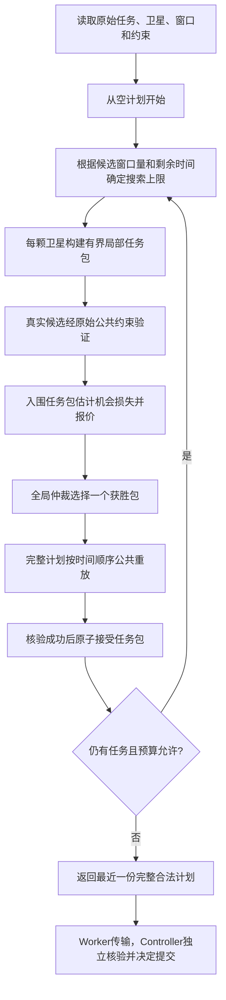

# RABAS 算法原理、跨规模优化与汇报说明（2026-10-20）

本文对应独立优化分支的 RABAS **1.1.1**，参数冻结提交 `b3968a0ff6762597ad30cbe873a10d216eb32c90`；首轮测试前修复提交 `4fbaa80`，下传覆盖修复后第二次冻结提交 `cfe53ad`，开发基线 `89dff80f881ed4c2a49b43906071ba07012be46c`。本文是本轮实际实现说明，不是待实现功能清单。测试结果及限制见 [完整实验报告](RABAS_cross_scale_report_20261020.md)。

## 1. 可以怎样介绍 RABAS

RABAS 的全称是 **Resource-Aware Bundle Auction Scheduling，资源感知任务包竞价调度**。它把每颗卫星看成一个报价方：卫星尝试将若干任务组成一个真实可执行的任务包，把完成收益与资源、转向、机会损失一起考虑后提交报价。中心调度器选择一个获胜任务包，通过统一约束核验后加入当前计划，再让各卫星重新报价。

这里的“竞价”是单个 Worker 内部的计算过程，没有实际货币、星间通信或分布式一致性协议。它不是 CBBA，也不是把已有 Greedy、CAABS 或 DARTIS 改名。CAABS 保留多条跨轮全局搜索路径；RABAS 始终只有一个已接受全局计划，多起点也仅发生在当前卫星的局部建包过程中。

适合汇报的一句话：**RABAS 用任务包表达短期组合收益，用机会成本表达对后续任务的影响，并根据剩余时间控制报价计算量。**

## 2. 核心过程

任务包不是只记录“预计能做两个任务”：它含有真实 Assignment，明确卫星、任务、原始窗口编号、起止时间、姿态及可选下传区间。默认最多两个任务，可配置为三个。每加入一个任务都核验完整当前排程，保证包内任务之间、其他卫星地面站占用之间不存在被忽略的冲突。

## 3. 旧版的问题与本轮处理

| 旧问题 | 本轮实际处理 | 尚存边界 |
|---|---|---|
| 每星只有一条贪心建包路径 | 支持至多4个不同首任务的局部路径；仍然单计划竞价 | 验证集没有稳定收益，因此默认1，不宣称默认多起点 |
| 只保护原始独占任务 | 依据当前计划探查剩余可行卫星和位置，识别共享任务变动态稀缺 | 最多2颗可行卫星、每星2个见证，是有界估计 |
| 候选固定按高优先级截断 | 结合拥有星数、已探查机会、截止期、时长、优先级；多起点可切换排序风格 | 不枚举全部任务组合；低宽度时仍会遗漏 |
| earliest/center覆盖不足 | 增加latest及转向余量后的原始网格边界提案 | 高压力时最多2位置；非敏捷仍仅中心 |
| 完整复制、重复构造和目标计算 | 只复制列表；缓存候选模板；按原公式算可加目标增量 | 每次真实插入、每次中标仍核验；BD非可加项继续调用公共函数 |
| 检查上限丢弃本轮合法报价 | 保留已完成报价；搜索停止后用预留时间核验一次 | 若核验本身超时，退回上一完整计划 |
| 大包永远优先 | 实现可选未来机会排序并消融 | 验证不支持默认启用，默认保留完成数优先 |
| 固定搜索量不适合大场景 | 候选窗口量/剩余时间驱动搜索收缩 | 不是最优预算分配器，也不识别具体场景 |

## 4. 报价如何计算

正式结果仍按项目原有函数计算，不改变 TP、TCR、TM、BD、RT。内部 Bid 只是搜索启发式，不能在 PPT 中当作 TP。

默认排序：先最大化本包新增任务数，再最大化下式，最后用稳定键打破平局：

`Bid = ΔU − 0.1 × C_transition − 0.1 × C_resource − 0.5 × C_opportunity`

- `ΔU`：公共 ObjectiveModel 的目标增量。TP归一化项、TCR、`1−TM`按原公式求增量；BD使用公共函数求前后差值。对负优先级或亚秒时域，回退完整公共函数，保持截断与归一化语义。实验冻结的目标权重是完成率1，其余0，不改变项目默认利润权重配置。
- `C_transition`：调用公共姿态转换函数，求包加入前后相邻观测转换秒数的正增量，再除以场景时长。
- `C_resource`：存储/累计功率容量占比平方的增量，加上卫星及相关地面站时间占用的平方增量。模型原字段是W累加，不能在汇报中称其为焦耳能量模型。
- `C_opportunity`：抽查受保护未安排任务，估计新包消耗的剩余卫星机会比例，再除以剩余任务数。

可选 `future_aware_rank=true` 时，先比较 `本包新增任务数 − opportunity_cost_weight × 未归一化机会损失`，然后比较包大小和Bid。它允许较小但较少阻塞后续任务的包获胜。不过验证集结果没有支持把它设为默认，故最终默认关闭。

最终计划只通过增加完成任务的中标或严格增加完成数的可选修复更新，因此内部启发式不会把较差完成数的正式计划替换为较好Bid的计划。

## 5. 动态机会成本的含义

例如任务T原本由两颗卫星观测，当前计划已占用其中一颗卫星的所有被探查机会，则T会被识别为只剩一颗可行卫星。某个竞价包若占用这颗卫星的最后见证位置，会增加机会成本。

为了控制代价，不对每个包做完整“假设中标后再求一次全局最优”的反事实求解：

1. 每轮在当前计划上用原始公共约束寻找见证，至多两颗可行卫星、每星两个位置。
2. 每层最多两个入围任务执行机会估计；普通候选不重复做昂贵机会搜索。
3. 已通过源窗口/几何核验的见证，仅为报价用公共离散约束估算新增包的影响。该估计包括互斥、转向、存储、累计功率、共享地面站资源，**不能替代任何真实任务插入的完整核验**。
4. 中标后清空当前轮机会缓存和报价；下轮依据新计划重新判断。

这是局部近似：未采样窗口可能提供额外机会，最多两星的抽样可能高估稀缺性，自定义额外约束也可能让估计不准确。验证集上关闭机会成本有时更快、完成更多，因此不能宣称“动态机会成本必然提高完成率”。

## 6. 候选覆盖和缓存为什么不属于记忆场景

缓存键是当前任务的真实窗口与网格位置，缓存生命周期仅为一次求解；上限4096项，超出按FIFO淘汰。缓存保存的是由公共构造器产生的候选模板，既不保存某场景最优排程，也不识别场景名或SHA。

选择新位置时仍使用原始窗口和原始姿态网格。通过受控的确定性位置选择器请求公共构造器生成对应子区间，不修改 Observation Windows、源编号、任务时长或姿态数据。模板被使用时必须再对当前计划调用原始 `is_feasible_assignment()`；整个获胜计划还要完整重放。

当前轮完整候选枚举缓存按确切计划对象序列区分。搜索从不修改已创建的 Assignment，只创建新的列表；公共模型也不原位修改 Assignment。取消后或下次求解不会沿用缓存。

非敏捷卫星不因为配置了earliest/latest就获得转动能力，仍保持公共模型的中心观测限制。通信窗口每星最多抽样4个，这仍是覆盖限制。1.1.1 恢复center下传并有界增加latest与当前计划空隙：最多4种提案，高压力最多2种；位置参数1仍只用所选模式。空隙通过原始通信窗口的采样比例请求公共构造器产生，再完整核验。

## 7. 参数变化表

| 参数 | 1.0.0默认 | 1.1.1默认 | 实际作用 |
|---|---:|---:|---|
| `max_bundle_size` | 2 | 2 | 上限1–3；1可消融任务包 |
| `bid_candidates_per_satellite` | 8 | 8 | 每层可行任务数上限，自适应可收缩至4或1 |
| `max_rounds` | 0 | 0 | 0使用任务数、最高1000轮 |
| `max_windows_per_task` | 4 | 4 | 每任务每星原始窗口上限；高压力至2 |
| `max_positions_per_window` | 2，上限2 | 4，上限8 | 增加latest/gap；高压力至2 |
| `max_checks_per_round` | 20000 | 20000 | 搜索检查上限；中标重放另计 |
| `transition_cost_weight` | 0.1 | 0.1 | 转向成本权重 |
| `resource_cost_weight` | 0.1 | 0.1 | 资源压力成本权重 |
| `opportunity_cost_weight` | 0.5 | 0.5 | 内部机会成本；0关闭该成本 |
| `dynamic_scarcity` | 无 | true | 当前计划的动态机会；false仅保护原始独占任务 |
| `diverse_candidates` | 无 | true | 多特征任务排序；false恢复优先级/ID排序 |
| `opportunity_probe_tasks` | 随候选宽度，默认8 | 4 | 保护任务抽样上限；高压力至1 |
| `multi_starts` | 固定1 | 1 | 可选1–4；验证未支持默认多起点 |
| `adaptive_search` | 无 | true | 按候选量和剩余时间调整实际搜索量 |
| `repair_attempts` | 无 | 0 | 可选1–64；停滞后尝试同星1换2，至多接受一次改善 |
| `future_aware_rank` | 无 | false | 可选机会损失优先排序；验证后撤销默认启用 |
| `reauction_mode` | all_affected | all_affected | 仍全星重报；没有声称实现跨轮旧报价复用 |

位置参数为4并不意味着每个窗口都检查四个不同点：短窗口可能只有一个位置；非敏捷仅中心；自适应可以进一步降低上限。

## 8. 自适应的具体公式

`pressure = 本次输入预选的窗口总数 / max(0.1, 剩余搜索秒数)`

| 条件 | 实际任务宽度 | 起点 | 每任务每星窗口 | 位置 | 保护任务 |
|---|---:|---:|---:|---:|---:|
| pressure ≤ 50 | 参数上限 | 参数上限 | 参数上限 | 参数上限 | 参数上限 |
| 50 < pressure ≤ 200 | min(4,参数) | 1 | 参数上限 | 参数上限 | 参数上限 |
| pressure > 200 | 1 | 1 | min(2,参数) | min(2,参数) | 1 |

它不直接使用“Small/Medium/Large”标签：同一个任务数，窗口更多或时间更短都会使搜索更窄。当前版本没有精确测量冲突率或在线训练预算模型；资源和冲突主要通过可行性检查、机会见证及报价体现。墙钟边界附近存在正常的运行时波动，不保证短预算时每次得到完全相同任务数。

## 9. 有界修复实现了什么

实现的是停滞后的**同星1换2**：临时拿掉一个低优先级任务，在最多8个未完成任务中尝试重新插入两个任务；完整重放通过后才替换当前计划。移除候选数受 `repair_attempts` 限制，最多接受一次严格增加完成数的结果。

没有实现跨星迁移、任意交换或多层冲突链。验证没有证明默认启用值得额外开销，因此默认0。机制测试中的收益只证明这个动作能工作，不等同于真实跨规模优势。

## 10. 取消、超时与正确性

内部预算或检查上限是正常停止原因；用户取消仍抛异常，不包装成成功。搜索预留 `min(0.05s, 5%预算)` 供结束阶段使用。已有完整报价可以在剩余总预算内再做一次中标重放；若无法完成重放，就返回上一份已验证计划。

Worker的硬超时、Controller的独立核验与SQLite事务提交没有改动。算法自己返回合法计划不等于已经正式发布；尤其预览的地球遮挡/采样检查通过，不等于连续物理认证通过。

## 11. 汇报时应主动说明的限制

- 本轮提升来自减少重复计算、有界搜索和通用输入特征；不读取场景身份选择答案。
- 动态机会、较宽位置覆盖、多起点和修复都可能花费额外计算，必须看消融，不能凭机制名称推断收益。
- 仍每轮全星重新报价，全量中标重放也随排程增大而变贵。
- 有界窗口、位置和任务宽度存在覆盖遗漏，不保证全局最优。
- 本轮不承诺三个规模全面领先；真实核验和独立比较的实际结果应与本说明一起展示。

## 12. 为什么做了第二次独立测试

首轮独立测试发现1.1.0模板实现丢失center下传覆盖，共享地面站族的20/100/300任务均仅完成4个。为修复该一般性回归，该批hub/downlink数据全体转为验证集；不利结果完整保留。修复后同组完成12/36/38，但这些提升只算验证证据。

随后重新冻结1.1.1，在此前未求解的周期轨道机会族和双地面站网络族上评价泛化；新族按独立函数/新seed生成，不从原测试任务或排程派生。真实历史场景只提供工程核验，不能冒充来源族隔离的严格独立证据。

## 13. 本轮可以如实展示的结果

最终独立公共模型测试、每算法2秒：Small平均18/20（90%），Medium平均70.5/100（70.5%），Large平均98/300（32.67%）。旧版同组分别17.5、21、7；CAABS分别16.5、43、37。Small与Adaptive Repair/Load Balance组均值并列，但共享地面站小实例落后部分基线且次级指标并非最好。中大型只在预算内有效返回的方法中领先，不把超时或不可用方法记为0。

10秒的验证集capacity/300中，Adaptive Repair142 > RABAS135，说明不是任意预算都领先。真实Controller预览Small20/20、Medium98/100成功；Large因物理可见性失败被拒绝；三个formal均因不可信物理设置未认证。718项全量测试无失败、50项跳过。完整对照、逐实例结果、消融和失败证据请使用配套报告，不能把上述公共模型成绩当作正式物理调度成绩。
