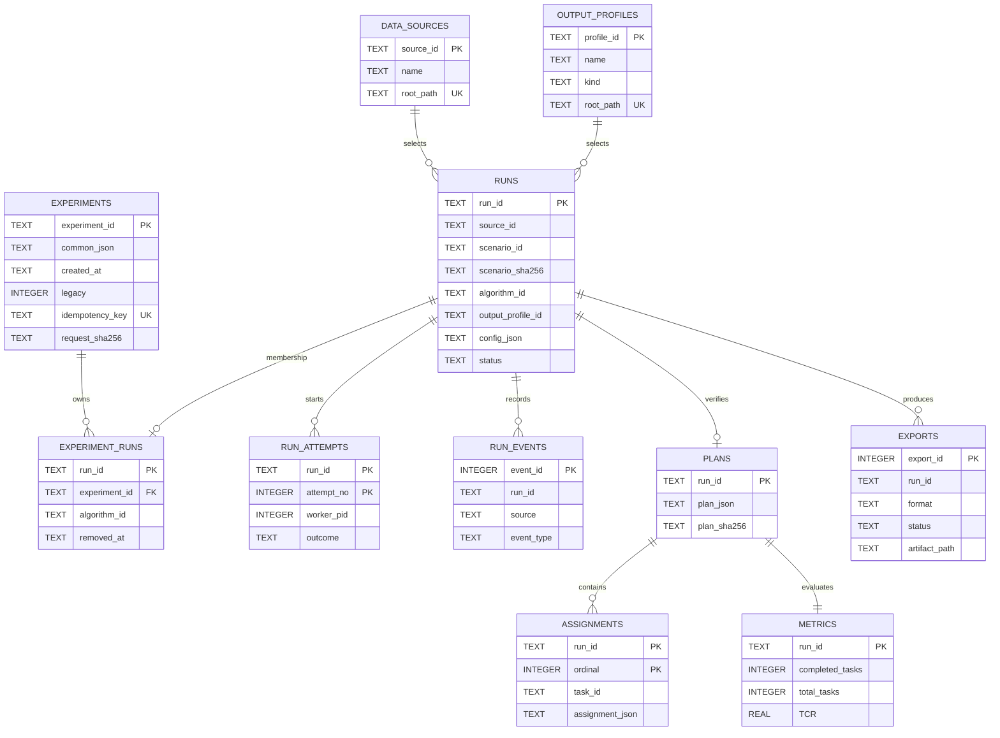

# 当前数据库设计与 ER 图（SQLite schema v4）

> 2026-10-18 当前：新增 experiments 与 experiment_runs 两表，升级前在线备份（同名备份已存在则使用唯一新文件），不重写原 Run。公共配置冻结、活跃算法唯一、移除保留历史；EXPERIMENT_CONTROL_CREATED 使用原事件表记录对照来源，不再加表。详见[实验迁移说明](experiment_management_handoff.md)。下文 v0.2/v3 段落为历史，当前 user_version=4。

> 2026-10-18：Run 配置 JSON 增加 schedule_model，列表投影增加模型与 has_plan；没有 SQL 模式迁移，旧历史不改写。详见[九算法存储说明](nine_algorithm_console_handoff.md)。

> 2026-10-17：新增规划预览，无 SQL 模式迁移。现有计划与指标通过配置 execution_mode 和 PREVIEW_VALIDATED 事件区别于正式认证，历史结果不改写。见[预览存储契约](planning_preview_handoff.md)。

本文件描述已落地的 SQLite 物理模式。完整字段和约束以 `eos_system/storage.py` 为准；`database_design_target.md` 是后续目标审核稿。

`runs.source_id` 和 `runs.output_profile_id` 保存用户选择；`config_json` 同时保留提交时实际解析的路径、哈希、算法参数和时间预算。目录登记项变化不会改写历史实验配置。登记表没有级联删除关系。正式计划、assignment 和指标只由 Controller 在共享约束核验成功后写入同一事务。导出记录可多次产生，不替代正式结果。

数据库启用 WAL、外键和写事务 `BEGIN IMMEDIATE`。当前 `PRAGMA user_version=4`，首次建库包含实验成员表；v1/v2/v3 逐步向前迁移，升级前保留在线备份。历史 v2 曾增加登记表、runs 来源/输出 ID 和 exports 路径；v3 增加 replay_artifacts。所有原运行与结果保留。

`experiment_runs.run_id` 外键指向 runs，原 Run 经已有永久删除 API 删除时成员链接级联删除；父实验保留。UI 的「移除算法」只写 removed_at 并在同一事务记录原取消协议，绝不执行永久删除或文件清理。部分唯一索引保证同一实验内每种算法最多一个活跃成员；重新添加产生新 Run。没有将实验汇总状态写成新的 Worker 状态机。

v0.2.1 的逐条清理不改变表结构。只有终态 `runs` 可删除；关联的 `exports`、`metrics`、`assignments`、`plans`、`run_events`、`run_attempts` 在同一事务内先于 `runs` 删除。提交后执行 `VACUUM` 和 WAL 截断，尽量立即回收空间；失败时空闲页仍可被未来实验重用。该操作不会级联删除数据源、输出方案或其他实验。
