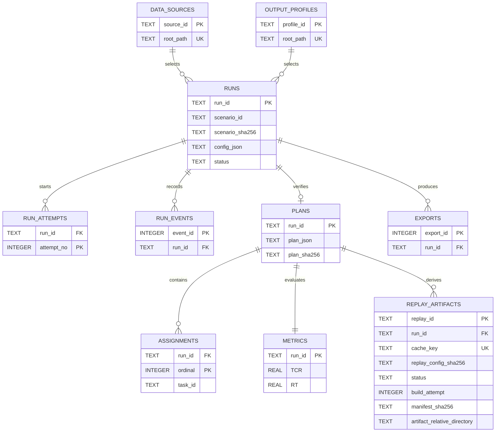

# 当前数据库设计与 ER 图（v0.3 回放后端）

- 更新：2026-10-16；程序 v0.3.1；实现分支：fix/restore-integrated-phase2；物理模式以 eos_system/storage.py 为准。
- 运行位置：Ubuntu 22.04/WSL2 的 EOS_RUNTIME_DIR/results.sqlite3。Windows 浏览器只通过 HTTP 使用。
- 当前 PRAGMA user_version=3。新库直接创建 v3；v1/v2 库先做 SQLite 在线备份，再在一个事务内增加回放表和索引。版本高于 3 拒绝启动。

## ER 图

## 正式数据与派生缓存

RUNS/PLANS/ASSIGNMENTS/METRICS 只由算法执行后的共享约束核验事务产生。REPLAY_ARTIFACTS 是正式计划之后的可再生缓存，不保存逐帧轨道、姿态或画面评分。run_id 外键指向 PLANS，并采用 ON DELETE RESTRICT。回放进程与算法 Worker 都不写 SQLite；Controller/API 的服务层是唯一写入者。

回放状态只入库 BUILDING、READY、FAILED；NOT_REQUESTED 是查询时“没有当前缓存记录”的响应值。cache_key 对 run、场景 SHA、计划 SHA、配置 SHA 与构建/传播/姿态/几何版本做规范 JSON 摘要，并有唯一约束。失败重试沿用 replay_id、递增 build_attempt；旧 attempt 不得发布 READY。历史 run 未保存代码摘要时 algorithm_code_sha 为 NULL，provenance_warning 披露缺失；新 HTTP 提交的 run 在 config_json 中保存算法与共享约束源码 SHA-256。

大文件位于 EOS_RUNTIME_DIR/replays/<replay_id>/build-<attempt>/；临时构建目录是 .build-<attempt>。Controller 校验 manifest 和资源哈希后先原子改名、再条件更新 READY。资源响应只接受 manifest 的五个键：orbit_display、attitude_samples、segments、diagnostics、replay_config。旧的场景哈希轨道缓存继续位于 visualizations/scenes，跨实验复用，不随某个 run 删除。

## 迁移、删除与恢复

每个连接启用 foreign_keys、WAL、busy_timeout；写入使用 BEGIN IMMEDIATE。v2→v3 只增 replay_artifacts 与索引，不重写正式结果。旧库在线备份为 results.sqlite3.pre-v3.bak；确认迁移和验收后可清理该备份。过去的测试库清理不代表当前运行库现状；本次修复未清空实际运行库。请由使用者确认迁移备份与验收后再决定清理。

现有 DELETE /api/runs/{run_id} 保留：BUILDING 回放使删除返回 409；其他回放记录先于正式计划在同一事务删除，再清理本 replay_id 的派生目录。delete_files 仍只控制正式 JSON/CSV 导出文件；登记场景和共享轨道缓存不清理。资源读取与目录删除在进程内使用同一锁，避免读到半删除文件。

Controller 启动取得单实例锁后，将旧 BUILDING 标 FAILED/REPLAY_BUILD_INTERRUPTED，并只回收身份令牌匹配的构建进程。READY 文件丢失或哈希不符时资源请求返回 REPLAY_RESOURCE_UNAVAILABLE，标记该缓存 FAILED；原 run、计划和 metrics.RT 保持不变。

字段与 SQL 约束细节见 [数据库目标与差异说明](database_design_target.md) 和 eos_system/storage.py；接口消费见 [回放后端交接](replay_backend_handoff.md)。

## v0.3.1 来源快照与一致性补充

本次保持 user_version=3，不增加新的来源表；RunConfig 的 scenario_provenance 存入 runs.config_json，旧记录缺失时使用空对象。新请求记录物理版本、父场景 SHA、epoch/传播版本及来源 sidecar SHA；Worker 准备与独立核验复查快照。JSON/CSV 导出与回放 manifest 保留来源。来源字段不会自动证明物理验收通过；正式证据由数据负责人提供。

回放提交与实验删除共用服务锁；资源读取和缓存删除互斥。READY 资源损坏落 FAILED，失败重试递增 build_attempt。缓存包含实际源码与模型内容身份、传播环境身份，不能仅以 Git HEAD 或场景文件名判定相同。当前资源文件格式与限制见[修复集成交接](restore_integration_handoff.md)。
