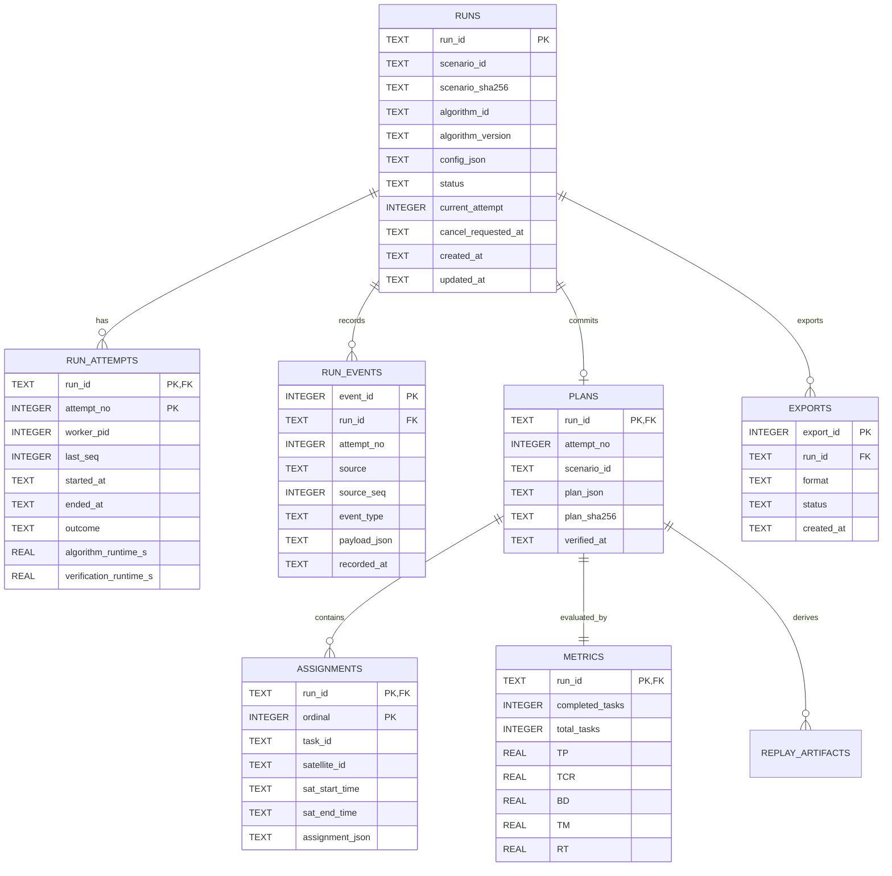

# 第二阶段数据库设计文档（审核稿）

- 版本：v0.2，2026-10-14（整星姿态与固定镜头回放同步版）
- 负责人：李泽同；数据库：SQLite，运行于 Ubuntu/WSL2 Linux 文件系统
- 关联文档：[接口设计文档](interface_design_target.md)
- 状态：v3 回放表已实现；本文保留后续目标，物理模式见 database_current_v03.md


- 同步配套：[第二阶段实施计划说明书_审核稿](replay_backend_implementation_plan.md)；[第二阶段_接口设计文档_审核稿](interface_design_target.md)。
- 本次变更：保留原审核稿的 OS 系统与四种算法要求，新增正式结果之后的独立整星姿态/固定镜头回放；已落地范围见 [当前 v3 ER 图](database_current_v03.md) 与 [交接](replay_backend_handoff.md)。

## 当前实现校正（2026-10-14）

当前代码已从 SQLite v2 加法迁移到 v3，新增 replay_artifacts 与索引；空库直接创建 v3。实际迁移由 eos_system/storage.py 的 REPLAY_SCHEMA 执行，本文举例的 001_initial.sql/002_replay_artifacts.sql 文件并不存在。历史 run 的 algorithm_code_sha 可为 NULL，并由 provenance_warning 标明；新 HTTP run 的源码摘要保存在 config_json。独立消息事件与手动缓存驱逐仍为后续目标。

现有 DELETE /api/runs/{run_id} 已实现。BUILDING 回放拒绝删除；READY/FAILED 的缓存行先于正式计划删除，本 replay_id 目录随后清理。旧 orbit.czml GET 保留到前端迁移完成，共享轨道缓存不随单次 run 删除。

## 1. 设计目标与原则

数据库保存单次实验的不可变配置、状态、尝试过程、正式计划、assignment 明细、重新计算的指标和可追溯事件。Controller 是这些业务表的唯一写入者；Worker 不连接数据库，Daemon 只监护进程，页面只经 API 查询。原始场景位于 `C:\EOS-Bench`，在 WSL 中只读访问 `/mnt/c/EOS-Bench`；SQLite 文件、WAL、锁与日志放在 WSL 的 Linux 文件系统，例如 `~/eos-course-runtime/`，不放在 `/mnt/c` 或 `/mnt/d`。

正式结果只在完整核验后提交。计划 JSON 是无损重建和导出的权威记录；`assignments` 是同事务写入的结构化明细，用于筛选、比较与甘特图读取。两者不允许分别更新。`metrics` 由 Controller 使用统一评估函数重新计算；Worker 自报值仅可记入诊断事件。导出文件可删后从数据库重建，不作为正式结果来源。

## 2. ER 图



`PLANS`、`METRICS` 对一次成功实验均为 1:1；尚未成功的 `RUNS` 没有计划和指标。`ASSIGNMENTS` 允许零行，表示空计划；这时 `PLANS` 仍存在。`RUN_EVENTS.attempt_no` 可为空，表示尚未启动 Worker 的事件。ER 图省略了部分字段，完整定义见下表。

## 3. 表结构

### 3.1 `runs`：实验主表

| 字段 | SQLite 类型与约束 | 用途 |
|---|---|---|
| `run_id` | `TEXT PRIMARY KEY` | UUID |
| `scenario_id` | `TEXT NOT NULL` | 已登记场景 ID |
| `scenario_sha256` | `TEXT NOT NULL` | 提交时的输入哈希；启动及核验前复核 |
| `scenario_path_snapshot` | `TEXT NOT NULL` | WSL 只读路径，仅内部使用；对外 API 不返回 |
| `algorithm_id` | `TEXT NOT NULL` | 算法注册名 |
| `algorithm_version` | `TEXT NOT NULL` | 代码/配置版本 |
| `model_id` | `TEXT NULL` | D 的模型注册 ID |
| `config_json` | `TEXT NOT NULL` | 规范化、不可变的完整 `RunConfig` JSON |
| `config_sha256` | `TEXT NOT NULL` | 配置快照摘要，比较与去重用 |
| `idempotency_key` | `TEXT UNIQUE NULL` | HTTP 重试去重；相同键不同配置返回 409 |
| `status` | `TEXT NOT NULL CHECK (...)` | `CREATED/QUEUED/RUNNING/VERIFYING/SUCCEEDED/FAILED/CANCELLED/TIMED_OUT` |
| `current_attempt` | `INTEGER NULL CHECK (current_attempt >= 1)` | 最近一次启动的尝试 |
| `cancel_requested_at` | `TEXT NULL` | 取消请求受理时间；不等于已取消 |
| `error_code`、`error_message` | `TEXT NULL` | 当前终态错误摘要，内部细节写事件 |
| `created_at`、`updated_at`、`queued_at`、`finished_at` | `TEXT`，按需非空 | ISO 8601 带时区时间 |

`config_json` 在创建后不可更新，实际实施可通过应用约束及数据库触发器保护；状态、时间和错误字段可更新。`scenario_id`/`algorithm_id`/版本是查询用冗余列，必须与 `config_json` 一致。若登记场景的文件哈希发生变化，旧 run 仍保留原哈希，不能悄悄改为新输入。

### 3.2 `run_attempts`：Worker 尝试

| 字段 | 类型与约束 | 用途 |
|---|---|---|
| `run_id`、`attempt_no` | `TEXT`、`INTEGER`；联合主键，`run_id` FK | 每次实际启动递增 |
| `worker_pid`、`worker_start_token` | `INTEGER NULL`、`TEXT NULL` | 识别进程；重启时不能只靠 PID 判断同一个 Worker |
| `last_seq` | `INTEGER NOT NULL DEFAULT 0` | 已受理的最大 IPC 序号 |
| `started_at`、`ended_at` | `TEXT NULL` | 生命周期 |
| `outcome` | `TEXT NULL` | `SUCCEEDED/FAILED/CANCELLED/TIMED_OUT/INTERRUPTED` |
| `algorithm_runtime_s`、`verification_runtime_s` | `REAL NULL CHECK (value >= 0)` | 与队列、导出时间分开 |
| `exit_code`、`error_code` | `INTEGER NULL`、`TEXT NULL` | 故障定位 |

启动确认后才写 `worker_pid`；Worker 异常退出和 Controller 恢复会明确填 `outcome`。`last_seq` 只随已处理 IPC 增长，不因重复/过期包倒退。

### 3.3 `run_events`：状态与诊断日志

| 字段 | 类型与约束 | 用途 |
|---|---|---|
| `event_id` | `INTEGER PRIMARY KEY` | 事件自增号 |
| `run_id` | `TEXT NOT NULL REFERENCES runs(run_id)` | 所属实验 |
| `attempt_no` | `INTEGER NULL` | 所属尝试；Controller 创建/排队事件可空 |
| `source` | `TEXT NOT NULL` | `controller/worker/daemon/api` 等；Daemon 事件由 Controller 代写或独立运行日志保存 |
| `source_seq` | `INTEGER NULL` | Worker IPC 序号 |
| `event_type` | `TEXT NOT NULL` | 状态变更、异常、核验拒绝、取消等 |
| `payload_json` | `TEXT NULL` | 小体积结构化诊断，禁止放整份计划 |
| `recorded_at` | `TEXT NOT NULL` | Controller 接收时间 |

可建部分唯一索引 `(run_id, attempt_no, source, source_seq) WHERE source_seq IS NOT NULL` 防止同一 Worker 事件重复落库。事件按 `event_id` 保序，不能只依赖分辨率有限的时间戳排序。若 Daemon 独立运行时 Controller 不可用，Daemon 先写自己的 WSL 日志，待 Controller 恢复后可补充恢复摘要事件，Daemon 不直接修改业务表。

### 3.4 `plans`：正式计划

| 字段 | 类型与约束 | 用途 |
|---|---|---|
| `run_id` | `TEXT PRIMARY KEY REFERENCES runs(run_id)` | 一个 run 最多一份正式计划 |
| `attempt_no` | `INTEGER NOT NULL` | 产生成功计划的尝试；与 `run_attempts` 联合外键 |
| `scenario_id` | `TEXT NOT NULL` | 必须等于本 run 的场景 ID |
| `plan_schema_version` | `INTEGER NOT NULL` | 计划 JSON 格式版本 |
| `plan_json` | `TEXT NOT NULL` | 完整规范 JSON，含 assignments、unassigned_tasks、场景时间范围；原时间字符串与 sat_angles 载荷保持无损，不含未核验的 Worker 指标 |
| `plan_sha256` | `TEXT NOT NULL` | 对规范 JSON 字节计算，导出一致性检查 |
| `verified_at` | `TEXT NOT NULL` | Controller 完成核验时间 |

`plans` 只接纳经共享约束模型验证的计划。`plan_json` 保存足以重建旧 CLI 的计划文件，导出时再合并数据库中的指标与出处；保持 `verify_schedules.py` 的文件结构可回放。

### 3.5 `assignments`：计划明细

| 字段 | 类型与约束 | 用途 |
|---|---|---|
| `run_id`、`ordinal` | `TEXT`、`INTEGER`；联合主键，`run_id` FK 指向 `plans` | 与 `plan_json.assignments[]` 顺序对应 |
| `task_id` | `TEXT NOT NULL`；`UNIQUE(run_id, task_id)` | 同一任务至多安排一次 |
| `satellite_id`、`sensor_id` | `TEXT NOT NULL` | 资源和甘特图查询 |
| `sat_start_time`、`sat_end_time` | `TEXT NOT NULL` | 按核实的场景时间语义生成带时区索引值；原字符串在 assignment_json 保留；起点早于终点由应用核验 |
| `ground_station_id`、`gs_start_time`、`gs_end_time` | `TEXT NULL` | 无地面站场景为空 |
| `assignment_json` | `TEXT NOT NULL` | 无损保存其余轨道号、资源量、角度等字段 |

结构化列是 `assignment_json` 的索引副本，由同一个 Controller 序列化函数生成。数据库无法独立验证全部轨道/资源约束，必须在写入前调用统一核验器。索引建议 `(run_id, sat_start_time)`、`(run_id, satellite_id, sat_start_time)`。

### 3.6 `metrics`：正式指标

| 字段 | 类型与约束 | 用途 |
|---|---|---|
| `run_id` | `TEXT PRIMARY KEY REFERENCES plans(run_id)` | 与正式计划 1:1 |
| `completed_tasks`、`total_tasks` | `INTEGER NOT NULL CHECK (>=0)` | `completed_tasks <= total_tasks` |
| `TP`、`TCR`、`BD`、`TM`、`RT` | `REAL NOT NULL` | 现有指标口径；`TCR` 在 `[0,1]`，`RT` 为算法秒数 |
| `RV`、`mip_gap` | `REAL NULL` | 可选；无样本或非 MIP 时为 `NULL` |
| `metric_schema_version` | `INTEGER NOT NULL` | 防止后来口径变动混比 |
| `computed_at` | `TEXT NOT NULL` | Controller 计算时间 |

算法比较优先用 `completed_tasks/TCR`，TP/BD/TM 并列报告。`RT` 是算法搜索时间；队列时间由 `runs.queued_at` 与尝试启动时间计算，核验时间由 `run_attempts` 保存。若 `metrics` 和 `plan_json` 不一致，导出拒绝并标记内部错误，不能悄悄替换历史记录。

### 3.7 `exports`：导出记录

| 字段 | 类型与约束 | 用途 |
|---|---|---|
| `export_id` | `INTEGER PRIMARY KEY` | 导出尝试 ID |
| `run_id` | `TEXT NOT NULL REFERENCES runs(run_id)` | 只能对已成功 run 导出，应用检查 |
| `format` | `TEXT NOT NULL CHECK (format IN ('json','csv'))` | 文件格式 |
| `status` | `TEXT NOT NULL CHECK (status IN ('STARTED','SUCCEEDED','FAILED'))` | 导出自身状态 |
| `artifact_path`、`artifact_sha256` | `TEXT NULL` | WSL 输出位置及校验值；对外只暴露下载端点 |
| `error_message` | `TEXT NULL` | 失败原因 |
| `created_at`、`finished_at` | `TEXT` | 审计 |

导出失败不改变 `runs.status=SUCCEEDED`。初版若直接流式生成文件，可只记录成功/失败元数据；是否缓存文件由联调性能决定。

## 4. 事务、约束与恢复

### 4.1 创建和入队

`POST /api/runs` 校验场景、算法和参数后，在一个事务内写 `runs(status='QUEUED')` 和创建事件，再通知内存队列。崩溃发生在 DB 提交后、队列通知前时，Controller 启动扫描 `QUEUED` 记录并重建队列。达到队列上限时在写入前拒绝，或提供受限的持久排队容量；不能在 DB 留下无人处理的“假排队”记录。

### 4.2 成功提交

1. 接收当前 `(run_id, attempt_no)` 的候选结果，先检查序号、取消请求、场景哈希及状态。
2. 使用同一 `RunConfig` 构造约束模型，核验每条 assignment、未分配集合及场景匹配；重新计算指标和规范 JSON。
3. 开始 `BEGIN IMMEDIATE`；复查 `status='VERIFYING'`、attempt 未变化且 `cancel_requested_at IS NULL`。
4. 同事务插入 `plans`、全部 `assignments`、`metrics`、成功事件，并把 `runs.status` 与 `run_attempts.outcome` 改为 `SUCCEEDED`；任何步骤失败则整体回滚，随后单独记 `FAILED`/错误事件。
5. 成功事务提交之后，网页和导出才看见计划。唯一键和外键保证重复 IPC/重复提交不能产生第二份正式计划。

取消、超时、成功竞争由同一个 Controller 串行处理；数据库事务仍需再次检查状态，防止未来改成多线程时出现竞态。运行阶段出错只更新状态/事件，不创建正式计划。`PRAGMA foreign_keys=ON` 每个连接必设；设置合理 `busy_timeout`，WAL 模式限于 WSL 本地文件系统；迁移前备份数据库并记录 `PRAGMA user_version`。

### 4.3 进程重启

Controller 启动先取得单实例进程锁，再打开数据库并扫描非终态记录：`QUEUED` 重建内存队列；`RUNNING/VERIFYING` 核对 Worker 身份和回收信息，初版保守地标记 `FAILED`/`INTERRUPTED`，不自动把旧候选计划提交为成功。以后若要自动重试，必须创建更大的 `attempt_no` 并保证旧 attempt 消息失效。Daemon 负责有限次数恢复 Controller，不直接重写数据库状态。

## 5. 查询、迁移和验收

建议索引：`runs(status, created_at)`、`runs(scenario_id, algorithm_id, created_at)`、`run_events(run_id, event_id)`、`assignments(run_id, satellite_id, sat_start_time)`。列表只查 `runs` 摘要；详情按需关联计划和指标，避免传输大 JSON。保留 `config_json`、`plan_json`、`metric_schema_version`、Git 提交和模型版本的出处，方便跨算法成对比较。

首版迁移用版本化 SQL 文件，例如 `001_initial.sql`；启动时只执行前向迁移，不隐式删表。迁移和 Controller 连接都使用同一 WSL 运行目录。备份与正式数据库必须处于同一文件系统，恢复演示不使用含半事务的手工文件复制。

验收检查：合法小实例成功后，`runs/plans/metrics/assignments` 可互相重建；故意在写 assignment 或 metrics 时注入错误，确认无半份成功记录；重复候选消息不会重复入库；非法计划不可标成功；重启后 `QUEUED` 能恢复且 `RUNNING` 有明确失败记录；JSON/CSV 与库中记录一致；原始输入 SHA-256 保持不变。

## 6. S1 待团队确认

1. 场景注册清单格式及 `scenario_id`/SHA 来源，由刘懋兴确认。
2. Worker 事件和取消时序由何明涛确认，Daemon 心跳/恢复事件由梁兆榮确认。
3. 算法 A/B/C/D 注册名、参数范围、模型 ID 和默认预算在小实例测量后冻结；目前文中的 `algorithm-a` 等只作示例。
4. CSV 首版按接口文档采用单文件：每条 assignment 一行并重复指标；空计划保留一行汇总。与梁兆榮联调确认字段展示，如需改格式须同步更新接口版本。


## 7. 新增独立回放存储设计

### 7.1 数据权威、迁移范围与保存原则

依据本次两份整星姿态/固定镜头 v2.0 文件，回放仅是正式结果的可再生缓存。原 `runs/run_attempts/run_events/plans/assignments/metrics/exports` 的正式语义保持不变；不在 assignments 中增加云台角、activation_time、显示四元数或拍摄成功判断，不在 metrics 中增加由画面推导的完成数、燃料和覆盖评分，不将 ReplayConfig 合入 RunConfig。

原版可仅用文件 manifest；本课程使用 SQLite v3 管理回放。实际 v2→v3 迁移由 storage.py 中的 REPLAY_SCHEMA 执行，并先做 SQLite 在线备份。

Controller 是正式表和新缓存表的唯一写入者；算法 Worker 与回放生成进程均不连接 SQLite；Daemon 只监护服务。姿态、轨道、阶段和诊断大文件保存在 WSL 本地独立目录，通过 manifest 元数据关联；不逐帧写库。回放状态只有 BUILDING/READY/FAILED；NOT_REQUESTED 表示无当前键记录，由 API 推导，不存虚假行。

### 7.2 replay_artifacts 字段

| 字段 | 类型与约束 | 用途 |
|---|---|---|
| replay_id | TEXT PRIMARY KEY | UUID，回放稳定身份 |
| run_id | TEXT NOT NULL REFERENCES plans(run_id) ON DELETE RESTRICT | 只绑定已提交正式计划；应用再检查 run=SUCCEEDED |
| scenario_id | TEXT NOT NULL | 与 run/plan 一致 |
| scenario_sha256 | TEXT NOT NULL | 正式输入哈希 |
| plan_sha256 | TEXT NOT NULL | 引用 plans 的规范 JSON 字节摘要 |
| replay_config_id / replay_config_version | TEXT NOT NULL | 已登记展示配置身份 |
| replay_config_json | TEXT NOT NULL | 不可变 ReplayConfig v2 快照 |
| replay_config_sha256 | TEXT NOT NULL | 配置规范字节摘要 |
| algorithm_code_sha / builder_code_sha | 前者 TEXT NULL、后者 TEXT NOT NULL | 历史算法摘要缺失时置 NULL；构建器记录源码摘要 |
| builder_version / propagation_version / attitude_version / geometry_version | TEXT NOT NULL | 实际影响输出的实现/解释版本 |
| cache_key | TEXT NOT NULL UNIQUE | run/输入/计划/配置/构建版本的规范 JSON SHA-256 |
| status | TEXT NOT NULL CHECK IN ('BUILDING','READY','FAILED') | 回放独立状态 |
| build_attempt | INTEGER NOT NULL CHECK >=1 | 同键失败重试递增，屏蔽过期消息 |
| builder_pid / builder_start_token | INTEGER NULL / TEXT NULL | 构建进程身份，不单独凭 PID 恢复 |
| last_seq | INTEGER NOT NULL DEFAULT 0 CHECK >=0 | 当前 build_attempt 已处理 IPC 序号 |
| artifact_relative_directory | TEXT NULL | READY 的不可变版本目录；相对配置回放根目录 |
| manifest_json / manifest_sha256 | TEXT NULL | READY 的完整 manifest 快照及文件字节哈希 |
| diagnostics_summary_json | TEXT NULL | 小体积诊断；完整内容在文件中 |
| build_runtime_s | REAL NULL CHECK >=0 | 回放耗时，不写 metrics.RT |
| error_code / error_message | TEXT NULL | 本次构建失败摘要 |
| created_at / updated_at | TEXT NOT NULL | 首次创建/最近更新的服务端带时区时间 |
| build_started_at / build_finished_at | TEXT NULL | 当前 attempt 生命周期 |

`scenario_id`、哈希、配置和版本列是快照，与 run/plan 关联核验后不可变。只允许状态、构建尝试、进程、产物与诊断字段按生命周期更新。`READY` 必须有完整目录、manifest、资源清单和结束时间；BUILDING/FAILED 不通过 HTTP 发布未验证资源。质量警告可出现在 READY，表示带已披露限制的有效回放；致命缺失则 FAILED，不能靠造样本变为 READY。

cache_key 包含 run_id，因此不同 run 不直接共用回放记录。轨道文件如另做共享缓存，其键至少含场景哈希、传播版本、时间范围和显示采样；共享文件必须单独引用计数或延迟回收，不能被某个回放清理顺带删掉。首版不引入共享缓存，减少恢复与清理复杂度。

### 7.3 建表 SQL 草案

以下 SQL 仅辅助审核字段；实际物理定义以 eos_system/storage.py 为准。

```sql
CREATE TABLE replay_artifacts (
    replay_id TEXT PRIMARY KEY NOT NULL,
    run_id TEXT NOT NULL REFERENCES plans(run_id) ON DELETE RESTRICT,
    scenario_id TEXT NOT NULL,
    scenario_sha256 TEXT NOT NULL CHECK(length(scenario_sha256) = 64),
    plan_sha256 TEXT NOT NULL CHECK(length(plan_sha256) = 64),
    replay_config_id TEXT NOT NULL,
    replay_config_version TEXT NOT NULL,
    replay_config_json TEXT NOT NULL,
    replay_config_sha256 TEXT NOT NULL CHECK(length(replay_config_sha256) = 64),
    algorithm_code_sha TEXT,
    provenance_warning TEXT,
    builder_code_sha TEXT NOT NULL,
    builder_version TEXT NOT NULL,
    propagation_version TEXT NOT NULL,
    attitude_version TEXT NOT NULL,
    geometry_version TEXT NOT NULL,
    cache_key TEXT NOT NULL UNIQUE CHECK(length(cache_key) = 64),
    status TEXT NOT NULL CHECK(status IN ('BUILDING', 'READY', 'FAILED')),
    build_attempt INTEGER NOT NULL CHECK(build_attempt >= 1),
    builder_pid INTEGER,
    builder_start_token TEXT,
    last_seq INTEGER NOT NULL DEFAULT 0 CHECK(last_seq >= 0),
    artifact_relative_directory TEXT,
    manifest_json TEXT,
    manifest_sha256 TEXT CHECK(manifest_sha256 IS NULL OR length(manifest_sha256) = 64),
    diagnostics_summary_json TEXT,
    build_runtime_s REAL CHECK(build_runtime_s IS NULL OR build_runtime_s >= 0),
    error_code TEXT,
    error_message TEXT,
    created_at TEXT NOT NULL,
    updated_at TEXT NOT NULL,
    build_started_at TEXT,
    build_finished_at TEXT,
    CHECK(status != 'READY' OR (
        artifact_relative_directory IS NOT NULL
        AND manifest_json IS NOT NULL
        AND manifest_sha256 IS NOT NULL
        AND build_runtime_s IS NOT NULL
        AND build_finished_at IS NOT NULL
        AND error_code IS NULL
    )),
    CHECK(status != 'FAILED' OR (
        error_code IS NOT NULL AND build_finished_at IS NOT NULL
    ))
);
CREATE INDEX idx_replay_run_created
    ON replay_artifacts(run_id, created_at);
CREATE INDEX idx_replay_status_updated
    ON replay_artifacts(status, updated_at);
```

长度检查不能代替十六进制/实际文件哈希核验。同一个缓存键仅一行；`replay_id` 不等于 run_id。数据库无法检查磁盘文件是否存在，发布和读取仍需应用核验。主表应用采用受控更新函数，避免任意业务代码修改输入快照。

### 7.4 展示配置、资源及诊断文件

ReplayConfig 快照以规范 UTF-8 JSON 固定后计算哈希，实际解析内容必须与快照一致；对原场景和原计划只读，不为展示回写字段。正式 `plans.plan_sha256` 使用原已提交规范 JSON 字节；不能读取导出包后重新规范化、合并出处再误当正式计划摘要。

Manifest 记录 schema_version=2、replay/run/scenario 身份、build_attempt、场景/计划/配置摘要、所有版本、原时间语义、ECEF/米、xyzw/body_to_ecef、camera_to_body 固定安装、姿态来源、视场解释、资源键/URL/MIME/字节数/哈希和诊断摘要。磁盘 manifest 的最终字节产生后计算 manifest_sha256，保存在数据库，避免自包含哈希循环。对外 URL 由已登记资源键生成，不暴露服务器本地绝对路径。

资源键与接口文档一致：orbit_display、attitude_samples、segments、diagnostics、replay_config。姿态有绝对时间和来源/质量；阶段有 satellite_id/task_id/sensor_id/assignment_ordinal/phase/起止/activation_time；原数组顺序保持，ordinal 零基。时域严格采用原拍摄半开区间和原转向实际返回值；首任务初态不入调度。原 sat_angles 时间不明时诊断或另行带时间导出，不猜测均匀时间。

中心交点、视锥覆盖和连续镜头按当前时间计算，是显示几何，不必逐帧持久化。部分/全部射线无交点、地形差异不更新正式 metrics。诊断 `used_fallback` 无法核实时可为 null；不能把 11.66 秒必然认定为回退，因为原分段模型也可能合法返回该值。

### 7.5 创建、失败重试与 READY 发布事务

1. Controller 读取同一正式成功 run、plan、登记场景和配置；复核全部身份、哈希、版本与保护路径，计算 cache_key。
2. 短事务查询/创建：无行时插入 BUILDING/attempt=1；同键 BUILDING 返回现有记录；READY 校验可用后复用；FAILED 且可重试时更新为 BUILDING、attempt+1、last_seq=0 并清除旧产物发布字段和错误。并发唯一键冲突后读取既有行，不能另造 replay_id。
3. 提交后启动构建进程；启动失败单独将本 attempt 改 FAILED。数据库锁不覆盖 Orekit 运算或文件构建。
4. 进程输出到 `<replay_id>/.build-<attempt>/`，只写临时文件；Controller 校验 payload 哈希、资源清单、场景/计划绑定、绝对时间端点及安全目录。
5. 在同一 WSL 文件系统把临时目录原子改名为不可变 `build-<attempt>/`。重新检查当前状态和 build_attempt；旧 attempt 不得发布。
6. 短事务通过条件更新 `WHERE replay_id=? AND build_attempt=? AND status='BUILDING'` 写 READY、相对目录、manifest、诊断和耗时。更新零行表示过期，不触碰正式 run。提交后 API 才服务该版本。

文件与 SQLite 没有跨介质原子事务；因此采用先完成文件、后发布数据库指针。若文件完成但 DB 尚未提交就崩溃，该目录是未发布缓存，恢复时对账或清理；若 DB READY 后文件遗失，资源端点拒绝返回并记录 `REPLAY_RESOURCE_UNAVAILABLE`，Controller 把回放改 FAILED 以供重试，原成功结果不变。

构建失败/超时/取消记录当前 attempt 的 FAILED、错误码、结束时间和日志，回收整个进程组；原正式状态、计划、assignment、metrics、export 记录均不回退。失败重试前先回收旧进程，不能同时运行同 replay_id 的两个 attempt。

### 7.6 状态转换、日志和 Controller 恢复

| 当前状态 | 事件 | 下一状态 | 对正式结果影响 |
|---|---|---|---|
| 无记录 | 受理构建并登记 | BUILDING | 无 |
| BUILDING | 产物核验并发布成功 | READY | 无 |
| BUILDING | 构建失败/取消/超时/中断 | FAILED | 无 |
| FAILED | 受控重试同键 | BUILDING，attempt+1 | 无 |
| READY | 资源遗失/缓存清理 | FAILED，记录原因 | 无 |
| READY | 相同请求且资源可用 | READY | 无，直接复用 |

回放事件可由 Controller 代写既有 run_events：source='replay_builder'，attempt_no=NULL，source_seq=NULL，payload 包含 replay_id/build_attempt/独立 seq 和错误摘要。这避免把回放 build_attempt 当算法 attempt、碰撞 Worker 去重索引。独立消息去重依靠 replay_artifacts.last_seq 和 Controller 状态条件；完整日志另存回放目录。首版不为小体积回放审计另增事件表。

Controller 恢复先取单实例锁，完成原正式业务恢复，再扫描回放。BUILDING 核对 PID+start_token、回收后标 FAILED/REPLAY_BUILD_INTERRUPTED，不盲目导入半成品；按需重新 POST。READY 校验发布目录和 manifest，异常标 FAILED；FAILED 保持。Daemon 不直接连接库、不写回放状态；独立构建中断不触发算法重试。

### 7.7 路径、清理和保留

回放根目录例如 `~/eos-course-runtime/replays/`，必须在 WSL Linux 文件系统，启动时解析实际绝对路径并确认不在保护输入目录。数据库 artifact_relative_directory 仅允许本 replay_id 下的 `build-<attempt>`；资源键来自 manifest 白名单。解析路径须校验归属、拒绝 `..`/绝对路径/符号链接逃逸，不能依据浏览器提交路径读文件。原 `output/Scenario_*.json` 也纳入保护清单。

现有 DELETE run 在 BUILDING 时返回 409；其他状态先删除回放行，再删除正式计划与 run，并清理本 replay_id 目录。场景、正式导出文件和共享轨道缓存沿用各自删除策略；单独缓存驱逐接口尚未实现。

### 7.8 不变性和迁移验收

| 检查 | 通过要求 |
|---|---|
| 原表一致性 | 对同一成功 run，生成/失败/重试/清理前后 plans、assignments、metrics 和正式配置内容完全一致；runs 保持 SUCCEEDED |
| 文件保护 | 保护清单每份场景/固定输入/原计划 SHA-256 回放前后相同；不只核对 input 目录 |
| 去重与隔离 | 同键只有一行；不同计划/配置/版本有不同键；同 run 多配置独立；过期 attempt 不发布 |
| 故障窗口 | 启动失败、文件发布前后、DB 发布前后注入中断，均无半成品 READY 和正式结果回退 |
| 恢复与清理 | Controller 重启、资源遗失、缓存清理均有诊断，能按需重建，无越目录删除 |
| 计时与数据粒度 | build_runtime_s 独立；metrics.RT 不变；不存逐帧指标；采样改变只影响派生数据 |
| SQL 迁移 | 外键启用、唯一键及状态 CHECK 生效；升级不重写原正式记录；备份/版本记录可追溯 |

本文件与接口文档必须共同审核：replay_status、cache_key 输入、build_attempt、资源键、manifest、阶段字段和目录策略一致。输入参考系、视场解释、采样阈值、缓存容量、构建超时由对应负责人实测冻结。所有核验记录必须说明实际版本和限制，不宣称已完成真实姿态动力学或通信指向冲突仿真。
