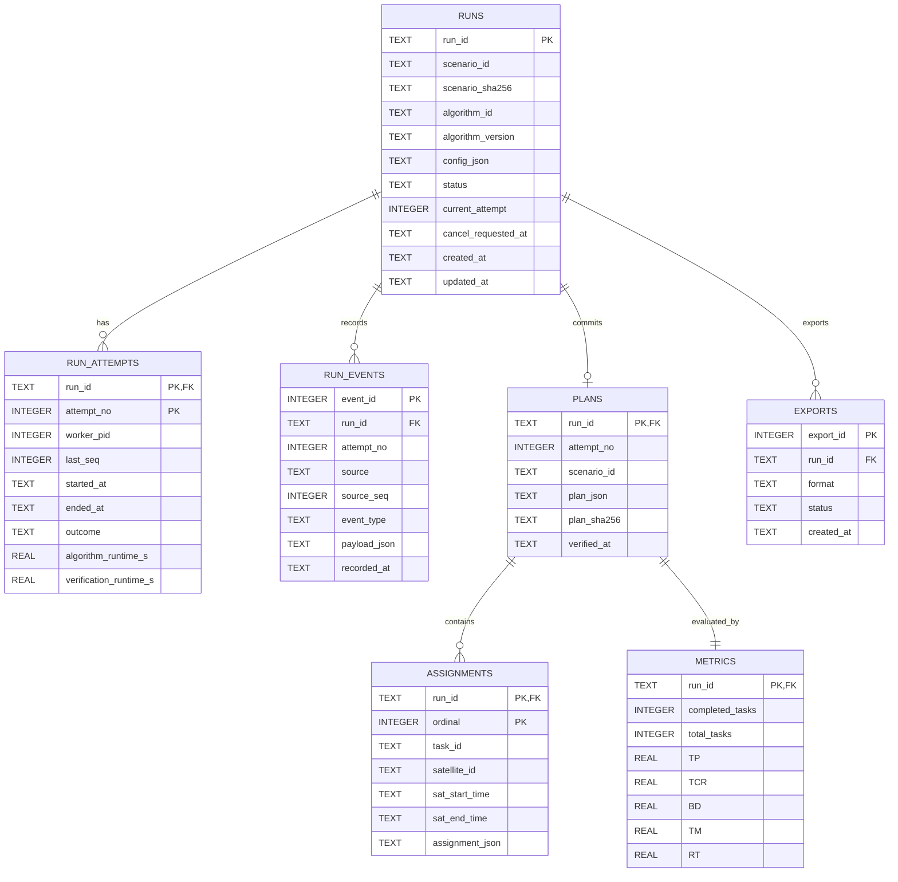

# 第二阶段数据库设计文档（审核稿）

> **文档状态：第二阶段目标设计，ER 图与字段以此作为讨论基线。** 当前 v0.2 的九表物理模式及 ER 图见 [当前数据库设计](database_current_v02.md)，实现以 `eos_system/storage.py` 中的 `SCHEMA` 为准。本文中的部分触发器与恢复字段属于后续目标；不要仅按本文字段直接读写现有 SQLite。正式计划只由 Controller 核验后在同一事务提交。

- 版本：v0.1，2026-10-13
- 负责人：李泽同；数据库：SQLite，运行于 Ubuntu/WSL2 Linux 文件系统
- 关联文档：[接口设计文档](interface_design_target.md)、[当前数据库设计](database_current_v02.md)
- 状态：设计稿；课程仓库中尚无该模式或迁移脚本

## 1. 设计目标与原则

数据库保存单次实验的不可变配置、状态、尝试过程、正式计划、assignment 明细、重新计算的指标和可追溯事件。Controller 是这些业务表的唯一写入者；Worker 不连接数据库，Daemon 只监护进程，页面只经 API 查询。原始场景位于 `C:\EOS-Bench`，在 WSL 中只读访问 `/mnt/c/EOS-Bench`；SQLite 文件、WAL、锁与日志放在 WSL 的 Linux 文件系统，例如 `~/eos-course-runtime/`，不放在 `/mnt/c` 或 `/mnt/d`。

正式结果只在完整核验后提交。计划 JSON 是无损重建和导出的权威记录；`assignments` 是同事务写入的结构化明细，用于筛选、比较与甘特图读取。两者不允许分别更新。`metrics` 由 Controller 使用统一评估函数重新计算；Worker 自报值仅可记入诊断事件。导出文件可删后从数据库重建，不作为正式结果来源。

## 2. ER 图

`PLANS`、`METRICS` 对一次成功实验均为 1:1；尚未成功的 `RUNS` 没有计划和指标。`ASSIGNMENTS` 允许零行，表示空计划；这时 `PLANS` 仍存在。`RUN_EVENTS.attempt_no` 可为空，表示尚未启动 Worker 的事件。ER 图省略了部分字段，完整定义见下表。

## 3. 表结构

### 3.1 `runs`：实验主表

| 字段 | SQLite 类型与约束 | 用途 |
|---|---|---|
| `run_id` | `TEXT PRIMARY KEY` | UUID |
| `scenario_id` | `TEXT NOT NULL` | 已登记场景 ID |
| `scenario_sha256` | `TEXT NOT NULL` | 提交时的输入哈希；启动及核验前复核 |
| `scenario_path_snapshot` | `TEXT NOT NULL` | WSL 只读路径，仅内部使用；对外 API 不返回 |
| `algorithm_id` | `TEXT NOT NULL` | 算法注册名 |
| `algorithm_version` | `TEXT NOT NULL` | 代码/配置版本 |
| `model_id` | `TEXT NULL` | D 的模型注册 ID |
| `config_json` | `TEXT NOT NULL` | 规范化、不可变的完整 `RunConfig` JSON |
| `config_sha256` | `TEXT NOT NULL` | 配置快照摘要，比较与去重用 |
| `idempotency_key` | `TEXT UNIQUE NULL` | HTTP 重试去重；相同键不同配置返回 409 |
| `status` | `TEXT NOT NULL CHECK (...)` | `CREATED/QUEUED/RUNNING/VERIFYING/SUCCEEDED/FAILED/CANCELLED/TIMED_OUT` |
| `current_attempt` | `INTEGER NULL CHECK (current_attempt >= 1)` | 最近一次启动的尝试 |
| `cancel_requested_at` | `TEXT NULL` | 取消请求受理时间；不等于已取消 |
| `error_code`、`error_message` | `TEXT NULL` | 当前终态错误摘要，内部细节写事件 |
| `created_at`、`updated_at`、`queued_at`、`finished_at` | `TEXT`，按需非空 | ISO 8601 带时区时间 |

`config_json` 在创建后不可更新，实际实施可通过应用约束及数据库触发器保护；状态、时间和错误字段可更新。`scenario_id`/`algorithm_id`/版本是查询用冗余列，必须与 `config_json` 一致。若登记场景的文件哈希发生变化，旧 run 仍保留原哈希，不能悄悄改为新输入。

### 3.2 `run_attempts`：Worker 尝试

| 字段 | 类型与约束 | 用途 |
|---|---|---|
| `run_id`、`attempt_no` | `TEXT`、`INTEGER`；联合主键，`run_id` FK | 每次实际启动递增 |
| `worker_pid`、`worker_start_token` | `INTEGER NULL`、`TEXT NULL` | 识别进程；重启时不能只靠 PID 判断同一个 Worker |
| `last_seq` | `INTEGER NOT NULL DEFAULT 0` | 已受理的最大 IPC 序号 |
| `started_at`、`ended_at` | `TEXT NULL` | 生命周期 |
| `outcome` | `TEXT NULL` | `SUCCEEDED/FAILED/CANCELLED/TIMED_OUT/INTERRUPTED` |
| `algorithm_runtime_s`、`verification_runtime_s` | `REAL NULL CHECK (value >= 0)` | 与队列、导出时间分开 |
| `exit_code`、`error_code` | `INTEGER NULL`、`TEXT NULL` | 故障定位 |

启动确认后才写 `worker_pid`；Worker 异常退出和 Controller 恢复会明确填 `outcome`。`last_seq` 只随已处理 IPC 增长，不因重复/过期包倒退。

### 3.3 `run_events`：状态与诊断日志

| 字段 | 类型与约束 | 用途 |
|---|---|---|
| `event_id` | `INTEGER PRIMARY KEY` | 事件自增号 |
| `run_id` | `TEXT NOT NULL REFERENCES runs(run_id)` | 所属实验 |
| `attempt_no` | `INTEGER NULL` | 所属尝试；Controller 创建/排队事件可空 |
| `source` | `TEXT NOT NULL` | `controller/worker/daemon/api` 等；Daemon 事件由 Controller 代写或独立运行日志保存 |
| `source_seq` | `INTEGER NULL` | Worker IPC 序号 |
| `event_type` | `TEXT NOT NULL` | 状态变更、异常、核验拒绝、取消等 |
| `payload_json` | `TEXT NULL` | 小体积结构化诊断，禁止放整份计划 |
| `recorded_at` | `TEXT NOT NULL` | Controller 接收时间 |

可建部分唯一索引 `(run_id, attempt_no, source, source_seq) WHERE source_seq IS NOT NULL` 防止同一 Worker 事件重复落库。事件按 `event_id` 保序，不能只依赖分辨率有限的时间戳排序。若 Daemon 独立运行时 Controller 不可用，Daemon 先写自己的 WSL 日志，待 Controller 恢复后可补充恢复摘要事件，Daemon 不直接修改业务表。

### 3.4 `plans`：正式计划

| 字段 | 类型与约束 | 用途 |
|---|---|---|
| `run_id` | `TEXT PRIMARY KEY REFERENCES runs(run_id)` | 一个 run 最多一份正式计划 |
| `attempt_no` | `INTEGER NOT NULL` | 产生成功计划的尝试；与 `run_attempts` 联合外键 |
| `scenario_id` | `TEXT NOT NULL` | 必须等于本 run 的场景 ID |
| `plan_schema_version` | `INTEGER NOT NULL` | 计划 JSON 格式版本 |
| `plan_json` | `TEXT NOT NULL` | 完整规范 JSON，含 assignments、unassigned_tasks、场景时间范围；不含未核验的 Worker 指标 |
| `plan_sha256` | `TEXT NOT NULL` | 对规范 JSON 字节计算，导出一致性检查 |
| `verified_at` | `TEXT NOT NULL` | Controller 完成核验时间 |

`plans` 只接纳经共享约束模型验证的计划。`plan_json` 保存足以重建旧 CLI 的计划文件，导出时再合并数据库中的指标与出处；保持 `verify_schedules.py` 的文件结构可回放。

### 3.5 `assignments`：计划明细

| 字段 | 类型与约束 | 用途 |
|---|---|---|
| `run_id`、`ordinal` | `TEXT`、`INTEGER`；联合主键，`run_id` FK 指向 `plans` | 与 `plan_json.assignments[]` 顺序对应 |
| `task_id` | `TEXT NOT NULL`；`UNIQUE(run_id, task_id)` | 同一任务至多安排一次 |
| `satellite_id`、`sensor_id` | `TEXT NOT NULL` | 资源和甘特图查询 |
| `sat_start_time`、`sat_end_time` | `TEXT NOT NULL` | 有时区 ISO 8601；起点早于终点由应用核验 |
| `ground_station_id`、`gs_start_time`、`gs_end_time` | `TEXT NULL` | 无地面站场景为空 |
| `assignment_json` | `TEXT NOT NULL` | 无损保存其余轨道号、资源量、角度等字段 |

结构化列是 `assignment_json` 的索引副本，由同一个 Controller 序列化函数生成。数据库无法独立验证全部轨道/资源约束，必须在写入前调用统一核验器。索引建议 `(run_id, sat_start_time)`、`(run_id, satellite_id, sat_start_time)`。

### 3.6 `metrics`：正式指标

| 字段 | 类型与约束 | 用途 |
|---|---|---|
| `run_id` | `TEXT PRIMARY KEY REFERENCES plans(run_id)` | 与正式计划 1:1 |
| `completed_tasks`、`total_tasks` | `INTEGER NOT NULL CHECK (>=0)` | `completed_tasks <= total_tasks` |
| `TP`、`TCR`、`BD`、`TM`、`RT` | `REAL NOT NULL` | 现有指标口径；`TCR` 在 `[0,1]`，`RT` 为算法秒数 |
| `RV`、`mip_gap` | `REAL NULL` | 可选；无样本或非 MIP 时为 `NULL` |
| `metric_schema_version` | `INTEGER NOT NULL` | 防止后来口径变动混比 |
| `computed_at` | `TEXT NOT NULL` | Controller 计算时间 |

算法比较优先用 `completed_tasks/TCR`，TP/BD/TM 并列报告。`RT` 是算法搜索时间；队列时间由 `runs.queued_at` 与尝试启动时间计算，核验时间由 `run_attempts` 保存。若 `metrics` 和 `plan_json` 不一致，导出拒绝并标记内部错误，不能悄悄替换历史记录。

### 3.7 `exports`：导出记录

| 字段 | 类型与约束 | 用途 |
|---|---|---|
| `export_id` | `INTEGER PRIMARY KEY` | 导出尝试 ID |
| `run_id` | `TEXT NOT NULL REFERENCES runs(run_id)` | 只能对已成功 run 导出，应用检查 |
| `format` | `TEXT NOT NULL CHECK (format IN ('json','csv'))` | 文件格式 |
| `status` | `TEXT NOT NULL CHECK (status IN ('STARTED','SUCCEEDED','FAILED'))` | 导出自身状态 |
| `artifact_path`、`artifact_sha256` | `TEXT NULL` | WSL 输出位置及校验值；对外只暴露下载端点 |
| `error_message` | `TEXT NULL` | 失败原因 |
| `created_at`、`finished_at` | `TEXT` | 审计 |

导出失败不改变 `runs.status=SUCCEEDED`。初版若直接流式生成文件，可只记录成功/失败元数据；是否缓存文件由联调性能决定。

## 4. 事务、约束与恢复

### 4.1 创建和入队

`POST /api/runs` 校验场景、算法和参数后，在一个事务内写 `runs(status='QUEUED')` 和创建事件，再通知内存队列。崩溃发生在 DB 提交后、队列通知前时，Controller 启动扫描 `QUEUED` 记录并重建队列。达到队列上限时在写入前拒绝，或提供受限的持久排队容量；不能在 DB 留下无人处理的“假排队”记录。

### 4.2 成功提交

1. 接收当前 `(run_id, attempt_no)` 的候选结果，先检查序号、取消请求、场景哈希及状态。
2. 使用同一 `RunConfig` 构造约束模型，核验每条 assignment、未分配集合及场景匹配；重新计算指标和规范 JSON。
3. 开始 `BEGIN IMMEDIATE`；复查 `status='VERIFYING'`、attempt 未变化且 `cancel_requested_at IS NULL`。
4. 同事务插入 `plans`、全部 `assignments`、`metrics`、成功事件，并把 `runs.status` 与 `run_attempts.outcome` 改为 `SUCCEEDED`；任何步骤失败则整体回滚，随后单独记 `FAILED`/错误事件。
5. 成功事务提交之后，网页和导出才看见计划。唯一键和外键保证重复 IPC/重复提交不能产生第二份正式计划。

取消、超时、成功竞争由同一个 Controller 串行处理；数据库事务仍需再次检查状态，防止未来改成多线程时出现竞态。运行阶段出错只更新状态/事件，不创建正式计划。`PRAGMA foreign_keys=ON` 每个连接必设；设置合理 `busy_timeout`，WAL 模式限于 WSL 本地文件系统；迁移前备份数据库并记录 `PRAGMA user_version`。

### 4.3 进程重启

Controller 启动先取得单实例进程锁，再打开数据库并扫描非终态记录：`QUEUED` 重建内存队列；`RUNNING/VERIFYING` 核对 Worker 身份和回收信息，初版保守地标记 `FAILED`/`INTERRUPTED`，不自动把旧候选计划提交为成功。以后若要自动重试，必须创建更大的 `attempt_no` 并保证旧 attempt 消息失效。Daemon 负责有限次数恢复 Controller，不直接重写数据库状态。

## 5. 查询、迁移和验收

建议索引：`runs(status, created_at)`、`runs(scenario_id, algorithm_id, created_at)`、`run_events(run_id, event_id)`、`assignments(run_id, satellite_id, sat_start_time)`。列表只查 `runs` 摘要；详情按需关联计划和指标，避免传输大 JSON。保留 `config_json`、`plan_json`、`metric_schema_version`、Git 提交和模型版本的出处，方便跨算法成对比较。

首版迁移用版本化 SQL 文件，例如 `001_initial.sql`；启动时只执行前向迁移，不隐式删表。迁移和 Controller 连接都使用同一 WSL 运行目录。备份与正式数据库必须处于同一文件系统，恢复演示不使用含半事务的手工文件复制。

验收检查：合法小实例成功后，`runs/plans/metrics/assignments` 可互相重建；故意在写 assignment 或 metrics 时注入错误，确认无半份成功记录；重复候选消息不会重复入库；非法计划不可标成功；重启后 `QUEUED` 能恢复且 `RUNNING` 有明确失败记录；JSON/CSV 与库中记录一致；原始输入 SHA-256 保持不变。

## 6. S1 待团队确认

1. 场景注册清单格式及 `scenario_id`/SHA 来源，由刘懋兴确认。
2. Worker 事件和取消时序由何明涛确认，Daemon 心跳/恢复事件由梁兆榮确认。
3. 算法 A/B/C/D 注册名、参数范围、模型 ID 和默认预算在小实例测量后冻结；目前文中的 `algorithm-a` 等只作示例。
4. CSV 首版按接口文档采用单文件：每条 assignment 一行并重复指标；空计划保留一行汇总。与梁兆榮联调确认字段展示，如需改格式须同步更新接口版本。
