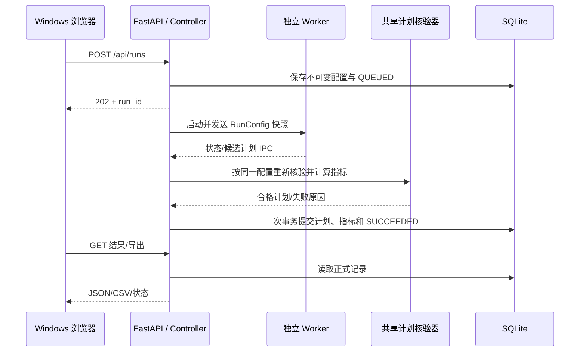

> 当前实验契约（2026-10-18）：`POST /api/experiments` 原子创建父实验和多个算法 Run；新增 `/control` 单变量对照、分页/详情、受限比较和成员管理。原 Run/Worker/认证接口保留，原 Cesium 页面只增加实验上下文。见[最新实验 API](experiment_management_handoff.md)。

> 历史 2026-10-17：逐项提交与条件组实现见[原控制台契约](console_gantt_handoff.md)，不代表当前实验组织方式。

> 九算法增量（2026-10-18）：新增 RunRequest.schedule_model、算法列表 models 与可用性说明，旧模型 ID 不再用于新 HTTP 算法提交；增加无 Run ID 的 Gantt 选择入口。见[九算法公共契约](nine_algorithm_console_handoff.md)。

> 规划预览接口：RunRequest.execution_mode 默认 formal，UI 显式提交 planning_preview。预览结果、比较隔离及正式导出 409 见[预览契约](planning_preview_handoff.md)。

> v0.3.2 已实现补充：场景元数据/可用性、自动登记与自适应预算见[六场景交接](six_scenario_scale_handoff.md)。配置 ID 保持，实际步长读 manifest，不写死 5 秒。

> **2026-10-16 当前实现入口：**[v0.3.1 修复集成交接](restore_integration_handoff.md)。本文的 v0.2/v0.3 段落保留目标设计与历史背景；默认配置、READY 读取方式与已实现范围以该交接及当前代码为准。

# 第二阶段接口设计文档（审核稿）

> **文档状态：第二阶段目标设计，尚非全部已实现接口。** v0.3 框架当前可调用的路径、字段和限制以 [`framework_handoff.md`](framework_handoff.md)、[`replay_backend_handoff.md`](replay_backend_handoff.md)、`eos_system/contracts.py`、`eos_system/api.py` 及启动后的 `/docs` 为准。本文保留完整目标契约，供四人讨论后逐项落地；其中 A/B/C/D 算法、Daemon 与部分 Worker 可靠性接口仍待实现。已落地的卫星本体/固定载荷回放见 [`satellite_replay_commits_1_3.md`](satellite_replay_commits_1_3.md)及后续 commit 4–6 交接记录。

- 版本：v0.2，2026-10-14（整星姿态与固定镜头回放同步版）
- 负责人：李泽同；对接：何明涛（Worker/IPC）、梁兆榮（页面/Daemon）、刘懋兴（场景/实验协议）
- 适用环境：Windows 浏览器 + Ubuntu/WSL2 服务；回放后端参考实现已落地；精确 Orekit 姿态与前端待联调
- 关联文档：[数据库设计文档](database_design_target.md)


- 同步配套：[第二阶段实施计划说明书_审核稿](replay_backend_implementation_plan.md)；[第二阶段_数据库设计文档_审核稿](database_design_target.md)。
- 本次变更：保留原审核稿的 OS 系统与四种算法要求，新增正式结果之后的独立整星姿态/固定镜头回放；已落地范围见 [回放后端交接](replay_backend_handoff.md)。

## 当前实现校正（2026-10-14）

本分支已实现第 9.2 节五个回放 HTTP 路由、SQLite v3、独立参考构建与受控资源。默认配置 ID 为 geometry-illustration-v2，姿态是明确标示的目标指向示意。第 9.7 节前端 `evaluateSatelliteState(t)`、模型、视锥、追踪与固定载荷视图已通过只读 visualization sidecar 落地；前端改读独立回放 manifest 资源及第 9.8 节完整消息型 IPC 仍待后续整合。

旧 GET /api/runs/{run_id}/visualization/orbit.czml 暂时保留给原 Cesium 页面；缓存未命中时仍可能生成 CZML。梁兆榮完成新资源 URL 迁移并验收后，另 PR 清退。新的回放 GET 不发起构建；POST 才发起。现有 DELETE /api/runs/{run_id} 保留，BUILDING 回放时返回 409，其他回放缓存按 run 删除。

## 1. 目标、边界和数据流

本文件提供 S1 审核和实施契约，使四人能够并行开发；性能阈值与 IPC 介质仍待实测定稿。保留 v0.1 正式实验协议，依据本次两份整星姿态/固定镜头 v2.0 文件增加独立回放协议。所有新增 HTTP、SQLite 和进程契约均属于课程适配层，不是 EOS-Bench 原仓库既有能力。初版由一个 FastAPI 进程承载 HTTP 与 Controller，独立 Worker 进程执行算法，独立 Daemon 进程监护 Controller。Controller 是正式结果的唯一写入者。所有后端进程在 WSL2 内运行；Windows 只通过 HTTP 使用系统。



现有 `main_scheduler.py` 同时计算、写 JSON 和绘制甘特图；实施时要抽出返回内存 `Schedule` 与指标的计算入口，旧 CLI 继续使用原输出行为。现有 `verify_schedules.py` 只验证文件且以默认约束建模；要抽出接收配置快照和候选计划的公共核验函数，再由文件 CLI 包装调用。核验不能信任 Worker 自报的指标。

## 2. 通用约定

| 项 | 约定 |
|---|---|
| 基础路径 | `/api`；HTTP JSON 使用 UTF-8；服务只监听本机/WSL 可访问地址，生产样式的公网部署不在本阶段范围 |
| 标识 | `run_id` 用 UUID 字符串，由服务生成；`attempt` 从 1 递增；场景和算法只接受服务端注册的 ID |
| 时间 | 对外统一 ISO 8601 带时区；场景 assignment 时间沿用场景数据的时间基准，序列化和反序列化不得改变其含义 |
| 数值 | 秒为算法预算与耗时单位；TCR 为 `[0,1]` 比例；TP/BD/TM 保留现有计算口径；缺失的 RV、MIP gap 用 `null` |
| 幂等 | `POST /api/runs` 可带 `Idempotency-Key`；相同键与相同请求返回同一 `run_id`，同键不同请求返回 409；取消重复提交不重复触发终态变化 |
| 错误 | 统一 `{ "error": { "code": "...", "message": "...", "details": {} } }`；`message` 用于展示，前端按 `code` 判断 |
| 分页 | 列表用 `limit`、`offset`，默认 20、最大 100，按创建时间倒序；响应给 `items`、`total`、`limit`、`offset` |

启动时核验 WSL 路径和数据库目录。HTTP 不接受任意文件路径、模型路径或 Python 表达式。算法参数从注册表中的类型、范围和默认值校验。现有 CLI 虽接受 `latest`，当前 `TimePlacementStrategy` 会把它回退为 `earliest`；首版 API 仅公布已确认行为的 `earliest`、`center`，待 `latest` 实现并通过一致性验证后再开放。

## 3. 核心数据契约

### 3.1 `RunConfig`：服务端保存的不可变快照

| 字段 | 类型/要求 | 说明 |
|---|---|---|
| `run_id` | UUID，服务端生成 | 全链路关联键 |
| `scenario_id` | 非空字符串，注册表中存在 | 不是客户端文件路径 |
| `scenario_sha256` | 64 位十六进制，服务端读取 | 与刘懋兴的场景清单核对；启动 Worker 和核验前再次确认 |
| `algorithm_id` | 注册名 | A/B/C/D 或已有基线的实际注册名；四种新算法命名在 S1 确认 |
| `algorithm_version` | 字符串，服务端填充 | 代码/模型版本用于重现 |
| `algorithm_params` | JSON object，白名单字段 | 注册表逐项验证；不透传任意对象 |
| `model_id` | 字符串或 `null` | D 使用服务端登记的模型 ID；模型路径由服务端解析 |
| `seed` | 非负整数 | 所有随机操作使用固定种子；无随机性的算法仍记录它 |
| `placement_mode` | `earliest` 或 `center` | 与统一约束模型一致 |
| `constraints` | JSON object | 包含 `unassigned_penalty`、`downlink_duration_ratio`、`agility_profile`、`non_agile_transition_s` 等实际约束参数；范围在注册表定稿 |
| `objective_weights` | 四个有限非负数，且总和大于 0 | `w_profit`、`w_completion`、`w_timeliness`、`w_balance`；保留本次输入，不把不同权重的结果混比 |
| `time_budget_s` | 正数，有服务端上限 | **算法搜索**预算；排队、核验和导出另计 |
| `created_at` | 服务端时间 | 不信任浏览器时钟 |

HTTP 提交体不包含 `run_id`、SHA、算法版本与时间戳；服务端补齐后写入 SQLite。若特定算法不使用某一字段，仍保存统一配置，算法注册信息标明实际生效参数。

### 3.2 候选计划与正式结果

候选计划沿用 `schedule_output.py` 的核心 JSON 结构：`scenario_id`、`start_time`、`end_time`、`assignments[]`、`unassigned_tasks[]`。每个 assignment 至少包含 `task_id`、`satellite_id`、`sensor_id`、`sat_start_time`、`sat_end_time`、`orbit_number`、`data_volume_GB`、`power_cost_W`、`sat_angles`；有地面站的场景还需 `ground_station_id`、`gs_start_time`、`gs_end_time`。`sat_window_id` 等内部可由场景窗口重新匹配。时间窗、资源、转移和唯一任务等约束由共享验证器检查。

正式 `RunResult` 由 Controller 形成：`run_id`、`status`、`attempt`、`config`、`plan`、`metrics`、`timings`、`verification`、`error`。`metrics` 包括 `completed_tasks`、`total_tasks`、`TP`、`TCR`、`BD`、`TM`、`RT`、可选 `RV` 和 `mip_gap`。其中 `RT` 对应现有 `EvaluationMetrics.runtime_efficiency`，表示算法运行秒数；`timings` 另列排队/核验/总耗时。成功结果的计划和指标只来自 Controller 重建的正式记录。

### 3.3 算法调用协议

传统算法实现 `BaseSchedulerAlgorithm.search(problem, constraint_model, initial_schedule) -> Schedule`，由统一调度入口构造 `SchedulingProblem` 和 `ConstraintModel`。D 可以在内部加载模型，但最终也返回 `Schedule` 并通过同一核验器。算法不得直接写正式数据库，且不得修改母场景。算法 ID、类别、负责人、版本、参数模式和模型需求在服务端注册表公开给 `GET /api/algorithms`；现有 `class_id` 是旧 CLI 分类，不能代替四种新算法的唯一 ID。

## 4. HTTP API

| 方法与路径 | 请求 | 成功响应 | 主要错误 |
|---|---|---|---|
| `GET /api/scenarios` | 可选 `limit/offset` | 200；`items` 含 ID、名称、任务数、来源、SHA；不含任意本地路径 | 500 配置错误 |
| `GET /api/algorithms` | 无 | 200；各算法的 ID、类别、版本、参数模式、可用性及 D 的模型 ID | 500 注册错误 |
| `POST /api/runs` | 下述提交体 | 202；`run_id`、`status=QUEUED`、详情 URL | 400 JSON 错、422 参数错、404 未登记场景/算法、409 幂等键冲突、429 队列满 |
| `GET /api/runs` | `status`、`scenario_id`、`algorithm_id`、分页 | 200；摘要列表及总数 | 422 查询值错 |
| `GET /api/runs/{run_id}` | 路径 UUID | 200；完整 `RunResult`；未成功时 `plan/metrics=null` | 404 不存在 |
| `POST /api/runs/{run_id}/cancel` | 无 | 202；`cancel_requested=true`，状态可能尚未到 `CANCELLED` | 404 不存在、409 已终态且不可取消 |
| `GET /api/runs/{run_id}/export?format=json` | `format=json|csv` | 200；附件。JSON 为既有可回放计划格式并附配置/出处；CSV 为单文件，每条 assignment 一行并重复本次指标，空计划保留一行空 assignment 汇总 | 404 不存在、409 尚未成功、422 格式错 |
| `GET /api/runs/{run_id}/visualization/replay` | 无 | 200；从已提交成功计划派生回放 manifest、卫星/载荷配置及半开区间 `SLEWING/OBSERVING` 时间段；不重跑调度 | 404 不存在、409 尚无正式成功结果、场景缺失/哈希不符或回放配置无效 |
| `GET /api/health` | 无 | 200；`status`、版本、Controller 实例 ID、时间、数据库可读状态 | 503 服务不健康 |

卫星回放还使用 `GET /visualization/fixed-payload-state.js`、`GET /visualization/fixed-payload-geometry.js`、`GET /visualization/fixed-payload-view.js` 与 `GET /visualization/assets/satellites/landsat8.glb` 四个本地静态资源路径。几何脚本在浏览器中以同一固定载荷姿态构建射线，用 Cesium WGS84 椭球相交；第二视图脚本只从主 Viewer 时钟和同一姿态输出设置相机。这些路径不接受客户端输入的任意资源路径。`GET /visualization/cesium/{run_id}` 会将 `schedule`、`czml`、`replay` 和 `gantt` URL 作为查询参数传给 Cesium 页面。这些资源只影响显示层，不改变 `RunConfig`、SQLite 模式、Controller 状态或正式计划契约。

回放 `cache_key` 包含场景 SHA、正式计划 SHA、显示配置 SHA、builder 代码/版本、传播/姿态/几何版本、资产 manifest SHA 和实际模型资源 bundle SHA。每次请求先重验只读输入和模型，通过后在进程内最多保留 16 个相同文档；该缓存不写数据库，服务重启后可重建。

`POST /api/runs` 示例：

```json
{
  "scenario_id": "registered-small-01",
  "algorithm_id": "algorithm-a",
  "algorithm_params": {},
  "model_id": null,
  "seed": 42,
  "placement_mode": "earliest",
  "constraints": {
    "unassigned_penalty": 1000.0,
    "downlink_duration_ratio": 1.0,
    "agility_profile": "Standard-Agility",
    "non_agile_transition_s": 10.0
  },
  "objective_weights": {
    "w_profit": 1.0,
    "w_completion": 0.0,
    "w_timeliness": 0.0,
    "w_balance": 0.0
  },
  "time_budget_s": 300
}
```

示例 ID 和预算是契约演示值，不表示已登记或已测得合理默认值。`POST /api/runs` 在 DB 写入 `QUEUED` 后返回；内存队列由 DB 的排队状态恢复，不能出现“HTTP 成功但数据库没有任务”。响应中的 URL 采用 `/api/runs/{run_id}`。前端初版每 1–2 秒轮询详情，不伪造算法进度百分比。

## 5. Controller 状态机与取消语义

| 当前状态 | 事件 | 下一状态 | 处理者 |
|---|---|---|---|
| `CREATED` | 配置持久化并进入有界队列 | `QUEUED` | Controller；初版可在一次事务内直接创建为 `QUEUED` |
| `QUEUED` | 获得并发名额且 Worker 启动确认 | `RUNNING` | Controller |
| `RUNNING` | 收到本 attempt 的候选计划 | `VERIFYING` | Controller |
| `VERIFYING` | 约束与指标核验通过且事务提交 | `SUCCEEDED` | Controller |
| `QUEUED/RUNNING/VERIFYING` | 不可恢复错误 | `FAILED` | Controller |
| `QUEUED/RUNNING/VERIFYING` | 取消已受理并完成回收/停止提交 | `CANCELLED` | Controller + Worker |
| `RUNNING` | 算法预算到期且进程回收 | `TIMED_OUT` | Controller + Worker |

终态不回退；同一 `run_id` 只能有一份正式成功计划。取消请求写入 `cancel_requested_at`，不立即假称 Worker 已停止。排队任务可直接取消；运行任务由何明涛的 Worker 实现信号与强制回收；核验期间如取消先于成功事务取得写入顺序，则禁止成功提交。成功已提交后取消返回 409。重复 IPC 以 `(run_id, attempt, seq)` 去重；旧 attempt 的结果作审计事件，不改变当前状态。Controller 重启后重建 `QUEUED` 任务；遗留 `RUNNING/VERIFYING` 先标明确故障并与 Worker 回收状态核对，不盲目重复提交。

## 6. Worker IPC 契约

初版进程启动采用 `multiprocessing` 的 `spawn`，具体 Pipe/Queue 由何明涛与李泽同在 S1 小实例实测后确定；**消息语义先固定**。消息必须是可序列化的纯数据，不直接传 Python `Schedule` 对象，不让 Worker 打开 SQLite。

```json
{
  "protocol_version": 1,
  "run_id": "6a1bfa9d-410b-4ea6-bbe1-17c7dc741c22",
  "attempt": 1,
  "seq": 3,
  "kind": "candidate_result",
  "sent_at": "2026-10-13T16:30:00+08:00",
  "payload": {
    "scenario_id": "registered-small-01",
    "algorithm_runtime_s": 12.4,
    "plan": {"scenario_id": "registered-small-01", "assignments": [], "unassigned_tasks": []}
  }
}
```

消息类型：`started`（PID、开始时间）、`heartbeat`（仅真实存活信息）、`candidate_result`（候选计划）、`failed`（错误码及摘要）、`cancel_ack`（已响应取消）。Controller → Worker 有 `start`（冻结的 `RunConfig`）、`cancel`；超时由 Controller/Worker 协调执行，最终状态由 Controller 决定。单个 Worker 的 `seq` 严格递增，Controller 持久化最后处理序号。大计划若改用临时文件，消息仅携带 `run_id` 隔离目录内的相对路径和 SHA-256；Controller 校验目录、大小与哈希后读取，临时文件永远不是正式记录。

## 7. Daemon 和模块交接

梁兆榮负责的 Daemon 通过 `/api/health` 与 Controller 心跳/进程标识判断服务健康，并使用独立进程锁，有限次数、带退避恢复。Controller 提供实例 ID、启动时间和健康状态；恢复前确认单实例锁释放。Daemon 不直接写 `runs/plans/metrics`，也不直接重启 Worker。何明涛提供 Worker PID、退出码、进程组回收结果；李泽同负责在 Controller 中落状态和恢复扫描。刘懋兴交付场景注册数据：稳定 ID、只读 WSL 路径、母场景来源、SHA-256、任务数、分组归属；训练/验证/测试来源分组也由该清单表达。

## 8. 契约验收与待定值

1. 固定小实例用同一配置、种子，在旧 CLI 与新 Worker 链路得到可行且指标口径一致的结果；`latest` 未验证前不显示。
2. 故意提交场景哈希错误、非法算法参数、超队列请求、重复消息、过期 attempt、约束不合格计划；均不能产生 `SUCCEEDED` 正式结果。
3. 取消、超时、Worker 异常和 Controller 重启后，查询状态明确；导出数据与 SQLite 中的正式计划一致。
4. S1 实测后填定：IPC 介质与最大载荷、队列容量/并发数、默认预算、算法参数范围、心跳周期和恢复次数。更改契约版本时同时更新本文件与数据库设计文档。


## 9. 独立回放协议：正式实验结果的只读派生

### 9.1 权威来源与协议边界

回放输入来自已提交 `runs.status=SUCCEEDED` 的 `plans.plan_json`、登记的只读场景和独立展示配置。`RunConfig`、算法 `candidate_result`、正式计划核心 JSON、验证器和 metrics 均不增加回放参数或视觉字段。正式 HTTP JSON/CSV 导出仍从数据库重建；回放不会替换正式导出。姿态、视场、模型、喷气和显示采样参数只属于 `ReplayConfig`。

正式实验状态、回放构建状态、显示阶段分别如下，禁止混用：

| 对象 | 状态/阶段 | 含义 |
|---|---|---|
| Run | 既有 CREATED…SUCCEEDED/FAILED/CANCELLED/TIMED_OUT | 算法和正式提交生命周期 |
| Replay | NOT_REQUESTED/BUILDING/READY/FAILED | 派生产物是否可用；NOT_REQUESTED 是无缓存记录时的响应状态 |
| Satellite | IDLE/SLEWING/OBSERVING | 当前仿真时间的显示阶段，不是任务成功判定 |

### 9.2 新增 HTTP API

| 方法与路径 | 请求与前置条件 | 成功响应 | 错误与副作用 |
|---|---|---|---|
| `POST /api/runs/{run_id}/replay` | 成功 run；JSON `{replay_config_id}`，只接受登记配置 ID | 构建中 202；已可复用 READY 时 200；返回 replay_id、构建状态和查询 URL | 404 run/配置不存在；409 尚未成功或依赖不兼容；422 字段错；429 独立队列满。不重跑算法 |
| `GET /api/runs/{run_id}/replay?replay_config_id=...` | 查询登记配置对应当前派生版本；省略配置使用服务端登记默认 ID | 200；NOT_REQUESTED/BUILDING/READY/FAILED；READY 含 manifest 和受控资源 URL | 404 run/配置不存在；409 run 尚未成功。只查询，不触发生成 |
| `GET /api/runs/{run_id}/replays/{replay_id}` | 精确查询指定回放，避免配置切换后轮询到别的结果 | 200；同上状态响应 | 404 不存在或不属于此 run |
| `GET /api/runs/{run_id}/replays/{replay_id}/resources/{resource_key}` | READY，资源键在 manifest 白名单中 | 200；受控 JSON/CZML，匹配 MIME/哈希；支持 ETag/304 | 404 资源键错；409 未 READY；删除后 404；缺文件/哈希不符 503 REPLAY_RESOURCE_UNAVAILABLE 并记录诊断 |
| `GET /api/runs/{run_id}/visualization/schedule` | 已正式成功 | 200；正式计划、plan_sha256 和场景身份供甘特图/原计划查看 | 404 不存在；409 未成功。不附加姿态或回放阶段 |

这五个接口已在本分支实现；新回放轨道使用 resources/orbit_display。旧 orbit.czml GET 按上文过渡约定保留。

POST 示例（当前已登记的示意配置）：

```json
{"replay_config_id":"geometry-illustration-v2"}
```

BUILDING 响应示例：

```json
{
  "run_id":"6a1bfa9d-410b-4ea6-bbe1-17c7dc741c22",
  "replay_id":"93614d1b-86c6-4092-8428-29da8b956a17",
  "replay_status":"BUILDING",
  "replay_config_id":"geometry-illustration-v2",
  "build_attempt":1,
  "status_url":"/api/runs/6a1bfa9d-410b-4ea6-bbe1-17c7dc741c22/replays/93614d1b-86c6-4092-8428-29da8b956a17",
  "manifest":null,
  "error":null
}
```

NOT_REQUESTED 返回 `replay_id=null`、`build_attempt=0`、`manifest=null`；FAILED 返回错误码/摘要和可重试标志，正式 run 仍 SUCCEEDED。READY 返回同一身份字段、manifest、diagnostics_summary 和 timings.build_runtime_s。GET 不用 500 表达正常的 FAILED 构建状态；协议/服务错误才使用 HTTP 错误。

### 9.3 幂等、重试与发布

去重键由 `run_id + scenario_sha256 + plan_sha256 + replay_config_sha256 + builder_version + propagation_version + attitude_version + geometry_version` 的规范 JSON 摘要得到，含所有实际影响输出的版本。相同键 READY 直接复用，BUILDING 返回同一个 replay_id；FAILED 的重复 POST 受控重试并递增 build_attempt。同键并发请求由 Controller 串行创建与数据库唯一约束协调，不能生成两份记录。修改配置内容必须登记新配置版本/哈希；不能改变原 run/config 或覆盖另一个键的成功回放。

构建输出到 `<replay_id>/.build-<attempt>/`。Controller 验证清单、身份、时间范围、样本和文件哈希后，将该目录在同一文件系统原子改名为不可变 `build-<attempt>/`，再用短事务把 READY 和 manifest 元数据发布。HTTP 只服务数据库指向的 READY 目录；文件发布但 DB 提交前崩溃时目录视为未发布孤立缓存，恢复扫描处理，不能当正式结果。过期 attempt 完成消息不覆盖当前结果。

### 9.4 ReplayConfig v2：单独展示配置

| 字段 | 类型/约定 |
|---|---|
| `schema_version` | 整数 2 |
| `replay_config_id`、`config_version` | 登记 ID 和不可变版本，不接受任意本地路径 |
| `attitude_mode` | 固定 `body_pointing_fixed_sensor` |
| `attitude_source` | `orekit_target_pointing` 或 `geometry_pointing_illustration`，后者必须标示意 |
| `idle_attitude_policy` | `hold_ecef_v1`，课程简化 |
| `initial_display_policy` | `first_task_start_attitude`；无任务默认对地，不增加初始调度约束 |
| `sensors[]` | 按 `(satellite_id,sensor_id)` 登记固定安装及光学配置，避免不同星重名载荷冲突 |
| `sensors[].sensor_mount_quaternion_xyzw` | 有限单位四元数，将 C 转到 B；构建校验归一化误差 |
| `sensors[].sensor_offset_body_m` | 第一版 `[0,0,0]` |
| `sensors[].fov_interpretation` | 未确认原单值时为 `square_full_angle_display_assumption` |
| `sensors[].horizontal_full_fov_deg/vertical_full_fov_deg` | 显示完整角，均在 `(0,180)`；sidecar 明确来源和解释，不回写原场景 |
| `earth_model` | `WGS84_ellipsoid` |
| `display_sampling_policy` | 轨道/姿态采样与任务端点加密规则；独立于算法粒度 |
| `models[]` | 按卫星关联 model_asset_id、固定轴向修正和展示缩放 |
| `thruster_effect_mode` | `disabled` 或 `illustration_only`；不定义资源消耗 |

服务端加载已登记配置后检查数字有限、四元数、载荷 ID、视场、模型资产 ID、版本与来源；缺数据不得伪造。首版不开放自由编辑 HTTP 接口，修改配置由负责人登记。颜色、面板尺寸等 UI 偏好可留在前端；会影响姿态、几何或缓存内容的参数必须进入配置哈希。

### 9.5 Manifest v2 与资源

| 类别 | 字段与约定 |
|---|---|
| 身份 | schema_version=2、replay_id、run_id、scenario_id、replay_config_id、build_attempt |
| 哈希 | scenario_sha256、plan_sha256、replay_config_sha256、cache_key |
| 版本 | algorithm_code_sha（正式 run 来源）、builder_code_sha、builder_version、propagation_version、attitude_version、geometry_version；不同 checkout 分别记录 |
| 时域 | start_time/end_time；原场景语义、解析规则和时区来源；采样端点不圆整 |
| 坐标 | reference_frame=ECEF、position_unit=m、quaternion_order=xyzw、rotation_direction=body_to_ecef、camera_axes、mount_rotation_direction=camera_to_body |
| 来源 | attitude_source、initial_display_policy、idle_attitude_policy、sensors、质量标签、非敏捷/视场示意限制 |
| 资源 | 每项 resource_key、受控 URL、MIME、size_bytes、sha256；无任意服务器路径 |
| 诊断 | diagnostics_summary、warnings；异常时长/角度解析回退与显示降级 |

`resource_key` 首版固定为 `orbit_display`、`attitude_samples`、`segments`、`diagnostics`、`replay_config`。`manifest` 放在响应和文件中；模型静态资源按登记资产 ID 服务，另在素材清单记录来源、许可、轴向及哈希。原轨道若不适合密集显示，单独派生，禁止覆盖原 CZML。

### 9.6 Samples、Segments 与诊断字段

| 对象 | 必须字段 | 规则 |
|---|---|---|
| 姿态样本 | satellite_id、time、body_to_ecef_quaternion_xyzw、source、quality | ECEF、单位四元数、带绝对时间；不能把原欧拉角直接交给 Cesium |
| 轨道样本/CZML | satellite_id、绝对时间/Epoch 映射、ECEF 位置或声明原 CZML 坐标系、来源 | 序列单位和参考系明确；所有消费者转换到同一 ECEF 状态 |
| 展示阶段 | satellite_id、task_id、sensor_id、phase、start_time、end_time、assignment_ordinal、activation_time | 半开区间；IDLE 的任务/载荷/ordinal 可 null；task_id 是原任务 ID |
| 转向诊断 | 前后 assignment_ordinal、legacy_transition_time_s、transition_source、used_fallback、available_gap_s、display_degraded、reason_code | 原函数实际返回值；无法核实回退与时长来源时字段 null/unknown，不猜测 |

`assignment_ordinal` 对应数据库/原计划数组的零基序号，阶段可排序但不改变原计划顺序。OBSERVING 严格采用原拍摄起止时刻。SLEWING 原则上是 `[s_i-T_legacy,s_i)`；转向段不足时保留诊断和实际显示区间，不改变任务时间。首任务无新增初始转向。无任务星仍生成位置和默认展示姿态。选定镜头在 IDLE 继续更新；阶段仅控制视锥显示。

诊断码至少覆盖 `ATTITUDE_PARSE_FALLBACK`、`TRANSITION_GAP_INSUFFICIENT`、`ATTITUDE_TIME_UNKNOWN`、`ORBIT_DATA_MISSING`、`ATTITUDE_DATA_MISSING`、`FOV_DISPLAY_ASSUMPTION`、`NON_AGILE_ILLUSTRATION`。实时射线无交点、部分地平线越界可由前端作为几何状态显示，不能转写成正式任务失败。

### 9.7 evaluateSatelliteState(t) 前端统一契约

输入为卫星 ID、主 Viewer 的绝对仿真时间和当前选中载荷。输出包含 `position_ecef_m`、`body_to_ecef_quaternion_xyzw`、`camera_to_ecef_quaternion_xyzw`、`camera_position_ecef_m`、`direction_ecef`、`up_ecef`、phase、task_id、sensor_id、activation_time、cone_visible、quality、warnings。回放索引按星建立；数据不足时相关字段为 null 并禁用不可靠几何，不能沿用上一帧覆盖。

固定关系 `R_EC=R_EB R_BC`；第一版偏移为零；C 的轴为前 -Z、右 +X、上 +Y。同一输出驱动卫星模型、镜头和几何；模型轴修正独立处理。SLERP 归一化并统一四元数符号，用绝对时间比例；等待规则和首任务初态确定性一致。

主 Viewer 为唯一时钟；第二 Viewer 禁用独立时间推进及自由旋转。光学比例固定，窗口缩放留白或用固定 off-center frustum。视锥可见条件只由阶段/配置决定；没有有效交点时清除地面覆盖。地面椭球覆盖不作为任务成功评价，地形差异需提示。跳转、刷新和低帧率跨任务均重新求当前时刻状态。

### 9.8 独立构建进程协议及计时

以下消息枚举是何明涛后续 IPC 目标。当前参考实现使用独立 Popen session、退出码与临时文件交接，未声称已支持全部消息型 IPC。


新增构建 IPC 与算法 `protocol_version=1`/candidate_result 分离，采用命名空间 `replay_protocol_version=1`：消息含 replay_id、build_attempt、seq、kind、sent_at、输入哈希及 payload。Controller → 构建进程：`replay_start`、`replay_cancel`；返回 `replay_started`、`replay_heartbeat`、`replay_built`、`replay_failed`、`replay_cancel_ack`。成功消息只说明临时文件准备好，由 Controller 校验发布，不由生成进程宣布数据库 READY。

构建进程只接收服务端解析的只读输入和指定临时输出目录；不接收浏览器任意路径、不写 SQLite。何明涛协助 spawn/Orekit-Java 子进程、进程组回收和超时，李泽同落状态。构建超时/取消/重启中断落 FAILED 并记录原因；不得取消或回退原 run。默认独立构建并发 1，具体超时/队列容量在小实例实测后冻结；严格 RT 实验期间不并发构建。

### 9.9 联调验收与冻结项

1. 同一成功结果 POST 两次返回相同 replay_id；并发、失败重试、过期 build_attempt 不重复发布；不同计划/配置/版本不混用。
2. GET 不生成、不运行算法；选星/刷新/暂停/拖动不修改正式记录；回放失败后原导出和指标可用。
3. 场景、计划、配置和资源哈希一致；路径穿越、未知资源键、跨 run 资源、半成品访问被拒绝。
4. 单敏捷星两任务、多星同时观测、首任务、无任务、精确端点、缺采样、ISO/原历元、非敏捷、地平线、日期线均有测试证据。
5. S1 冻结安装、时间语义、原转向来源与版本；R2 冻结采样和误差阈值；R4 冻结构建超时、缓存保留、资源上限和固定 Cesium 版本。接口与数据库文档同步变更。

## v0.3.1 已落地接口补充（2026-10-16）

- 新增 GET /api/replay-configs。默认 fixed-payload-illustration-v1；请求端读取登记表，旧 geometry-illustration-v2 仅显式兼容。
- POST /api/runs 记录 scenario_provenance。旧数据展示 legacy_unknown；candidate_only、来源 SHA/版本/物理标记不合格为 422。此门禁不代替 E3/E4。
- POST /replay 是构建/重试的唯一正常入口。GET 状态与资源不启动新构建；旧 orbit.czml GET 是暂保留的兼容例外，待前端迁移复核再清退。
- GET /visualization/replay 不再同步生成独立 sidecar，改为读取当前默认配置的 READY attitude_samples 文档；未 READY 为 409。
- attitude_samples 资源为含 manifest/satellites/missions/assignments/segments/samples 的对象。样本采用 UTC、ECEF 米、body_to_ecef xyzw；segments 只存活动的半开区间，空隙为 IDLE。
- 正式 schedule 的 plan_sha256 必须与 manifest 相同；API 场景文件 ID 与 JSON 内部 ID 分别保留。模型 URL 带实际 SHA 校验。
- 本次实现双 Viewer 同钟、固定安装、统一样本、失败重试和有界回收；消息型 replay_protocol_version=1、W3 与 Daemon 仍是目标，不得写成已完成。
