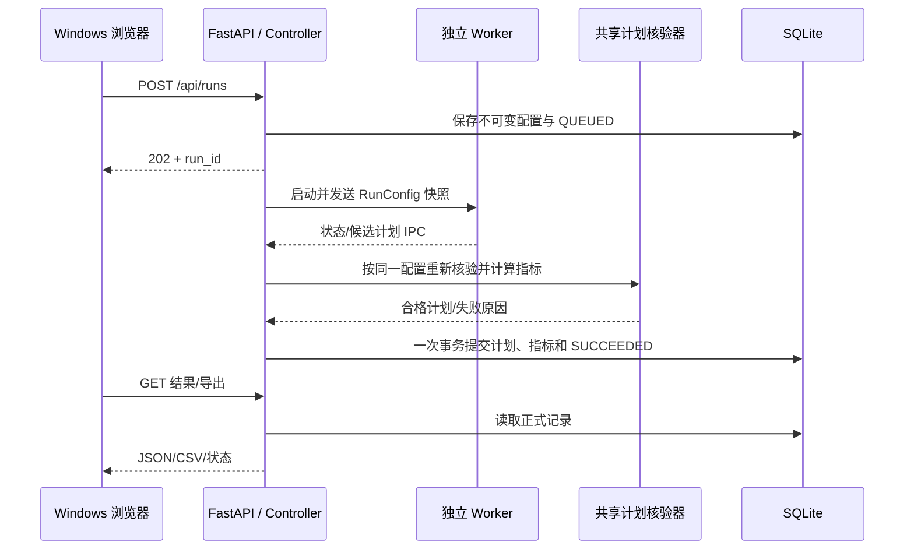

# 第二阶段接口设计文档（审核稿）

> **文档状态：第二阶段目标设计，尚非全部已实现接口。** v0.2 框架当前可调用的路径、字段和限制以 [`framework_handoff.md`](framework_handoff.md)、`eos_system/contracts.py`、`eos_system/api.py` 及启动后的 `/docs` 为准。本文保留完整目标契约，供四人讨论后逐项落地；其中 A/B/C/D 算法、Daemon 与部分 Worker 可靠性接口仍待实现。已落地的卫星本体/固定载荷回放 commit 1–3 见 [`satellite_replay_commits_1_3.md`](satellite_replay_commits_1_3.md)。

- 版本：v0.1，2026-10-13
- 负责人：李泽同；对接：何明涛（Worker/IPC）、梁兆榮（页面/Daemon）、刘懋兴（场景/实验协议）
- 适用环境：Windows 浏览器 + Ubuntu/WSL2 服务；本文包含尚未实现的目标接口
- 关联文档：[当前数据库设计](database_current_v02.md)、[数据库目标设计](database_design_target.md)

## 1. 目标、边界和数据流

本文件冻结 S1 的首版契约，使四人能够并行开发。初版由一个 FastAPI 进程承载 HTTP 与 Controller，独立 Worker 进程执行算法，独立 Daemon 进程监护 Controller。Controller 是正式结果的唯一写入者。所有后端进程在 WSL2 内运行；Windows 只通过 HTTP 使用系统。



现有 `main_scheduler.py` 同时计算、写 JSON 和绘制甘特图；实施时要抽出返回内存 `Schedule` 与指标的计算入口，旧 CLI 继续使用原输出行为。现有 `verify_schedules.py` 只验证文件且以默认约束建模；要抽出接收配置快照和候选计划的公共核验函数，再由文件 CLI 包装调用。核验不能信任 Worker 自报的指标。

## 2. 通用约定

| 项 | 约定 |
|---|---|
| 基础路径 | `/api`；HTTP JSON 使用 UTF-8；服务只监听本机/WSL 可访问地址，生产样式的公网部署不在本阶段范围 |
| 标识 | `run_id` 用 UUID 字符串，由服务生成；`attempt` 从 1 递增；场景和算法只接受服务端注册的 ID |
| 时间 | 对外统一 ISO 8601 带时区；场景 assignment 时间沿用场景数据的时间基准，序列化和反序列化不得改变其含义 |
| 数值 | 秒为算法预算与耗时单位；TCR 为 `[0,1]` 比例；TP/BD/TM 保留现有计算口径；缺失的 RV、MIP gap 用 `null` |
| 幂等 | `POST /api/runs` 可带 `Idempotency-Key`；相同键与相同请求返回同一 `run_id`，同键不同请求返回 409；取消重复提交不重复触发终态变化 |
| 错误 | 统一 `{ "error": { "code": "...", "message": "...", "details": {} } }`；`message` 用于展示，前端按 `code` 判断 |
| 分页 | 列表用 `limit`、`offset`，默认 20、最大 100，按创建时间倒序；响应给 `items`、`total`、`limit`、`offset` |

启动时核验 WSL 路径和数据库目录。HTTP 不接受任意文件路径、模型路径或 Python 表达式。算法参数从注册表中的类型、范围和默认值校验。现有 CLI 虽接受 `latest`，当前 `TimePlacementStrategy` 会把它回退为 `earliest`；首版 API 仅公布已确认行为的 `earliest`、`center`，待 `latest` 实现并通过一致性验证后再开放。

## 3. 核心数据契约

### 3.1 `RunConfig`：服务端保存的不可变快照

| 字段 | 类型/要求 | 说明 |
|---|---|---|
| `run_id` | UUID，服务端生成 | 全链路关联键 |
| `scenario_id` | 非空字符串，注册表中存在 | 不是客户端文件路径 |
| `scenario_sha256` | 64 位十六进制，服务端读取 | 与刘懋兴的场景清单核对；启动 Worker 和核验前再次确认 |
| `algorithm_id` | 注册名 | A/B/C/D 或已有基线的实际注册名；四种新算法命名在 S1 确认 |
| `algorithm_version` | 字符串，服务端填充 | 代码/模型版本用于重现 |
| `algorithm_params` | JSON object，白名单字段 | 注册表逐项验证；不透传任意对象 |
| `model_id` | 字符串或 `null` | D 使用服务端登记的模型 ID；模型路径由服务端解析 |
| `seed` | 非负整数 | 所有随机操作使用固定种子；无随机性的算法仍记录它 |
| `placement_mode` | `earliest` 或 `center` | 与统一约束模型一致 |
| `constraints` | JSON object | 包含 `unassigned_penalty`、`downlink_duration_ratio`、`agility_profile`、`non_agile_transition_s` 等实际约束参数；范围在注册表定稿 |
| `objective_weights` | 四个有限非负数，且总和大于 0 | `w_profit`、`w_completion`、`w_timeliness`、`w_balance`；保留本次输入，不把不同权重的结果混比 |
| `time_budget_s` | 正数，有服务端上限 | **算法搜索**预算；排队、核验和导出另计 |
| `created_at` | 服务端时间 | 不信任浏览器时钟 |

HTTP 提交体不包含 `run_id`、SHA、算法版本与时间戳；服务端补齐后写入 SQLite。若特定算法不使用某一字段，仍保存统一配置，算法注册信息标明实际生效参数。

### 3.2 候选计划与正式结果

候选计划沿用 `schedule_output.py` 的核心 JSON 结构：`scenario_id`、`start_time`、`end_time`、`assignments[]`、`unassigned_tasks[]`。每个 assignment 至少包含 `task_id`、`satellite_id`、`sensor_id`、`sat_start_time`、`sat_end_time`、`orbit_number`、`data_volume_GB`、`power_cost_W`、`sat_angles`；有地面站的场景还需 `ground_station_id`、`gs_start_time`、`gs_end_time`。`sat_window_id` 等内部可由场景窗口重新匹配。时间窗、资源、转移和唯一任务等约束由共享验证器检查。

正式 `RunResult` 由 Controller 形成：`run_id`、`status`、`attempt`、`config`、`plan`、`metrics`、`timings`、`verification`、`error`。`metrics` 包括 `completed_tasks`、`total_tasks`、`TP`、`TCR`、`BD`、`TM`、`RT`、可选 `RV` 和 `mip_gap`。其中 `RT` 对应现有 `EvaluationMetrics.runtime_efficiency`，表示算法运行秒数；`timings` 另列排队/核验/总耗时。成功结果的计划和指标只来自 Controller 重建的正式记录。

### 3.3 算法调用协议

传统算法实现 `BaseSchedulerAlgorithm.search(problem, constraint_model, initial_schedule) -> Schedule`，由统一调度入口构造 `SchedulingProblem` 和 `ConstraintModel`。D 可以在内部加载模型，但最终也返回 `Schedule` 并通过同一核验器。算法不得直接写正式数据库，且不得修改母场景。算法 ID、类别、负责人、版本、参数模式和模型需求在服务端注册表公开给 `GET /api/algorithms`；现有 `class_id` 是旧 CLI 分类，不能代替四种新算法的唯一 ID。

## 4. HTTP API

| 方法与路径 | 请求 | 成功响应 | 主要错误 |
|---|---|---|---|
| `GET /api/scenarios` | 可选 `limit/offset` | 200；`items` 含 ID、名称、任务数、来源、SHA；不含任意本地路径 | 500 配置错误 |
| `GET /api/algorithms` | 无 | 200；各算法的 ID、类别、版本、参数模式、可用性及 D 的模型 ID | 500 注册错误 |
| `POST /api/runs` | 下述提交体 | 202；`run_id`、`status=QUEUED`、详情 URL | 400 JSON 错、422 参数错、404 未登记场景/算法、409 幂等键冲突、429 队列满 |
| `GET /api/runs` | `status`、`scenario_id`、`algorithm_id`、分页 | 200；摘要列表及总数 | 422 查询值错 |
| `GET /api/runs/{run_id}` | 路径 UUID | 200；完整 `RunResult`；未成功时 `plan/metrics=null` | 404 不存在 |
| `POST /api/runs/{run_id}/cancel` | 无 | 202；`cancel_requested=true`，状态可能尚未到 `CANCELLED` | 404 不存在、409 已终态且不可取消 |
| `GET /api/runs/{run_id}/export?format=json` | `format=json|csv` | 200；附件。JSON 为既有可回放计划格式并附配置/出处；CSV 为单文件，每条 assignment 一行并重复本次指标，空计划保留一行空 assignment 汇总 | 404 不存在、409 尚未成功、422 格式错 |
| `GET /api/runs/{run_id}/visualization/replay` | 无 | 200；从已提交成功计划派生回放 manifest、卫星/载荷配置及半开区间 `SLEWING/OBSERVING` 时间段；不重跑调度 | 404 不存在、409 尚无正式成功结果、场景缺失/哈希不符或回放配置无效 |
| `GET /api/health` | 无 | 200；`status`、版本、Controller 实例 ID、时间、数据库可读状态 | 503 服务不健康 |

卫星回放还使用 `GET /visualization/fixed-payload-state.js` 与 `GET /visualization/assets/satellites/landsat8.glb` 两个本地静态资源路径。`GET /visualization/cesium/{run_id}` 会将 `schedule`、`czml`、`replay` 和 `gantt` URL 作为查询参数传给 Cesium 页面。这些资源只影响显示层，不改变 `RunConfig`、SQLite 模式、Controller 状态或正式计划契约。

`POST /api/runs` 示例：

```json
{
  "scenario_id": "registered-small-01",
  "algorithm_id": "algorithm-a",
  "algorithm_params": {},
  "model_id": null,
  "seed": 42,
  "placement_mode": "earliest",
  "constraints": {
    "unassigned_penalty": 1000.0,
    "downlink_duration_ratio": 1.0,
    "agility_profile": "Standard-Agility",
    "non_agile_transition_s": 10.0
  },
  "objective_weights": {
    "w_profit": 1.0,
    "w_completion": 0.0,
    "w_timeliness": 0.0,
    "w_balance": 0.0
  },
  "time_budget_s": 300
}
```

示例 ID 和预算是契约演示值，不表示已登记或已测得合理默认值。`POST /api/runs` 在 DB 写入 `QUEUED` 后返回；内存队列由 DB 的排队状态恢复，不能出现“HTTP 成功但数据库没有任务”。响应中的 URL 采用 `/api/runs/{run_id}`。前端初版每 1–2 秒轮询详情，不伪造算法进度百分比。

## 5. Controller 状态机与取消语义

| 当前状态 | 事件 | 下一状态 | 处理者 |
|---|---|---|---|
| `CREATED` | 配置持久化并进入有界队列 | `QUEUED` | Controller；初版可在一次事务内直接创建为 `QUEUED` |
| `QUEUED` | 获得并发名额且 Worker 启动确认 | `RUNNING` | Controller |
| `RUNNING` | 收到本 attempt 的候选计划 | `VERIFYING` | Controller |
| `VERIFYING` | 约束与指标核验通过且事务提交 | `SUCCEEDED` | Controller |
| `QUEUED/RUNNING/VERIFYING` | 不可恢复错误 | `FAILED` | Controller |
| `QUEUED/RUNNING/VERIFYING` | 取消已受理并完成回收/停止提交 | `CANCELLED` | Controller + Worker |
| `RUNNING` | 算法预算到期且进程回收 | `TIMED_OUT` | Controller + Worker |

终态不回退；同一 `run_id` 只能有一份正式成功计划。取消请求写入 `cancel_requested_at`，不立即假称 Worker 已停止。排队任务可直接取消；运行任务由何明涛的 Worker 实现信号与强制回收；核验期间如取消先于成功事务取得写入顺序，则禁止成功提交。成功已提交后取消返回 409。重复 IPC 以 `(run_id, attempt, seq)` 去重；旧 attempt 的结果作审计事件，不改变当前状态。Controller 重启后重建 `QUEUED` 任务；遗留 `RUNNING/VERIFYING` 先标明确故障并与 Worker 回收状态核对，不盲目重复提交。

## 6. Worker IPC 契约

初版进程启动采用 `multiprocessing` 的 `spawn`，具体 Pipe/Queue 由何明涛与我在 S1 小实例实测后确定；**消息语义先固定**。消息必须是可序列化的纯数据，不直接传 Python `Schedule` 对象，不让 Worker 打开 SQLite。

```json
{
  "protocol_version": 1,
  "run_id": "6a1bfa9d-410b-4ea6-bbe1-17c7dc741c22",
  "attempt": 1,
  "seq": 3,
  "kind": "candidate_result",
  "sent_at": "2026-10-13T16:30:00+08:00",
  "payload": {
    "scenario_id": "registered-small-01",
    "algorithm_runtime_s": 12.4,
    "plan": {"scenario_id": "registered-small-01", "assignments": [], "unassigned_tasks": []}
  }
}
```

消息类型：`started`（PID、开始时间）、`heartbeat`（仅真实存活信息）、`candidate_result`（候选计划）、`failed`（错误码及摘要）、`cancel_ack`（已响应取消）。Controller → Worker 有 `start`（冻结的 `RunConfig`）、`cancel`；超时由 Controller/Worker 协调执行，最终状态由 Controller 决定。单个 Worker 的 `seq` 严格递增，Controller 持久化最后处理序号。大计划若改用临时文件，消息仅携带 `run_id` 隔离目录内的相对路径和 SHA-256；Controller 校验目录、大小与哈希后读取，临时文件永远不是正式记录。

## 7. Daemon 和模块交接

梁兆榮负责的 Daemon 通过 `/api/health` 与 Controller 心跳/进程标识判断服务健康，并使用独立进程锁，有限次数、带退避恢复。Controller 提供实例 ID、启动时间和健康状态；恢复前确认单实例锁释放。Daemon 不直接写 `runs/plans/metrics`，也不直接重启 Worker。何明涛提供 Worker PID、退出码、进程组回收结果；我负责在 Controller 中落状态和恢复扫描。刘懋兴交付场景注册数据：稳定 ID、只读 WSL 路径、母场景来源、SHA-256、任务数、分组归属；训练/验证/测试来源分组也由该清单表达。

## 8. 契约验收与待定值

1. 固定小实例用同一配置、种子，在旧 CLI 与新 Worker 链路得到可行且指标口径一致的结果；`latest` 未验证前不显示。
2. 故意提交场景哈希错误、非法算法参数、超队列请求、重复消息、过期 attempt、约束不合格计划；均不能产生 `SUCCEEDED` 正式结果。
3. 取消、超时、Worker 异常和 Controller 重启后，查询状态明确；导出数据与 SQLite 中的正式计划一致。
4. S1 实测后填定：IPC 介质与最大载荷、队列容量/并发数、默认预算、算法参数范围、心跳周期和恢复次数。更改契约版本时同时更新本文件与数据库设计文档。
