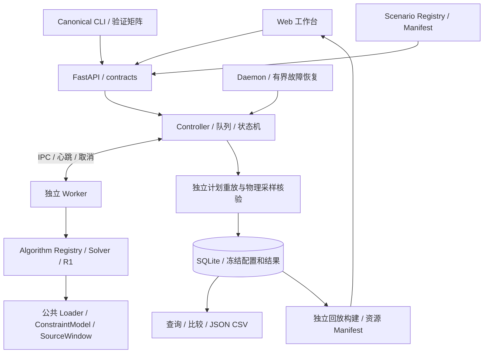

# EOS-Course-Project 项目总览与后续开发交接

交接日期：2026-10-23。适用于组员接手系统修复、算法开发、场景搭建、模型训练与实验验收。

本文根据当前源码、场景清单和已保存的真实验证结果整理。历史专题文档保留各阶段事实；当前算法数量、目录与验收结论以本文引用的最新 Registry、Manifest 和报告为准。

## 1. 项目是什么，已经做到哪里

这是基于 EOS-Bench 扩展的地球观测卫星调度课程实验平台。输入是卫星轨道、任务、可见窗口及资源配置；输出是在统一约束下安排的观测计划、指标与可视化结果。

项目既研究调度算法，也实现操作系统课程要求的独立进程、IPC、同步互斥、超时取消、持久化和故障恢复。当前已有可运行的系统链路，接手工作重点是维护公共边界、解决已知问题、扩展算法与数据，再进行可追溯验证。

| 方面 | 当前状态 | 接手时的边界 |
|---|---|---|
| Web 工作台 | 新建实验、实验管理、比较、参数配置、导出、Gantt/Cesium | 前端通过 API，参数与算法列表来自后端 |
| 实验执行 | Controller 管理队列；独立 Worker 求解；支持 1—8 并发 | Web 进程数和求解 Worker 数是不同设置 |
| 可信结果 | 公共约束重放、来源窗口复核、Orekit 曝光采样、重新计算指标 | Worker 自报结果不能直接判成功 |
| 算法 | 19 个比较算法；2 个初始排程模型角色 | 两个初始模型不重复计为自主比较算法 |
| 场景 | 96 个核心实例＋7 个附加实例；统一发现/加载 | Canonical 文件唯一，失败原型隔离保留 |
| 学习模型 | 已有 PPO/LAVIS 模型协议和真实工件 | 新增两份开发兼容模型，不代表正式泛化效果 |
| 运行记录 | SQLite、JSON/CSV、状态事件、模型身份、采样核验记录 | 历史结果不因重跑成功而改写 |
| 物理可信度 | 工程采样开发验证 | 严格连续区间认证仍未解决，不能标正式 release |

### 交付基线

- 当前分支：`test/basic-algorithms-web-acceptance-20261023`。
- 当前 HEAD：`4a743105c910caea6953cc1adf1726fb9592f1ae`，提交说明为 `feat: add six basic scheduling algorithms`。
- **本轮统一场景、Registry、网页筛选、验证工具及报告仍有已修改和未跟踪文件，尚未全部进入该提交。只交付提交号或只让组员 clone，会漏掉本轮成果。**
- 本轮没有暂存、提交、推送、PR 或合并。组长应核对相关文件后确定新的交付基线，或同时交付经过筛选的工作区文件与数据包。
- 已有其他未跟踪历史文档、审查目录和旧数据包，不能用 `git add .` 一并纳入，也不能用清理命令删除。

开始接手前运行 `git branch --show-current`、`git status --short --branch`、`git log -1 --oneline` 和 `git rev-parse HEAD`，把实际结果写进后续修复记录。

## 2. 架构与代码入口



| 路径 | 职责 | 后续修改的主要影响 |
|---|---|---|
| `eos_system/api.py`、`contracts.py` | HTTP 接口、请求与 RunConfig 契约 | 参数校验、兼容旧请求、前端调用 |
| `eos_system/controller.py` | 派发、状态、超时、取消、核验、可信终态 | Worker 生命周期和结果可信边界 |
| `worker_reference.py`、`controller_ipc.py`、`worker_process.py`、`worker_recovery.py` | 求解进程、通信、身份与回收 | 并发、协作取消、孤儿进程恢复 |
| `eos_system/algorithm_registry.py`、`algorithm_presentation.py` | 算法元数据、参数、构造和展示说明 | 所有算法选择入口，展示与执行身份需区分 |
| `algorithms/solver_contracts.py`、`runner.py` | Solver 协议、公共求解入口 | 不同算法接入的一致性 |
| `schedulers/scenario_loader.py`、`constraint_model.py`、`source_windows.py` | 正式场景模型、资源与来源窗口约束 | 算法公平性、可行性与历史兼容 |
| `utils/visibility.py`、`attitude_frames.py`、`time_parsing.py`、`continuous_exposure.py` | 轨道、可见性、姿态、时间和曝光判定 | 物理口径、场景生成证据与模型适用域 |
| `eos_system/verification.py`、`planning_preview.py`、`preview_audit_process.py` | 独立核验与曝光采样子进程 | 本轮一个协议异常的定位入口 |
| `storage.py`、`experiments.py`、`statistics_export.py`、`exporting.py` | 事务、实验管理、比较和导出 | 数据迁移、历史记录、指标口径 |
| `eos_system/dataset_registry.py`、`scenario_catalog.py`、`config.py` | Canonical 与 Legacy 发现、解析、默认目录 | 场景列表、SHA、路径边界和 Web/CLI 一致性 |
| `eos_system/web/` | 工作台、算法参数、场景筛选、比较交互 | 保留用户选择、可用性提示和失败状态 |
| `replay/`、`replay_configs/`、`replay_service.py`、`replay_builder.py` | 冻结计划的派生回放与资源身份 | 回放构建、缓存和资源发布 |
| `draw/`、`assets/satellites/` | Gantt、Cesium、载荷视图及模型资源 | 显示几何、时间同步、资源 SHA |
| `eos_system/daemon.py` | Linux/WSL 后台守护 | 单实例、有界恢复与启动环境 |
| `scripts/`、`tests/`、`docs/phase2/` | 生成/训练/验证工具、回归与证据 | 开发成果必须配套实际执行结果 |

输入场景只读；算法输出先是候选计划。Controller 独立核验后才能形成相应模式下的可信结果并入库。回放从冻结计划派生，动画、视锥或轨迹正常不能替代调度核验。

## 3. 算法和目标配置

### 当前比较算法

| 类别 | ID | 实现入口/说明 |
|---|---|---|
| 整数规划 | `mip` | `algorithms/mip.py`；依赖 PuLP/CBC |
| 公共启发式 | `profit_first`、`timeliness_first`、`balance_first` | 收益、时效、均衡提案 |
| 压力修复 | `pressure_repair` | `algorithms/pressure_repair.py` |
| 元启发式 | `sa`、`ga`、`aco` | `meta_sa.py`、`meta_ga.py`、`meta_aco.py` |
| 强化学习 | `ppo` | `algorithms/ppo/`；需要真实冻结模型 |
| 冲突束搜索 | `caabs` | `algorithms/conflict_beam.py` |
| 任务包竞价 | `rabas` | `algorithms/auction_bundle.py` |
| 学习型价值排序 | `lavis` | `algorithms/lavis/`；LAVIS-OC 为已有扩展路线 |
| 截止期动态插入 | `dartis` | `algorithms/deadline_insertion.py` |
| 六种基础基线 | `fcfs`、`sjf`、`priority`、`edf`、`llf`、`hrrn` | `algorithms/basic.py`；`fcfo`、`fifo`兼容映射到`fcfs` |

`completion_first` 与 `adaptive_repair` 是另外两个初始排程模型角色。SA/GA/ACO 等是否消费初始解按实际实现及 Registry 说明判断，不能假定所有算法都使用它。

Web 保留后端 Registry 的全部条目；缺依赖或模型的算法显示原因并禁用，不按 ID 隐藏 MIP/PPO。后续验证器继续动态读取 Registry，不能把 19 永久写死为算法列表。

### 已确认的目标语义

权重顺序为 TP、TCR、TM、BD：

| 配置 | `w_profit` | `w_completion` | `w_timeliness` | `w_balance` |
|---|---:|---:|---:|---:|
| TP 优先 | 1 | 0 | 0 | 0 |
| TCR 优先 | 0 | 1 | 0 | 0 |

原 13 种比较算法通过 `algorithms/objective_adapters/` 保留 R1 公共目标适配；模型训练目标与请求目标分别记录。不能偷偷更换用户权重，也不能修改旧模型 manifest 来宣称重新训练。

**用户已经确认：六种基础算法保留原生队列策略。** 公共权重用于同任务、同开始时刻的可行放置择优和统一评价，不叠加 R1 全局重排。到达时间用首个窗口开始，截止期用最后窗口结束；Priority 数值越大越优先，六种算法均为非抢占式。后续不要为“TP/TCR结果必须不同”而擅自改变这些语义。

旧 `main_scheduler.py --algos ...` 工作流保留用于历史兼容；当前统一实验验收优先使用 `--canonical matrix` 或 `scripts/validate_scenarios.py matrix`，它们经过真实公共 API/Controller/Worker/Verifier 链路。

### 指标口径

TP 为任务收益，TCR 为完成率，BD 为均衡度，TM 为归一化等待时间，RT 为算法耗时。TM/RT 越小越好，其他指标按各自定义比较。页面综合分为 `70*TCR + 20*(TP/场景总优先级) + 10*(1-TM)`，总优先级为0时收益项为0；RT不进入综合分，综合分也不能替代用户的公共目标权重。

只比较场景 SHA、约束、目标、预算、种子、初始模型及资源条件一致的记录。并发4与并发8的 RT 不能直接当严格性能排名；空计划、预算退出、超时和异常分别报告。

## 4. 场景数据现状

### 唯一目录与文件职责

```text
input/                         原始轨道/任务来源，不等同于可运行场景
data/scenarios/eos-v1/          新 Canonical 场景唯一权威位置
  standard/                    低冲突
  realistic/                   受控混合分布
  stress/high_conflict/         高冲突
  stress/resource_overload/     存储资源压力
  stress/narrow_window/         窄窗口子实例
  legacy/                      旧场景索引，不复制旧 JSON
  dataset_plan_v3.json          当前96实例计划
data/registry/                 场景清单、数据集清单、来源索引
data/derived/eos-v1/            统计、CSV和难度图
experiments/scenarios/          Legacy 兼容原路径
experiments/runs/eos-v1/        运行、模型、矩阵、日志和归档数据库
```

每个可用实例包括 `scenario.json`、`provenance.json`、`validation.json`、`characterization.json`，另有 Loader 兼容的 `provenance/scenario.json.provenance.json`。后者是字节相同的来源镜像，不是另一份场景。

你当前打开的 `dataset_plan_v2.json` 是历史计划；**现行计划是 `dataset_plan_v3.json`，不是 v2**。保留旧计划和旧试验，不通过覆盖旧 ID 隐藏修复过程。

### 核心矩阵

| 规模 | 卫星数 | 任务数 | 核心实例数 |
|---|---:|---:|---:|
| S1 | 10 | 10 | 12 |
| S2 | 10 | 20 | 12 |
| S3 | 20 | 30 | 12 |
| S4 | 20 | 40 | 12 |
| S5 | 40 | 80 | 12 |
| S6 | 50 | 80 | 12 |
| S7 | 50 | 100 | 12 |
| S8 | 100 | 200 | 12 |

每档为低冲突、混合、高冲突、资源过载四种类型，各3个固定种子，共96核心实例。另有4份保留的r2试验和3份窄窗口子实例，共103可用实例。6份早期失败或难度定义错误的原型通过 `quarantine.json` 隔离保留，不算作可用核心数据。

真实轨道来自原始10/20/50/100星输入；40星取真实50星清单的40条，不复制轨道改ID。任务与部分能力为明确标注的合成开发配置。每个实例时域1800秒；窗口由真实轨道可见性扫描与出口细化获得，保留初始Nadir姿态和边界四元数。

难度证据来自完整源机会：候选窗口数、可选卫星数、无机会比例、重叠率、候选卫星Jaccard、逐星负载、时域与存储压力。八档低/混合/高冲突的均值梯度检查通过，全部核心任务集合摘要不同；详细图表见 [难度统计](../../data/derived/eos-v1/difficulty_statistics.json) 与 [PNG](../../data/derived/eos-v1/difficulty_gradient.png)。这不等于每个种子都严格排序，也不等于真实业务分布。

资源过载采用公共模型确实执行的每轨存储上限 `0.0007`；不能把当前未执行的 `max_operation_time_s` 字段当成硬约束压力证据。核心数据使用所有算法共同支持的无地面站域；扩展下传/地面站前应先审计所有算法共同支持范围。

### 血缘和可信度

- 通过 Registry 查询 ID/路径/规模/难度，提交时重新计算真实文件 SHA。
- `provenance.json` 保存原始输入 SHA、种子、生成器版本及实际代码SHA、Git提交、物理环境和血缘。
- r2/r3同源修订、窄窗口父子实例不能当独立训练/测试样本；依据 `lineage_equivalence_group` 与父ID分组。
- 本轮新模型使用3个明确的r2训练来源；冻结 `final_test` 没有用于训练、生成或验证，后续继续单独保管。
- `validation.json` 是生成时证据快照；其中 `full_matrix_status=PENDING` 不会随运行回写。最新结果看统一 Manifest 与矩阵。
- 生成时选定完整曝光以0.05秒采样，返回的实际计划另外独立核验。`SAMPLED_PASS` 不表示所有源窗口都取得连续证明；数据保持 development，`formal_release_eligible=false`。

## 5. 已有验证成果和已知限制

以下数字来自本轮保存的实际结果，属于交接快照，不是对组员新环境的自动保证。

| 范围 | 实际结果 |
|---|---|
| 核心比较矩阵 | 96 × 19 × 2 = 3,648 组合全部实跑 |
| 全部可用实例比较 | 103 × 19 × 2 = 3,914 组合，无漏项 |
| 非空计划 | 3,761组采样核验通过；其中740组返回预算耗尽时的可行计划 |
| 合法空计划 | 45组；其中7组在预算耗尽时返回空计划 |
| 求解超时 | 106组，均为MIP；没有提高预算反复重试 |
| 其他失败 | 2组并发异常，原失败保留 |
| 初始排程模型 | 412组：382非空按时通过、4合法空计划、26超预算但计划采样通过 |
| 输入/目标一致性 | 3,914组场景SHA、公共约束、目标、模型身份与核验记录检查通过 |
| Web/API/回放 | 16项真实ASGI接口/回放资源检查通过；浏览器点击交互未实测 |
| 回归 | 前端22项；Registry专项6项；journal专项2项；此前相关46项、扩展155项通过，两批有重叠，不能简单相加 |
| 原资产保护 | 118项既有场景/输入/归档/模型哈希未变；三份误删文件已恢复并与HEAD一致 |

预算耗尽可行记录是上述核验通过记录的子集，不额外累加。原始 `SUCCEEDED` 共3,806组，但不能把它全部写成“算法按时完成且返回非空计划”。

两次异常必须保留在待办：

| 原运行 | 错误 | 当前定位与诊断 |
|---|---|---|
| `SCN-S3-resource_overload-0-r3 / llf / TCR` | `PHYSICS_ERROR: PREVIEW_INVALID_RESPONSE` | 核验子进程返回内容不能解析成JSON；没有获得物理谓词失败结论。原stdout未持久化，具体污染来源未确定 |
| `SCN-S8-resource_overload-1-r3 / ppo / TCR` | `WORKER_EXIT_TIMEOUT` | 已返回候选，退出回收未在期限内完成；尚未形成可信核验结果 |

两者各做了一次相同输入、模型、目标与5秒预算的单并发诊断，均通过；这不能证明并发问题已经修复。诊断见 [parallel-failure-diagnostics.json](../../experiments/runs/eos-v1/parallel-failure-diagnostics.json)。

证据入口：

- [建设与验证报告](scenario_dataset_build_report.md)：全实例、难度、算法计数、失败和成本。
- [规范比较矩阵CSV](../../experiments/runs/eos-v1/compatibility_matrix.csv)：TP/TCR/TM/BD/RT、状态、目标与模型。
- [一致性审计](../../experiments/runs/eos-v1/matrix-integrity.json)：3,914完整覆盖与身份检查。
- `experiments/runs/eos-v1/matrix-full.json`、`.jsonl`、`.csv`：完整请求、事件与核验记录；前两者文件较大。
- `experiments/runs/eos-v1/initial-models-full.json`：初始模型单独验证。
- `experiments/runs/eos-v1/logs/`：各阶段真实日志，失败日志也保留。
- `experiments/runs/eos-v1/fast-runtime/archive_manifest.json`：SQLite完整性与归档文件SHA。

原harness对未成功结果曾统一填写 `verification_status=FAILED`；规范矩阵区分算法超时未进入核验、Worker退出异常和核验协议错误，并保留原字段，不能把旧字段统解释成物理约束违例。

## 6. 组员环境搭建与首次启动

### 环境与依赖

推荐 Windows 编辑/浏览器＋WSL2 Ubuntu 后端，或原生Linux。后端使用Linux进程、锁与回收机制，不能直接改用Windows Python作为等价验收环境。

在完整交付的项目根目录、Ubuntu终端执行：

```bash
export EOS_RUNTIME_DIR="$HOME/eos-course-runtime-dev"
mkdir -p "$EOS_RUNTIME_DIR"
python3 -m venv "$EOS_RUNTIME_DIR/.venv"
source "$EOS_RUNTIME_DIR/.venv/bin/activate"
python -m pip install --upgrade pip
python -m pip install -r requirements-system.txt -r requirements-visualization.txt
python -m pip install -r requirements-ml.txt
python -m pip install 'PuLP==3.3.2'
```

`requirements-system.txt` 不包含所有可选算法依赖，`requirements-ml.txt` 也没有PyTorch；PPO还需模型依赖匹配的PyTorch包。仅安装这些requirements，不能就宣称19个算法全部就绪。Orekit虽然列在visualization依赖文件中，工程物理核验和场景生成同样需要它。

本轮实际环境：Python3.10.12、Orekit-JPype13.1.5.0、JPype1.5.2、Java17、numpy2.2.6、scikit-learn1.7.2、PuLP3.3.2、torch2.14.1+cpu。完整记录见 [execution-environment.json](../../experiments/runs/eos-v1/execution-environment.json)。这是实测环境快照，不保证所有包源都有相同wheel；模型负责人应交付可复现的包源/工件。依赖不匹配时不能编辑旧模型manifest放行，必要时用新环境重训并发布新模型ID。

### 新运行目录使用已有场景与模型

```bash
export EOS_SCENARIO_DIR="$PWD/data/scenarios/eos-v1"
export EOS_OREKIT_DATA="$PWD/utils/orekit-data.zip"
export EOS_MAX_WORKERS=1

python -B scripts/validate_scenarios.py list --scale S1
python -B scripts/install_canonical_models.py \
  --source-runtime experiments/runs/eos-v1 \
  --runtime "$EOS_RUNTIME_DIR" \
  --report "$EOS_RUNTIME_DIR/model-installation.json"

python -m eos_system
```

浏览器打开 `http://127.0.0.1:8765/`；OpenAPI文档为 `/docs`，健康检查为 `/api/health`。首次先用S1、单并发、5秒预算和FCFS，确认非空计划、指标、导出与回放，再启用学习算法及大规模数据。

检查 `utils/orekit-data.zip` 是真实ZIP而非LFS指针。当前物理核验可读 `EOS_OREKIT_DATA`，部分轨道回放入口仍要求项目内 `utils/orekit-data.zip` 存在，交付时保留该文件。新模型来源目录必须完整，PPO为`manifest.json + model.pt`，LAVIS为`manifest.json + model.joblib`。

启动后检查 `/api/algorithms` 的可用性与模型枚举，显式选择：

- `ppo-eos-v1-dev-20261023`。
- `lavis-eos-v1-dev-20261023`。

这两份模型是小训练量的开发兼容模型：PPO实际100轮，LAVIS20行实际续排标签；工件保持`trained_not_validated`等原始清单状态，兼容性证据另存。旧LAVIS-OC等模型可保留，但其物理域/依赖限制仍生效，不能假设可直接替换用于所有Nadir场景。

数据源ID以 `GET /api/data-sources` 的实际返回为准。显式将 `EOS_SCENARIO_DIR` 指向Canonical时，新数据库会登记为 `runtime`；自动登记会复用同路径已有来源，未必另外生成 `canonical-eos-v1`。下例使用前面启动配置对应的 `runtime`，不要把某台机器上的数据源别名写死为跨机器契约。

### 可直接验证的API请求

```bash
curl -sS http://127.0.0.1:8765/api/experiments \
  -H 'Content-Type: application/json' \
  -d '{"runs":[{"source_id":"runtime","scenario_id":"SCN-S1-low_conflict-0-r3","algorithm_id":"fcfs","execution_mode":"physical_validation","time_budget_s":5,"seed":2026102300,"objective_weights":{"w_profit":1,"w_completion":0,"w_timeliness":0,"w_balance":0}}]}'
```

TCR实验将两项权重改为 `w_profit=0`、`w_completion=1`，其他条件保持一致。**API的RunRequest历史默认模式为`formal`，与网页日常工程核验不同；脚本必须显式传`execution_mode=physical_validation`。**

正常停止用原终端Ctrl+C并等待退出；后台使用 `python -m eos_system.daemon start/status/stop`。同一运行目录只能有一个Controller，不通过删除锁文件、增加Uvicorn Web worker或启用`--reload`实现算法并发。修改受保护的物理/执行源码后应正常重启并使用新的试验记录。

### 查看本轮历史结果

归档数据库在 `experiments/runs/eos-v1/fast-runtime/`。同机可将 `EOS_RUNTIME_DIR` 指向此目录查看结果；日常开发推荐用新运行目录，保留交付归档不变。

换机器后，历史RunConfig可能包含原机的绝对场景路径；SQLite存在不表示旧回放一定能重建。保留历史配置作为证据，在接收机重新登记场景、安装模型并提交新Run验证，不批量修改旧数据库配置。当前注册/生成入口用项目相对结构和环境变量，不依赖本机审计目录。

## 7. 场景搭建与扩展步骤

已有103份交付完整时，先查询、验证与运行，不必重新生成。生成器默认续跑并核对已完成SHA，不覆盖已完成实例。

```bash
# 初次建设：先五个代表性规模，再扩完整96核心
python -B scripts/generate_scenarios.py
python -B scripts/generate_scenarios.py --all

# 父场景完成后构建三份窄窗口子实例
python -B scripts/generate_narrow_scenarios.py

# 公共加载、SHA、来源镜像、结构及计数复核，更新本轮清单
python -B scripts/validate_scenarios.py index
python -B scripts/validate_scenarios.py list --scale S8 --difficulty high_conflict
python -B scripts/plot_scenario_difficulty.py
```

`characterize_scenarios.py` 当前提供供生成器复用的 `characterize(scene)` 函数，不能假设它有单独命令行参数；全量统计和图表使用 `plot_scenario_difficulty.py`。

扩展新规模、长时域或新难度时，按以下顺序开发：

1. 审计真实原始输入的实体数、唯一轨道、历元和SHA；确认数据源适用性。
2. 制定新版本的计划、场景ID、种子、血缘和训练/验证分组，不覆盖当前v3实例。
3. 扩展现有生成器，使用真实轨道、时间解析、可见性谓词、姿态与完整曝光规则；任务为合成时明确标注。
4. 先生成一个小实例，复核Schema、引用、时间边界、曝光机会及公共Loader。
5. 用真实API执行小规模全算法与TP/TCR，记录模型域和公共约束兼容性。
6. 再扩多种子和大规模，统计完整源机会的难度梯度，避免以算法成绩挑选或删掉困难实例。
7. 更新Manifest与报告；失败原型保留原因，隔离与替代版本的关系清晰可查。

`--root`只改存储位置，**不会自动产生新数据版本、新ID或新独立血缘**。把同一固定计划换个目录运行，不能当成独立数据集。修改物理口径后，应重新生成/验证相应新版本，不能只改`validation.json`或来源侧车的PASS字段。

不完整目录、无效来源、SHA不一致或缺初始姿态时，先定位并保存现场；不要删除母数据或复制一份“适配某算法”的场景。分支修复后仍须所有算法读同一Canonical文件。

详细流程：[scenario_catalog.md](scenario_catalog.md)。

## 8. 算法、模型和系统功能如何继续开发

新增算法实现 `solve(problem, constraints, context) -> Schedule`，共用类型来自 `algorithms/solver_contracts.py`；在Registry登记唯一ID、实现版本、参数模型、构造函数、可用性和目标语义。参数未知字段应报错，随机数使用独立种子，搜索轮询取消并遵守预算，返回assignment保留实际来源窗口身份。

算法负责搜索，公共核验负责最终可行性和指标。新增算法还要审查 `COMPARISON_ALGORITHMS`、R1适配器支持范围、旧工厂兼容及展示元数据；只增加一个类并不等于完成Web/Worker接入。不要给算法写独立前端、另一套场景Schema或绕过公共核验的“成功”入口。

学习算法扩展应保留候选/特征/标签协议，明确训练目标及来源分组；训练和推理分离，记录依赖、代码、模型SHA、成本与验证。当前 `train_canonical_models.py` 的两个ID和3份来源是固定兼容性基线，重新调用不会自动得到独立新模型实验；新训练必须使用新ID和可审查的训练方案。

公共接口变化先评估请求契约、Registry、Runner、Worker、Verifier、存储迁移、导出及Web影响。物理代码、模型、输入和目标都参与身份校验；出现源码变更要求重启的保护应按版本流程处理，不关闭门禁或回填历史身份。

## 9. 后续修复与开发优先级

负责人为沿用README分工的建议，公共契约与集成由组长协调。

| 优先级 | 工作 | 建议协作 | 验收条件 |
|---|---|---|---|
| P0 | 确保完整交付未提交源码、Canonical、模型与证据 | 李泽同统筹，全员核对 | 接收机无私有路径依赖，S1真实链路跑通，包内SHA可查 |
| P0 | 核验JSON协议异常诊断与修复 | 何明涛＋李泽同 | 持久化有上限的原stdout/stderr及阶段信息；并发重复复现；污染/畸形响应仍失败关闭，不宽松解析成成功 |
| P0 | PPO候选后退出超时 | 何明涛，模型负责人配合 | 检查退出时序、线程/JVM/资源释放及回收；无泄漏、无误杀、无放宽可信结果条件 |
| P1 | MIP超时与模型构建成本 | 李泽同协调算法维护 | 区分建模/求解/传输时间，保留固定预算、候选与参数，比较新版本效果，不通过删场景制造通过 |
| P1 | `completion_first`大规模预算行为 | 算法与框架维护 | 对26份超预算记录定位，明确预算覆盖范围，修复后新版本复测 |
| P1 | 依赖声明与换机复现 | 李泽同＋各模型负责人 | 补齐PyTorch/PuLP/CBC与Orekit说明，提供环境锁定或受控wheel，干净环境完成安装验证 |
| P1 | 场景扩展与血缘治理 | 刘懋兴统筹，其他算法负责人复核 | 新ID/版本、多种子、真实难度、共同约束、无训练测试泄漏 |
| P1 | 新数据筛选与回放的真实浏览器验收 | 梁兆榮 | 小/大场景、空筛选、MIP/PPO可用性、导出与回放、旧记录、不同分辨率均有实际浏览器证据 |
| P2 | 学习模型独立泛化与稳定性实验 | 李泽同主导，刘懋兴/何明涛配合 | 新模型ID、足量来源、预先固定协议、成对多种子、训练成本、失败与退步一起报告 |
| P2 | 严格连续曝光认证、地面站/下传共同域 | 公共物理与全算法负责人共同审查 | 有可信连续区间证据或全算法共同支持证明，再谈formal/release升级 |

JSON协议问题当前缺原始输出，仍有根因证据缺口；单并发通过不能作为并发修复验收。定位时先用隔离运行目录，保留本轮完整矩阵，修改公共物理/框架代码后重新建立对应版本的验证证据。

## 10. 修复后怎样验收

先专项回归与真实小实例，再扩大范围；不要每改一处都无条件重跑数小时全矩阵，也不要只检查生成器能输出JSON。

```bash
python -B -m unittest discover -s tests -p test_canonical_registry.py -v
python -B -m unittest discover -s tests -p test_matrix_journal.py -v
python -B -m unittest discover -s tests -p test_basic_algorithms.py -v
python -B -m unittest discover -s tests -p test_objective_adapters.py -v
```

前端专项在安装Node.js的项目根目录运行；本轮环境使用：

```bash
node --test --test-isolation=none tests/scenario_filters.test.cjs tests/basic_algorithms.test.cjs tests/algorithm_parameters.test.cjs tests/delivery_workbench.test.cjs tests/experiment_interactions.test.cjs tests/workspace_pages.test.cjs
```

Node版本不支持该选项时使用其支持的测试启动方式，保留版本和stdout；HTTP/Node测试不能冒充浏览器点击验收。框架大改再按相关专题及完整Python测试进行更广回归。

小规模新矩阵使用**新的结果路径和运行目录**：

```bash
python -B scripts/validate_scenarios.py matrix \
  --scenario-ids SCN-S1-low_conflict-0-r3 \
  --root "$EOS_SCENARIO_DIR" --runtime "$EOS_RUNTIME_DIR" \
  --output "$EOS_RUNTIME_DIR/matrix-s1-new.json" \
  --orekit-data "$EOS_OREKIT_DATA" --workers 1 --submission-window 8 --budget 5
```

去掉`--scenario-ids`会遍历当前全部可用场景与动态Registry、两个目标。本轮103场景的目标是3,914组；以后新增算法或场景时目标随Registry/数据量变化。默认只续跑同条件未终态项，预算/输入/模型/代码身份改变应使用新报告。不要把`--retry-failed`当成刷通过率工具。

`audit_canonical_matrix.py`、`report_scenario_dataset.py`和`index`的部分默认位置绑定本轮eos-v1成果；开展新实验时检查其路径/预算假设并显式指定可用参数。尤其`index`会重建本轮登记文件，报告脚本会重写本轮建设报告，不要误把它们当成任意实验的无副作用读取器。

每项修复至少交付：触发场景ID/SHA、原失败Run及错误码、改动与版本、实际命令/环境、预期与实测、原失败保留、新结果及回归限制。回归覆盖旧场景、历史实验查看、TP/TCR、取消超时、导出与回放中的相关路径。

## 11. 交给组员的文件清单

| 交付部分 | 内容 | 注意 |
|---|---|---|
| 源码与文档 | 审核后的完整代码快照/新基线，以及本轮未跟踪工具、测试、Registry、新文档 | 只发当前HEAD不完整；排除无关私有文件 |
| Canonical场景 | `data/scenarios/eos-v1/`、`data/registry/`、必要派生统计 | 完整四件套、兼容来源镜像、v3计划、隔离原因与血缘一起保留 |
| 原始来源 | `input/`及物理生成确实需要的源文件，`utils/orekit-data.zip` | 原SHA不可改；旧场景依赖按需要附带 |
| 新模型 | `experiments/runs/eos-v1/models/ppo/ppo-eos-v1-dev-20261023/`与对应LAVIS目录 | 完整工件、manifest、环境与训练说明 |
| 结果证据 | 建设报告、规范矩阵、一致性审计、初始模型结果、诊断与日志 | 大型完整JSON/journal按存储条件另附，不能只剩漂亮汇总图 |
| 历史查看包（可选） | `experiments/runs/eos-v1/fast-runtime/`及archive_manifest | 是本轮有意识的结果归档，不是把个人运行目录全部打包；换机处理旧绝对路径限制 |
| 原有公开开发数据（按需） | 旧80份公开开发场景及其来源说明、Legacy数据 | 与新96核心区分，不把final_test并入日常开发包 |

不要分发个人`.ssh`、凭据、机器虚拟环境、活动锁和整套个人缓存；组员在自己的Linux环境创建新运行目录。旧 `utils/orekit-data.zip`、`docs/organize.jpg`、`docs/visualisation.gif`已经恢复，交付时保留其真实文件。

接收验收清单：

- [ ] 代码基线与未提交变更范围明确，未漏掉新增脚本/Registry/前端文件。
- [ ] Canonical可发现103可用实例，明确96核心与7附加、6隔离原型。
- [ ] 来源、计划、模型、物理数据完整，SHA可核对；final_test单独受控。
- [ ] `/api/algorithms`、场景筛选与模型枚举符合接收机实际环境。
- [ ] S1单并发真实API运行、独立核验、导出与回放跑通。
- [ ] 两个已知并发错误及MIP/初始模型预算问题有接手记录，未标作已全部修复。
- [ ] 新实验使用新结果文件；开发组员了解六种基础策略已确认的语义。

## 12. 建议阅读顺序

1. 本文：全局、接手边界和优先级。
2. [README](../../README.md)：一般使用与现有成员职责。
3. [场景目录和命令](scenario_catalog.md)、[场景建设报告](scenario_dataset_build_report.md)。
4. [算法接入](algorithm_integration.md)、[基础算法](algorithms/basic_scheduling.md)，再读本人维护算法专题。
5. [实验管理](experiment_management_handoff.md)、[Daemon](daemon_implementation_and_validation.md)、[来源窗口契约](assignment_source_window_contract_v1.md)。
6. 维护前端/回放时读[工作台交付](delivery_workbench_handoff.md)、[回放后端](replay_backend_handoff.md)及对应交互专题。

历史文档中的算法数量、MIP/PPO隐藏规则、默认路径和早期待开发事项可能已经变化；冲突时核对当前源码与日期明确的实际证据，不把所有旧阶段结论拼成同一版本的“全部完成”。
