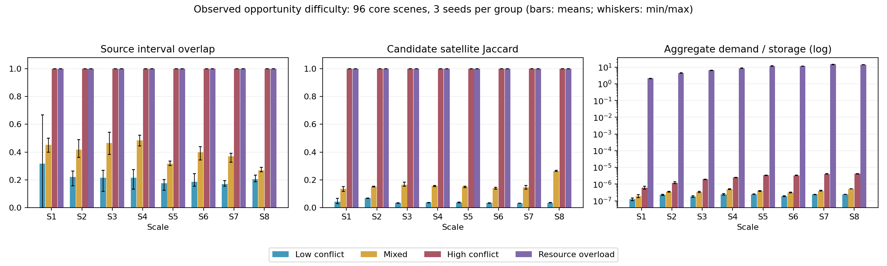

# 统一场景数据集建设与全算法兼容性验证报告

本报告由实际文件和矩阵记录生成。未执行、失败、空计划和预算退出分别报告；当前数据均为development，未宣称正式release或连续区间认证。
生成时间：2026-10-23T01:58:30.073448+00:00。核心场景96/96；全部可用103；比较矩阵已终态3914/3914，未终态0。初始模型角色另行验证412/412。

## 资产审计与保护

工作分支：`test/basic-algorithms-web-acceptance-20261023`；起始HEAD：`4a743105c910caea6953cc1adf1726fb9592f1ae`。未执行暂存、提交、推送、PR或合并。
只读审计共92份公开场景（12份Legacy/历元修复，80份共享development）；结构结果：{'WARN': 92}。WARN不等于物理通过或物理失败。
原始10、20、50、100星输入实际数量均正确。原ZIP、现有场景、旧模型和未跟踪历史文件保留。冻结final_test仅登记位置，没有读取内容或参与训练。
详细SHA、规模、时间、窗口数与结构问题见`data/registry/eos-v1-asset-audit-20261023.json`；既有审计结论见`scenario_dataset_asset_audit.md`。

## 存储和生成

Canonical场景唯一存储于`data/scenarios/eos-v1/`；每实例四个文件及兼容来源镜像。Legacy只有相对路径索引。登记文件位于`data/registry/`；矩阵、Worker记录、数据库及新模型位于`experiments/runs/eos-v1/`。
八档规模×四种难度×三个固定种子，当前计划96实例。轨道只取真实原始输入，40星取真实50星清单前40个ID；任务及敏捷载荷能力明确标注为受控合成开发配置。
时域为1800秒。目标位置由实际Orekit轨道的WGS84星下点加种子控制扰动生成，随后通过真实可见性谓词扫描，不手写随机窗口。网格5秒，真实出口二分到微秒；选定完整曝光以0.05秒含端点独立采样，所有实际计划还须通过公共Verifier。
全体卫星具有真实计算的初始Nadir姿态和边界四元数。资源过载使用公共ConstraintModel确实执行的每轨存储上限0.0007 GiB；没有借用未执行的运行时间字段冒充硬约束。
当前核心实例：96/96；其他可用实例：7（保留r2试验及窄窗口子实例）；缺少核心实例：0。

## 难度统计

| 档型 | 已生成 | 平均窗口重叠率 | 平均卫星集合Jaccard | 平均最大需求/时域 | 平均最大需求/存储 |
|---|---:|---:|---:|---:|---:|
| high_conflict | 24 | 1.0000 | 1.0000 | 0.3961 | 0.0000 |
| low_conflict | 24 | 0.2129 | 0.0398 | 0.0494 | 0.0000 |
| mixed | 24 | 0.3962 | 0.1635 | 0.1778 | 0.0000 |
| resource_overload | 24 | 1.0000 | 1.0000 | 0.9691 | 30.4188 |

所有统计来自完整、可容纳曝光的源区间，未用算法成绩筛选实例。重叠率按同星不同任务窗口对统计；集合交集用Jaccard；需求/存储是候选需求压力，不是可同时执行任务数。各星负载和逐任务机会分布在characterization.json中保留。

## 全算法及两目标矩阵

矩阵文件：`experiments/runs/eos-v1/matrix-full.json`。动态注册表比较算法数量：19。
TP权重=(1,0,0,0)，TCR权重=(0,1,0,0)，字段顺序为TP/TCR/TM/BD。请求、RunConfig和独立结果保持同一场景ID、SHA、输入实体和公共约束。基础策略保留队列规则，公共权重用于同任务同开始时刻放置择优；不冒充R1全局优化。
PPO/LAVIS使用实际训练的新ID：`ppo-eos-v1-dev-20261023`、`lavis-eos-v1-dev-20261023`。3个明确r2训练来源没有使用final_test；PPO实际100轮，LAVIS原续排协议20行标签。它们是开发兼容性模型，不能据此声称独立泛化性能。旧模型及冻结推理源码未改写。
核心矩阵已终态3648/3648；全部可用实例矩阵已终态3914/3914，未终态0（包含已提交尚未返回）。当前执行批次预期3914；若小于全量目标，差额也属于尚未验证，不能省略。
终态分布：`{'SUCCEEDED': 3806, 'TIMED_OUT': 106, 'FAILED': 2}`；细分结果：`{'SUCCEEDED': 3021, 'TIMED_OUT': 106, 'FEASIBLE_PLAN_AT_BUDGET': 740, 'EMPTY_VALID_PLAN': 38, 'EMPTY_PLAN_AT_BUDGET': 7, 'FAILED': 2}`。

| 算法 | 非空且核验通过 | 空且核验通过 | 其中预算耗尽可行 | 超时 | 失败/拒绝/取消 | 尚未终态 |
|---|---:|---:|---:|---:|---:|---:|
| mip | 91 | 9 | 50 | 106 | 0 | 0 |
| profit_first | 204 | 2 | 50 | 0 | 0 | 0 |
| timeliness_first | 204 | 2 | 52 | 0 | 0 | 0 |
| balance_first | 204 | 2 | 51 | 0 | 0 | 0 |
| pressure_repair | 204 | 2 | 52 | 0 | 0 | 0 |
| sa | 204 | 2 | 51 | 0 | 0 | 0 |
| ga | 204 | 2 | 74 | 0 | 0 | 0 |
| aco | 204 | 2 | 70 | 0 | 0 | 0 |
| ppo | 203 | 2 | 25 | 0 | 1 | 0 |
| caabs | 204 | 2 | 46 | 0 | 0 | 0 |
| rabas | 204 | 2 | 41 | 0 | 0 | 0 |
| lavis | 204 | 2 | 10 | 0 | 0 | 0 |
| dartis | 204 | 2 | 55 | 0 | 0 | 0 |
| fcfs | 204 | 2 | 20 | 0 | 0 | 0 |
| sjf | 204 | 2 | 20 | 0 | 0 | 0 |
| priority | 204 | 2 | 20 | 0 | 0 | 0 |
| edf | 204 | 2 | 20 | 0 | 0 | 0 |
| llf | 203 | 2 | 20 | 0 | 1 | 0 |
| hrrn | 204 | 2 | 20 | 0 | 0 | 0 |

“其中预算耗尽可行”是核验通过记录的子集，不额外加总。超时不计成功。
完整CSV包含场景ID/SHA、规模、难度、算法、权重、模型身份、状态、时间、安排数、核验和失败原因。预算标记来自明确注明不可信的Worker遥测；独立物理通过依据Controller receipt，不以遥测代替。原始SQLite保留配置、计划、事件和Worker尝试。

### 初始模型角色与目标覆盖

completion_first和adaptive_repair来自动态初始模型Registry，单独走真实Runner和独立核验进程，不虚增比较算法数量。超过5秒仍返回核验通过计划的记录标为TIMED_OUT/VALIDATED_PLAN_AFTER_BUDGET，不参与质量排名。

| 角色 | 非空且核验通过 | 空且核验通过 | 预算可行子集 | 超时 | 失败/拒绝 | 未执行 |
|---|---|---|---|---|---|---|
| completion_first | 178 | 2 | 0 | 26 | 0 | 0 |
| adaptive_repair | 204 | 2 | 0 | 0 | 0 | 0 |

两目标分别按实际请求核对，不因相同结果推断算法忽略权重。固定队列基线不承诺全局优化；原13种R1适配器仍保留请求目标、训练目标和适配器身份。

| 目标 | 已终态 | 全量目标 | 非空且核验通过 | 空且核验通过 | 预算可行子集 | 超时 | 失败/拒绝/取消 |
|---|---|---|---|---|---|---|---|
| TP | 1957 | 1957 | 1881 | 23 | 374 | 53 | 0 |
| TCR | 1957 | 1957 | 1880 | 22 | 373 | 53 | 2 |

### 八档规模的实际难度证据

下表来自96份完整源机会统计；每格为3个种子的平均值。全组均值排序不等同于每个单独种子严格排序。资源过载列为3个实例的最小总需求/总有效每轨存储容量下界。

| 规模 | 低/混合/高：窗口重叠 | 低/混合/高：卫星Jaccard | 过载存储下界最小值 |
|---|---|---|---|
| S1 | 0.3175 / 0.4515 / 1.0000 | 0.0432 / 0.1352 / 1.0000 | 2.0229 |
| S2 | 0.2197 / 0.4172 / 1.0000 | 0.0684 / 0.1506 / 1.0000 | 4.3945 |
| S3 | 0.2147 / 0.4643 / 1.0000 | 0.0342 / 0.1651 / 1.0000 | 6.4261 |
| S4 | 0.2162 / 0.4827 / 1.0000 | 0.0359 / 0.1556 / 1.0000 | 8.4490 |
| S5 | 0.1755 / 0.3170 / 1.0000 | 0.0371 / 0.1511 / 1.0000 | 11.4223 |
| S6 | 0.1858 / 0.3998 / 1.0000 | 0.0335 / 0.1414 / 1.0000 | 11.5618 |
| S7 | 0.1696 / 0.3690 / 1.0000 | 0.0316 / 0.1458 / 1.0000 | 14.4741 |
| S8 | 0.2041 / 0.2680 / 1.0000 | 0.0348 / 0.2634 / 1.0000 | 14.3258 |

96份任务集合独立摘要数：96；八档均值梯度与过载下界检查：True。无候选机会比例最大值：0.0000。

原始统计：[JSON](../../data/derived/eos-v1/difficulty_statistics.json)、[CSV](../../data/derived/eos-v1/difficulty_statistics.csv)。高冲突与资源过载共享高竞争结构，后者增加存储硬约束；realistic表示受控混合分布，不表示真实业务请求采集。

### 运行成本与可复现性

96份核心生成逐实例墙钟合计1013.151秒，另有一次性轨道网格初始化、原型、训练和核验成本。所有可用实例生成成本合计1061.747秒。比较矩阵成功记录的算法RT合计6884.429秒；不是端到端墙钟，超时没有正式指标时不得当成0秒算法完成。
每轮预算5秒，并发与Worker启动/核验额外开销在日志和数据库中记录。并发从4提升到8，再改用最多24个未终态请求的滚动提交；每次切换均在已证明零活动运行时进行。前后批次不用于严格耗时排名。滚动harness先实际试跑38组合全部通过，保留独立smoke结果。Linux执行源码快照用于减轻Windows挂载文件I/O；实际场景始终符号链接回唯一Canonical文件，不为不同算法复制。source SHA、模型身份及harness历史共同确定试验版本，不仅凭Git HEAD识别未提交代码。
实际Python、Orekit、JVM、依赖版本、Orekit数据SHA和执行快照公共生产源码逐文件比对见[execution-environment.json](../../experiments/runs/eos-v1/execution-environment.json)。原资产118项哈希及分支/HEAD保护结果见[preservation-check.json](../../experiments/runs/eos-v1/preservation-check.json)。
本轮算法源码摘要：`521af8ec19a01f66d27007af163e6fa7e244f64e168f52506f6386bc48c7121c`。独立重生成记录见[reproducibility.json](../../experiments/runs/eos-v1/reproducibility.json)：S1低冲突种子0在相同输入/代码下产生完全相同JSON字节，临时副本未保留。其他实例保留固定种子但未逐一独立重生成。

### Web、API和回放

实际ASGI接口与回放子进程检查状态：`PASS`；已记录接口检查16项。证据见[web-api-replay.json](../../experiments/runs/eos-v1/web-api-replay.json)。浏览器点击交互未实测，不用HTTP/Node回归冒充浏览器验收。
网页按规模、难度、卫星数和任务数筛选；API和CLI使用相同Registry。网页取消旧的MIP按ID隐藏，保留全部注册条目及后端不可用原因。旧场景与历史实验ID保持可用。模型安装器校验旧工件不变，生产入口重启后可发现新Canonical场景及已安装新模型。

## 失败、限制与成本

主矩阵106次MIP超时均保留，没有加预算重跑。另两次失败分别为S3资源过载种子0的LLF/TCR核验子进程PREVIEW_INVALID_RESPONSE，以及S8资源过载种子1的PPO/TCR候选返回后WORKER_EXIT_TIMEOUT。前者没有得到可解析的物理结论，后者尚未进入正式结果核验，均不能解释成已证实的可见性违例。
两次FAILED各做一次相同请求条件的单并发诊断，状态为{'SUCCEEDED': 2}。原矩阵及数据库失败不替换、不提升为成功，证据见[parallel-failure-diagnostics.json](../../experiments/runs/eos-v1/parallel-failure-diagnostics.json)。原核验进程stdout未持久化，不能确认当时JSON无效的具体字节来源；并发可靠性根因未根治，列为未解决限制。
初代五份试验缺少初始姿态，被公共约束拒绝，PPO训练正确拒绝登记工件；原JSON未删除，quarantine.json记录原因。r2资源试验错误采用未执行的运行时间容量统计，已保留并隔离，r3改用真实存储约束。
首次接口试跑在开发时遇到部署源身份变动保护；后续报告工具处理空事件payload出错，停止Controller时中断两次核验。原矩阵和错误保留；工具修复后的重跑保留attempt_history，不能将历史失败从审计中删除。
没有关闭公共约束、物理核验或提高无限预算。严格连续认证仍INCONCLUSIVE，当前是工程采样开发数据。PPO/LAVIS共同域不含地面站，因此核心矩阵使用无地面站；原有带地面站接口保留。
生成成本逐实例保存在provenance.generation_wall_s；矩阵逐次RT及资源并发条件保留。时域为半小时的受控压力试验，不代表全天真实业务分布。

## 回归与复现

首批相关回归46项通过；扩展回归155项通过，两批有重叠。扩展覆盖注册、来源身份、结构审计、R1、临时对照及姿态切换。最后的新增/修改专项结果另见运行目录日志。
最终前端22项通过，含空筛选禁止提交、保留兼容选择、Legacy无元数据回退和MIP/PPO全部可见；Registry专项6项、journal恢复/身份/损坏尾记录专项2项通过。测试命令与实际stdout见experiments/runs/eos-v1/logs。
完整命令、筛选、Web/API、环境变量和模型选择见`scenario_catalog.md`。继续运行生成器--all会按固定计划验证已完成SHA后续跑；矩阵工具按动态算法清单运行两目标，可分批续跑并保留失败。
后续更大规模应新增数据版本和ID，先审计真实轨道数量、扩展小批物理机会与候选容量，再按同一协议加种子与长时域。不能通过复制轨道或编辑旧场景扩大规模；增加地面站等约束须先扩展所有算法共同域，再进行独立核验。

## 全部可用新场景

全部实例的Schema、来源镜像与实际Loader计数已复核；结构WARN仅为尚未填写旧distribution_type字段。物理列SAMPLED_PASS表示选定完整曝光独立采样通过，不表示每个窗口连续认证。每份validation.json保留生成时快照PENDING，全算法最新状态以Manifest与矩阵为准。
“retained_trial”中的3份r2来源参与开发训练；与对应r3任务同源，不当成独立测试样本。narrow_window与父场景共享血缘，不增加独立核心种子数。Manifest另存lineage_equivalence_group，将相同轨道+任务的不同修订归为同组，防止训练测试泄漏。

| ID | 星/任务 | 秒 | 难度 | 种子 | 角色/划分 | 物理 | 已终态/预期 | SHA-256 | 血缘/父ID | 相对路径 |
|---|---:|---:|---|---:|---|---|---:|---|---|---|
| SCN-S1-mixed-0-r3 | 10/10 | 1800.0 | mixed | 2026102310 | core/train_development | SAMPLED_PASS | 38/38 | 8e3f494f513c646972c3b762821581a24f77da8651c9a6c561b50d7414fe5f20 | SCN-S1-mixed-0-r3 / 无 | data/scenarios/eos-v1/realistic/SCN-S1-mixed-0-r3/scenario.json |
| SCN-S1-mixed-1-r3 | 10/10 | 1800.0 | mixed | 2026102311 | core/validation | SAMPLED_PASS | 38/38 | 8a2350cee19a5caf8e1553a8fe01c04b53cbdd50dd62255bdef5fbb54da9f1ff | SCN-S1-mixed-1-r3 / 无 | data/scenarios/eos-v1/realistic/SCN-S1-mixed-1-r3/scenario.json |
| SCN-S1-mixed-2-r3 | 10/10 | 1800.0 | mixed | 2026102312 | core/validation | SAMPLED_PASS | 38/38 | fbfb561fba8137e73fb59a647167715f0ec011302193c3071b1a0a852d6a886b | SCN-S1-mixed-2-r3 / 无 | data/scenarios/eos-v1/realistic/SCN-S1-mixed-2-r3/scenario.json |
| SCN-S2-mixed-0-r2 | 10/20 | 1800.0 | mixed | 2026102410 | retained_trial/train_development | SAMPLED_PASS | 38/38 | 3ada11142afc672df60a9f06b24209a385db7c9e8b47d6c8e6991090651c6022 | SCN-S2-mixed-0-r2 / 无 | data/scenarios/eos-v1/realistic/SCN-S2-mixed-0-r2/scenario.json |
| SCN-S2-mixed-0-r3 | 10/20 | 1800.0 | mixed | 2026102410 | core/train_development | SAMPLED_PASS | 38/38 | 1c93b8a949daad9f76b326c3411a365a654776518bf24f8cab0ebfcbe840b341 | SCN-S2-mixed-0-r3 / 无 | data/scenarios/eos-v1/realistic/SCN-S2-mixed-0-r3/scenario.json |
| SCN-S2-mixed-1-r3 | 10/20 | 1800.0 | mixed | 2026102411 | core/validation | SAMPLED_PASS | 38/38 | 125921fbdc98779ca9239245369b89766e284425ccc232b673b8e4eb687f9447 | SCN-S2-mixed-1-r3 / 无 | data/scenarios/eos-v1/realistic/SCN-S2-mixed-1-r3/scenario.json |
| SCN-S2-mixed-2-r3 | 10/20 | 1800.0 | mixed | 2026102412 | core/validation | SAMPLED_PASS | 38/38 | 7a2224fdc8e5530fca88c7bb6da376e0c304e376b956cf413d6e8f1f0a34ce49 | SCN-S2-mixed-2-r3 / 无 | data/scenarios/eos-v1/realistic/SCN-S2-mixed-2-r3/scenario.json |
| SCN-S3-mixed-0-r3 | 20/30 | 1800.0 | mixed | 2026102510 | core/train_development | SAMPLED_PASS | 38/38 | ddba536d821d5e9f34f52934e855fc34bd32290b3cadd1b624b28c56d0c0b92d | SCN-S3-mixed-0-r3 / 无 | data/scenarios/eos-v1/realistic/SCN-S3-mixed-0-r3/scenario.json |
| SCN-S3-mixed-1-r3 | 20/30 | 1800.0 | mixed | 2026102511 | core/validation | SAMPLED_PASS | 38/38 | 02dfee08ec920f34065c81f5b18a744d343d0cf127c8e76f045f0dfcf6d87655 | SCN-S3-mixed-1-r3 / 无 | data/scenarios/eos-v1/realistic/SCN-S3-mixed-1-r3/scenario.json |
| SCN-S3-mixed-2-r3 | 20/30 | 1800.0 | mixed | 2026102512 | core/validation | SAMPLED_PASS | 38/38 | 80b307cc207340bd496fd83d9cdf2461cdf8056afd6796bd78241c34f9036788 | SCN-S3-mixed-2-r3 / 无 | data/scenarios/eos-v1/realistic/SCN-S3-mixed-2-r3/scenario.json |
| SCN-S4-mixed-0-r3 | 20/40 | 1800.0 | mixed | 2026102610 | core/train_development | SAMPLED_PASS | 38/38 | a54882bf4e17c1477cdc401735283f4d8d72bcb1bf1710f04330937da53b6c3f | SCN-S4-mixed-0-r3 / 无 | data/scenarios/eos-v1/realistic/SCN-S4-mixed-0-r3/scenario.json |
| SCN-S4-mixed-1-r3 | 20/40 | 1800.0 | mixed | 2026102611 | core/validation | SAMPLED_PASS | 38/38 | 063a329d0d2ffbba1155f81dfe7f803d248ed4be976fb1da495f443f60c9d308 | SCN-S4-mixed-1-r3 / 无 | data/scenarios/eos-v1/realistic/SCN-S4-mixed-1-r3/scenario.json |
| SCN-S4-mixed-2-r3 | 20/40 | 1800.0 | mixed | 2026102612 | core/validation | SAMPLED_PASS | 38/38 | a103b7daea70f004811ea2517f55f402692523c1536e59e96c8c6b9cccbfb8e5 | SCN-S4-mixed-2-r3 / 无 | data/scenarios/eos-v1/realistic/SCN-S4-mixed-2-r3/scenario.json |
| SCN-S5-mixed-0-r3 | 40/80 | 1800.0 | mixed | 2026102710 | core/train_development | SAMPLED_PASS | 38/38 | e5fe3522f5454f4c1347aa2b7e007af117467c217ae524a0ca6ade154a7c26d5 | SCN-S5-mixed-0-r3 / 无 | data/scenarios/eos-v1/realistic/SCN-S5-mixed-0-r3/scenario.json |
| SCN-S5-mixed-1-r3 | 40/80 | 1800.0 | mixed | 2026102711 | core/validation | SAMPLED_PASS | 38/38 | 095b2107885907049cf60b3047490a4a93091f0c4e734792401297083cbc66d4 | SCN-S5-mixed-1-r3 / 无 | data/scenarios/eos-v1/realistic/SCN-S5-mixed-1-r3/scenario.json |
| SCN-S5-mixed-2-r3 | 40/80 | 1800.0 | mixed | 2026102712 | core/validation | SAMPLED_PASS | 38/38 | c52d70fb27e4d4aa32044a64f688115df326c76f3cf2b1dc5a4bc822dca31887 | SCN-S5-mixed-2-r3 / 无 | data/scenarios/eos-v1/realistic/SCN-S5-mixed-2-r3/scenario.json |
| SCN-S6-mixed-0-r3 | 50/80 | 1800.0 | mixed | 2026102810 | core/train_development | SAMPLED_PASS | 38/38 | 21673d2433e0de07f01ee5466f6130d2787d8d0b1b2884ded2585e01440114c8 | SCN-S6-mixed-0-r3 / 无 | data/scenarios/eos-v1/realistic/SCN-S6-mixed-0-r3/scenario.json |
| SCN-S6-mixed-1-r3 | 50/80 | 1800.0 | mixed | 2026102811 | core/validation | SAMPLED_PASS | 38/38 | f839f8d2fca010b86c9b06507202fdcbedef0007c3655f520d188f85d90eada2 | SCN-S6-mixed-1-r3 / 无 | data/scenarios/eos-v1/realistic/SCN-S6-mixed-1-r3/scenario.json |
| SCN-S6-mixed-2-r3 | 50/80 | 1800.0 | mixed | 2026102812 | core/validation | SAMPLED_PASS | 38/38 | 7260ee6bf98fa4c94cc7b5ab5c94c4fb4ce125e9c01121e4189c6bdf2d3b5a6f | SCN-S6-mixed-2-r3 / 无 | data/scenarios/eos-v1/realistic/SCN-S6-mixed-2-r3/scenario.json |
| SCN-S7-mixed-0-r3 | 50/100 | 1800.0 | mixed | 2026102910 | core/train_development | SAMPLED_PASS | 38/38 | 9edb3afd19b8e1aad6dc24c3809e2ec7c8a2357bd363336f1446f2c747f74cd1 | SCN-S7-mixed-0-r3 / 无 | data/scenarios/eos-v1/realistic/SCN-S7-mixed-0-r3/scenario.json |
| SCN-S7-mixed-1-r3 | 50/100 | 1800.0 | mixed | 2026102911 | core/validation | SAMPLED_PASS | 38/38 | 41b6b587400a7ab5105dec70b9457d11bccb7fc97339920adb5425af9f1b3c59 | SCN-S7-mixed-1-r3 / 无 | data/scenarios/eos-v1/realistic/SCN-S7-mixed-1-r3/scenario.json |
| SCN-S7-mixed-2-r3 | 50/100 | 1800.0 | mixed | 2026102912 | core/validation | SAMPLED_PASS | 38/38 | 22a5387a968de0b0910991c51b959dc4048c239437370206967e0b7a0b799502 | SCN-S7-mixed-2-r3 / 无 | data/scenarios/eos-v1/realistic/SCN-S7-mixed-2-r3/scenario.json |
| SCN-S8-mixed-0-r3 | 100/200 | 1800.0 | mixed | 2026103010 | core/train_development | SAMPLED_PASS | 38/38 | 95981f2621c2fe440bbc8ab3be2cd49bc49aae79f710adefb0379647798849b9 | SCN-S8-mixed-0-r3 / 无 | data/scenarios/eos-v1/realistic/SCN-S8-mixed-0-r3/scenario.json |
| SCN-S8-mixed-1-r3 | 100/200 | 1800.0 | mixed | 2026103011 | core/validation | SAMPLED_PASS | 38/38 | 5ad32b35fe8f43bef728a145c184bfb6ba04f27e92f67afd0104d5cac0beb703 | SCN-S8-mixed-1-r3 / 无 | data/scenarios/eos-v1/realistic/SCN-S8-mixed-1-r3/scenario.json |
| SCN-S8-mixed-2-r3 | 100/200 | 1800.0 | mixed | 2026103012 | core/validation | SAMPLED_PASS | 38/38 | e06fe853bb814703ef23d934fca63b0a547395d8a93fbe380fce36118774820e | SCN-S8-mixed-2-r3 / 无 | data/scenarios/eos-v1/realistic/SCN-S8-mixed-2-r3/scenario.json |
| SCN-S1-low_conflict-0-r2 | 10/10 | 1800.0 | low_conflict | 2026102300 | retained_trial/train_development | SAMPLED_PASS | 38/38 | 708448503054d87992b018e372476383016f185f4d84d1991387a3e84eb93525 | SCN-S1-low_conflict-0-r2 / 无 | data/scenarios/eos-v1/standard/SCN-S1-low_conflict-0-r2/scenario.json |
| SCN-S1-low_conflict-0-r3 | 10/10 | 1800.0 | low_conflict | 2026102300 | core/train_development | SAMPLED_PASS | 38/38 | 58436247dcf93768ba8554b04c91e17ee3af76a9f13be974d691bdce0ea8c6b4 | SCN-S1-low_conflict-0-r3 / 无 | data/scenarios/eos-v1/standard/SCN-S1-low_conflict-0-r3/scenario.json |
| SCN-S1-low_conflict-1-r3 | 10/10 | 1800.0 | low_conflict | 2026102301 | core/validation | SAMPLED_PASS | 38/38 | dc007d554c8cf1fa37547f30f267bac8c452603e354d3237006271a836bf97b9 | SCN-S1-low_conflict-1-r3 / 无 | data/scenarios/eos-v1/standard/SCN-S1-low_conflict-1-r3/scenario.json |
| SCN-S1-low_conflict-2-r3 | 10/10 | 1800.0 | low_conflict | 2026102302 | core/validation | SAMPLED_PASS | 38/38 | ec8d6c12cec21168566af1d8fd07485ac538f83b0d2eabba646f2cd84d9e2a8c | SCN-S1-low_conflict-2-r3 / 无 | data/scenarios/eos-v1/standard/SCN-S1-low_conflict-2-r3/scenario.json |
| SCN-S2-low_conflict-0-r3 | 10/20 | 1800.0 | low_conflict | 2026102400 | core/train_development | SAMPLED_PASS | 38/38 | b70ceea9a748f44e8effc7586e3916b7ca109999727285eb206cc0ca792f95ec | SCN-S2-low_conflict-0-r3 / 无 | data/scenarios/eos-v1/standard/SCN-S2-low_conflict-0-r3/scenario.json |
| SCN-S2-low_conflict-1-r3 | 10/20 | 1800.0 | low_conflict | 2026102401 | core/validation | SAMPLED_PASS | 38/38 | 8c1b8bf66a7133b1a7da6da59bcb4d314efc5c46bdf554407b34e9a72a086a86 | SCN-S2-low_conflict-1-r3 / 无 | data/scenarios/eos-v1/standard/SCN-S2-low_conflict-1-r3/scenario.json |
| SCN-S2-low_conflict-2-r3 | 10/20 | 1800.0 | low_conflict | 2026102402 | core/validation | SAMPLED_PASS | 38/38 | 873299ca09ff162e04c134c7596dcc1899a4fc4ddd7ab73a8f6ab472158ec65d | SCN-S2-low_conflict-2-r3 / 无 | data/scenarios/eos-v1/standard/SCN-S2-low_conflict-2-r3/scenario.json |
| SCN-S3-low_conflict-0-r3 | 20/30 | 1800.0 | low_conflict | 2026102500 | core/train_development | SAMPLED_PASS | 38/38 | e97065d4f9d0ab56c1cf19610549ca47e9ee767d4653392058a92e9f9dca3f4e | SCN-S3-low_conflict-0-r3 / 无 | data/scenarios/eos-v1/standard/SCN-S3-low_conflict-0-r3/scenario.json |
| SCN-S3-low_conflict-1-r3 | 20/30 | 1800.0 | low_conflict | 2026102501 | core/validation | SAMPLED_PASS | 38/38 | c94ac87ae615a3301159ba2975ddeef0326838e6d3b86d2e203b089efb4716f2 | SCN-S3-low_conflict-1-r3 / 无 | data/scenarios/eos-v1/standard/SCN-S3-low_conflict-1-r3/scenario.json |
| SCN-S3-low_conflict-2-r3 | 20/30 | 1800.0 | low_conflict | 2026102502 | core/validation | SAMPLED_PASS | 38/38 | efaf7c8d5cf9a40ac547521a81c2664a3e07e2c3c4bd3a606e99d799f202c861 | SCN-S3-low_conflict-2-r3 / 无 | data/scenarios/eos-v1/standard/SCN-S3-low_conflict-2-r3/scenario.json |
| SCN-S4-low_conflict-0-r3 | 20/40 | 1800.0 | low_conflict | 2026102600 | core/train_development | SAMPLED_PASS | 38/38 | fd6ebcc892001461bdbe8008b44cb216a43e8764a20b5c6457d2ab03cae54190 | SCN-S4-low_conflict-0-r3 / 无 | data/scenarios/eos-v1/standard/SCN-S4-low_conflict-0-r3/scenario.json |
| SCN-S4-low_conflict-1-r3 | 20/40 | 1800.0 | low_conflict | 2026102601 | core/validation | SAMPLED_PASS | 38/38 | 277a18e5164e82601540213ce2d01dcfb8cb0a20b7a7834a4575a9d778e62102 | SCN-S4-low_conflict-1-r3 / 无 | data/scenarios/eos-v1/standard/SCN-S4-low_conflict-1-r3/scenario.json |
| SCN-S4-low_conflict-2-r3 | 20/40 | 1800.0 | low_conflict | 2026102602 | core/validation | SAMPLED_PASS | 38/38 | 16aafe75f54389bdfb56931b9aa60927f4647dfb5d753f916c590dc255cc6985 | SCN-S4-low_conflict-2-r3 / 无 | data/scenarios/eos-v1/standard/SCN-S4-low_conflict-2-r3/scenario.json |
| SCN-S5-low_conflict-0-r3 | 40/80 | 1800.0 | low_conflict | 2026102700 | core/train_development | SAMPLED_PASS | 38/38 | 39c58a3e0e066ce34ff80e7a65d5081895d792fd59a119ab041551f6edfc9c3b | SCN-S5-low_conflict-0-r3 / 无 | data/scenarios/eos-v1/standard/SCN-S5-low_conflict-0-r3/scenario.json |
| SCN-S5-low_conflict-1-r3 | 40/80 | 1800.0 | low_conflict | 2026102701 | core/validation | SAMPLED_PASS | 38/38 | b6037076119124952a9b5154e213ae3d25db8bd15252304007a167b0b8f6b822 | SCN-S5-low_conflict-1-r3 / 无 | data/scenarios/eos-v1/standard/SCN-S5-low_conflict-1-r3/scenario.json |
| SCN-S5-low_conflict-2-r3 | 40/80 | 1800.0 | low_conflict | 2026102702 | core/validation | SAMPLED_PASS | 38/38 | d551b163826d641904dfff77efc01459fadc30ccfa36b699c93929f47fb75b51 | SCN-S5-low_conflict-2-r3 / 无 | data/scenarios/eos-v1/standard/SCN-S5-low_conflict-2-r3/scenario.json |
| SCN-S6-low_conflict-0-r3 | 50/80 | 1800.0 | low_conflict | 2026102800 | core/train_development | SAMPLED_PASS | 38/38 | 122fdcb35a6d476733ab9b162cb83ab2be2284f27571ca185d09b15dc1fda79e | SCN-S6-low_conflict-0-r3 / 无 | data/scenarios/eos-v1/standard/SCN-S6-low_conflict-0-r3/scenario.json |
| SCN-S6-low_conflict-1-r3 | 50/80 | 1800.0 | low_conflict | 2026102801 | core/validation | SAMPLED_PASS | 38/38 | 0213d582285797fb931cffbca9b7ef968ed4d626e525f01bea6cf1f89f0f93f3 | SCN-S6-low_conflict-1-r3 / 无 | data/scenarios/eos-v1/standard/SCN-S6-low_conflict-1-r3/scenario.json |
| SCN-S6-low_conflict-2-r3 | 50/80 | 1800.0 | low_conflict | 2026102802 | core/validation | SAMPLED_PASS | 38/38 | bad5c4facbc36c2749e0428c6e05ae2c6f9ba83e49b8e1ad2194da29dff810d9 | SCN-S6-low_conflict-2-r3 / 无 | data/scenarios/eos-v1/standard/SCN-S6-low_conflict-2-r3/scenario.json |
| SCN-S7-low_conflict-0-r3 | 50/100 | 1800.0 | low_conflict | 2026102900 | core/train_development | SAMPLED_PASS | 38/38 | 09cafe2b1348c852837bf81b1014ebc3428f3607142d977165fcca6ea960c474 | SCN-S7-low_conflict-0-r3 / 无 | data/scenarios/eos-v1/standard/SCN-S7-low_conflict-0-r3/scenario.json |
| SCN-S7-low_conflict-1-r3 | 50/100 | 1800.0 | low_conflict | 2026102901 | core/validation | SAMPLED_PASS | 38/38 | 6eb1e4d56898f4b03f079b92c725e551d582cacd92e95c17916d75666e0521da | SCN-S7-low_conflict-1-r3 / 无 | data/scenarios/eos-v1/standard/SCN-S7-low_conflict-1-r3/scenario.json |
| SCN-S7-low_conflict-2-r3 | 50/100 | 1800.0 | low_conflict | 2026102902 | core/validation | SAMPLED_PASS | 38/38 | 9b6f6f098cea547c79c3bf3d2d917cdaee14bc2eb9bf27f74853ab5820a66b91 | SCN-S7-low_conflict-2-r3 / 无 | data/scenarios/eos-v1/standard/SCN-S7-low_conflict-2-r3/scenario.json |
| SCN-S8-low_conflict-0-r3 | 100/200 | 1800.0 | low_conflict | 2026103000 | core/train_development | SAMPLED_PASS | 38/38 | a69f45d7c2d1ece5a8b5ed81e0df432afac1ebba6ecb147849c5fc34a8d141d9 | SCN-S8-low_conflict-0-r3 / 无 | data/scenarios/eos-v1/standard/SCN-S8-low_conflict-0-r3/scenario.json |
| SCN-S8-low_conflict-1-r3 | 100/200 | 1800.0 | low_conflict | 2026103001 | core/validation | SAMPLED_PASS | 38/38 | 53a41506993335b9485c9f6e5ba2fa7a30c43882428c7d500ab692e029fe4250 | SCN-S8-low_conflict-1-r3 / 无 | data/scenarios/eos-v1/standard/SCN-S8-low_conflict-1-r3/scenario.json |
| SCN-S8-low_conflict-2-r3 | 100/200 | 1800.0 | low_conflict | 2026103002 | core/validation | SAMPLED_PASS | 38/38 | 9e4d4565eb2f855003234e31e43a6466c170a0e90658c13e3798bcfe41c22722 | SCN-S8-low_conflict-2-r3 / 无 | data/scenarios/eos-v1/standard/SCN-S8-low_conflict-2-r3/scenario.json |
| SCN-S1-high_conflict-0-r3 | 10/10 | 1800.0 | high_conflict | 2026102320 | core/train_development | SAMPLED_PASS | 38/38 | b53d9cbc382931e92bcc2b7c0214c9d012ca7bf767049ee26e40c347e132d5d2 | SCN-S1-high_conflict-0-r3 / 无 | data/scenarios/eos-v1/stress/high_conflict/SCN-S1-high_conflict-0-r3/scenario.json |
| SCN-S1-high_conflict-1-r3 | 10/10 | 1800.0 | high_conflict | 2026102321 | core/validation | SAMPLED_PASS | 38/38 | a64cafb6bc3b41471a0ce02560b25c4a28c8a0589bf1939afbcd1cbe97187fa5 | SCN-S1-high_conflict-1-r3 / 无 | data/scenarios/eos-v1/stress/high_conflict/SCN-S1-high_conflict-1-r3/scenario.json |
| SCN-S1-high_conflict-2-r3 | 10/10 | 1800.0 | high_conflict | 2026102322 | core/validation | SAMPLED_PASS | 38/38 | a42b3f1c51e1c0f18ac1f2d377b8491e97f7f16252fcfb637ab94ed28a7990ab | SCN-S1-high_conflict-2-r3 / 无 | data/scenarios/eos-v1/stress/high_conflict/SCN-S1-high_conflict-2-r3/scenario.json |
| SCN-S2-high_conflict-0-r3 | 10/20 | 1800.0 | high_conflict | 2026102420 | core/train_development | SAMPLED_PASS | 38/38 | c5f8e6275a2b788627874fae4273a5782a131892baf54715365817e3802bd341 | SCN-S2-high_conflict-0-r3 / 无 | data/scenarios/eos-v1/stress/high_conflict/SCN-S2-high_conflict-0-r3/scenario.json |
| SCN-S2-high_conflict-1-r3 | 10/20 | 1800.0 | high_conflict | 2026102421 | core/validation | SAMPLED_PASS | 38/38 | 4372549ed1d02ef4c58b7af63007f829a67d2b07f3a3168cb472099bd8d47a23 | SCN-S2-high_conflict-1-r3 / 无 | data/scenarios/eos-v1/stress/high_conflict/SCN-S2-high_conflict-1-r3/scenario.json |
| SCN-S2-high_conflict-2-r3 | 10/20 | 1800.0 | high_conflict | 2026102422 | core/validation | SAMPLED_PASS | 38/38 | 8e1234da7af2f4b736e22776b3306ad3b409b2aaaefacf8f708d0dd6d96c13aa | SCN-S2-high_conflict-2-r3 / 无 | data/scenarios/eos-v1/stress/high_conflict/SCN-S2-high_conflict-2-r3/scenario.json |
| SCN-S3-high_conflict-0-r3 | 20/30 | 1800.0 | high_conflict | 2026102520 | core/train_development | SAMPLED_PASS | 38/38 | 0ca7993f600da9facb736e7628451a83fa96bb45ec42da4f1ad127e49fbe77b6 | SCN-S3-high_conflict-0-r3 / 无 | data/scenarios/eos-v1/stress/high_conflict/SCN-S3-high_conflict-0-r3/scenario.json |
| SCN-S3-high_conflict-1-r3 | 20/30 | 1800.0 | high_conflict | 2026102521 | core/validation | SAMPLED_PASS | 38/38 | b12783125ac055de2b197bf05b50804a1f87104b4fa5e8214dd1dfe92f363d20 | SCN-S3-high_conflict-1-r3 / 无 | data/scenarios/eos-v1/stress/high_conflict/SCN-S3-high_conflict-1-r3/scenario.json |
| SCN-S3-high_conflict-2-r3 | 20/30 | 1800.0 | high_conflict | 2026102522 | core/validation | SAMPLED_PASS | 38/38 | e630caab281d52e56d993ec9eabf6abd22bb982ea35889c058191415d401d1a3 | SCN-S3-high_conflict-2-r3 / 无 | data/scenarios/eos-v1/stress/high_conflict/SCN-S3-high_conflict-2-r3/scenario.json |
| SCN-S4-high_conflict-0-r2 | 20/40 | 1800.0 | high_conflict | 2026102620 | retained_trial/train_development | SAMPLED_PASS | 38/38 | 7fd7cd2c598ad1e5c0f59ae41a59b1ca4cc3b3fb01655504223bb6fe7d19fb0a | SCN-S4-high_conflict-0-r2 / 无 | data/scenarios/eos-v1/stress/high_conflict/SCN-S4-high_conflict-0-r2/scenario.json |
| SCN-S4-high_conflict-0-r3 | 20/40 | 1800.0 | high_conflict | 2026102620 | core/train_development | SAMPLED_PASS | 38/38 | 6239cce03aba4d79b233e835163765ecf467ffa912aaae41ea2b2943cbbdb54b | SCN-S4-high_conflict-0-r3 / 无 | data/scenarios/eos-v1/stress/high_conflict/SCN-S4-high_conflict-0-r3/scenario.json |
| SCN-S4-high_conflict-1-r3 | 20/40 | 1800.0 | high_conflict | 2026102621 | core/validation | SAMPLED_PASS | 38/38 | e90c11939d0dc4fe33945ebdd184c1dcaa7a5152e0cafd7465145d94d41cb2d1 | SCN-S4-high_conflict-1-r3 / 无 | data/scenarios/eos-v1/stress/high_conflict/SCN-S4-high_conflict-1-r3/scenario.json |
| SCN-S4-high_conflict-2-r3 | 20/40 | 1800.0 | high_conflict | 2026102622 | core/validation | SAMPLED_PASS | 38/38 | 8c7253bb3b26aca809284149c0d313ae6f1d97473d88135b4fea6822dd446c7e | SCN-S4-high_conflict-2-r3 / 无 | data/scenarios/eos-v1/stress/high_conflict/SCN-S4-high_conflict-2-r3/scenario.json |
| SCN-S5-high_conflict-0-r3 | 40/80 | 1800.0 | high_conflict | 2026102720 | core/train_development | SAMPLED_PASS | 38/38 | 87f9ffd2b95a514f9ce403f043cbdf7e0bd56a2782ab62394be5ade9fe1ca1cc | SCN-S5-high_conflict-0-r3 / 无 | data/scenarios/eos-v1/stress/high_conflict/SCN-S5-high_conflict-0-r3/scenario.json |
| SCN-S5-high_conflict-1-r3 | 40/80 | 1800.0 | high_conflict | 2026102721 | core/validation | SAMPLED_PASS | 38/38 | cc692484f0f56bc2d2e46da418f1267de98018e52d3fc3d0d214ac1e0eb53cec | SCN-S5-high_conflict-1-r3 / 无 | data/scenarios/eos-v1/stress/high_conflict/SCN-S5-high_conflict-1-r3/scenario.json |
| SCN-S5-high_conflict-2-r3 | 40/80 | 1800.0 | high_conflict | 2026102722 | core/validation | SAMPLED_PASS | 38/38 | 8fa5d092c8464aa909826af8e0c17ddd989ab27354f3a088ae99ab09a5140cf7 | SCN-S5-high_conflict-2-r3 / 无 | data/scenarios/eos-v1/stress/high_conflict/SCN-S5-high_conflict-2-r3/scenario.json |
| SCN-S6-high_conflict-0-r3 | 50/80 | 1800.0 | high_conflict | 2026102820 | core/train_development | SAMPLED_PASS | 38/38 | 7b4021589f0dc9a707540b67fa71668017a95c935b54d0fdbd80a89eab807653 | SCN-S6-high_conflict-0-r3 / 无 | data/scenarios/eos-v1/stress/high_conflict/SCN-S6-high_conflict-0-r3/scenario.json |
| SCN-S6-high_conflict-1-r3 | 50/80 | 1800.0 | high_conflict | 2026102821 | core/validation | SAMPLED_PASS | 38/38 | 1b6c955b79cdcdd1ab7165559b4dc93c8916e29a7b9253543b76a696023acf77 | SCN-S6-high_conflict-1-r3 / 无 | data/scenarios/eos-v1/stress/high_conflict/SCN-S6-high_conflict-1-r3/scenario.json |
| SCN-S6-high_conflict-2-r3 | 50/80 | 1800.0 | high_conflict | 2026102822 | core/validation | SAMPLED_PASS | 38/38 | 457d532c34a5d12ce68d012d943859d12549dcc59039e80ec5a938fc3f781a8e | SCN-S6-high_conflict-2-r3 / 无 | data/scenarios/eos-v1/stress/high_conflict/SCN-S6-high_conflict-2-r3/scenario.json |
| SCN-S7-high_conflict-0-r3 | 50/100 | 1800.0 | high_conflict | 2026102920 | core/train_development | SAMPLED_PASS | 38/38 | de31529eb0e2db7198493fdfa9402a097ef21232cb9565be2e011cb4fd401631 | SCN-S7-high_conflict-0-r3 / 无 | data/scenarios/eos-v1/stress/high_conflict/SCN-S7-high_conflict-0-r3/scenario.json |
| SCN-S7-high_conflict-1-r3 | 50/100 | 1800.0 | high_conflict | 2026102921 | core/validation | SAMPLED_PASS | 38/38 | acaf5049ecb5434f5763c2597261891413871de6a98aeb24bf7efb2ee16602b4 | SCN-S7-high_conflict-1-r3 / 无 | data/scenarios/eos-v1/stress/high_conflict/SCN-S7-high_conflict-1-r3/scenario.json |
| SCN-S7-high_conflict-2-r3 | 50/100 | 1800.0 | high_conflict | 2026102922 | core/validation | SAMPLED_PASS | 38/38 | 8025429391c4e1b12eba2a6ba36dfcb817c4a170b5460e95a87e7f2074b77509 | SCN-S7-high_conflict-2-r3 / 无 | data/scenarios/eos-v1/stress/high_conflict/SCN-S7-high_conflict-2-r3/scenario.json |
| SCN-S8-high_conflict-0-r2 | 100/200 | 1800.0 | high_conflict | 2026103020 | retained_trial/train_development | SAMPLED_PASS | 38/38 | 9ad21a954cf3b56a315d2d0f53e065ee447b46556f6eee804431adb614457a3e | SCN-S8-high_conflict-0-r2 / 无 | data/scenarios/eos-v1/stress/high_conflict/SCN-S8-high_conflict-0-r2/scenario.json |
| SCN-S8-high_conflict-0-r3 | 100/200 | 1800.0 | high_conflict | 2026103020 | core/train_development | SAMPLED_PASS | 38/38 | 6c4e2a64078603658d0f051c6b922b84f870d49a5f1cb536ba8c664cb61e7bd0 | SCN-S8-high_conflict-0-r3 / 无 | data/scenarios/eos-v1/stress/high_conflict/SCN-S8-high_conflict-0-r3/scenario.json |
| SCN-S8-high_conflict-1-r3 | 100/200 | 1800.0 | high_conflict | 2026103021 | core/validation | SAMPLED_PASS | 38/38 | 4c663658876b1dbba9857f977e806a8835ec94557f5fac65a059f30d6a05bebb | SCN-S8-high_conflict-1-r3 / 无 | data/scenarios/eos-v1/stress/high_conflict/SCN-S8-high_conflict-1-r3/scenario.json |
| SCN-S8-high_conflict-2-r3 | 100/200 | 1800.0 | high_conflict | 2026103022 | core/validation | SAMPLED_PASS | 38/38 | e63c3e4f0b00bca6f24ffb0b8eed942853e154307c0346fdc8e592c255f000b9 | SCN-S8-high_conflict-2-r3 / 无 | data/scenarios/eos-v1/stress/high_conflict/SCN-S8-high_conflict-2-r3/scenario.json |
| SCN-S2-narrow_window-0-r3 | 10/20 | 1800.0 | narrow_window | 2026102410 | narrow_window/train_development | SAMPLED_PASS | 38/38 | cc8a4aecdb826719d4ce50c125fe2ff6628820de6b31c3c57323f34afdf34c0d | SCN-S2-mixed-0-r3 / SCN-S2-mixed-0-r3 | data/scenarios/eos-v1/stress/narrow_window/SCN-S2-narrow_window-0-r3/scenario.json |
| SCN-S4-narrow_window-0-r3 | 20/40 | 1800.0 | narrow_window | 2026102620 | narrow_window/train_development | SAMPLED_PASS | 38/38 | db75091a620c8df37f608c57a58048a385aa4251cea0b997cb093970101204a9 | SCN-S4-high_conflict-0-r3 / SCN-S4-high_conflict-0-r3 | data/scenarios/eos-v1/stress/narrow_window/SCN-S4-narrow_window-0-r3/scenario.json |
| SCN-S8-narrow_window-0-r3 | 100/200 | 1800.0 | narrow_window | 2026103020 | narrow_window/train_development | SAMPLED_PASS | 38/38 | dd73f9b1b155b9e435607d493bc06b7c6856592aba8fcad72bfc04102b89513e | SCN-S8-high_conflict-0-r3 / SCN-S8-high_conflict-0-r3 | data/scenarios/eos-v1/stress/narrow_window/SCN-S8-narrow_window-0-r3/scenario.json |
| SCN-S1-resource_overload-0-r3 | 10/10 | 1800.0 | resource_overload | 2026102330 | core/train_development | SAMPLED_PASS | 38/38 | 262e97df039189fcce27a0fbe23a832e5211fc1a418fab29c2bc2305ac52dff2 | SCN-S1-resource_overload-0-r3 / 无 | data/scenarios/eos-v1/stress/resource_overload/SCN-S1-resource_overload-0-r3/scenario.json |
| SCN-S1-resource_overload-1-r3 | 10/10 | 1800.0 | resource_overload | 2026102331 | core/validation | SAMPLED_PASS | 38/38 | b363e3c859f625ca552125015696d9374dd69d28eec6b0ea705842c818ae6995 | SCN-S1-resource_overload-1-r3 / 无 | data/scenarios/eos-v1/stress/resource_overload/SCN-S1-resource_overload-1-r3/scenario.json |
| SCN-S1-resource_overload-2-r3 | 10/10 | 1800.0 | resource_overload | 2026102332 | core/validation | SAMPLED_PASS | 38/38 | 2095af76d1143e795daeb5686a02e03a36ef38a793dfa2c90618cfd3a450958c | SCN-S1-resource_overload-2-r3 / 无 | data/scenarios/eos-v1/stress/resource_overload/SCN-S1-resource_overload-2-r3/scenario.json |
| SCN-S2-resource_overload-0-r3 | 10/20 | 1800.0 | resource_overload | 2026102430 | core/train_development | SAMPLED_PASS | 38/38 | 588f6f4d5ef939ce3586feee1469a8cc399a6dfaeb9af310e56483390cecd009 | SCN-S2-resource_overload-0-r3 / 无 | data/scenarios/eos-v1/stress/resource_overload/SCN-S2-resource_overload-0-r3/scenario.json |
| SCN-S2-resource_overload-1-r3 | 10/20 | 1800.0 | resource_overload | 2026102431 | core/validation | SAMPLED_PASS | 38/38 | 389e2f97b5b2d2f80a676736a72533bb4a3f792c416ed592cdaba601f4333073 | SCN-S2-resource_overload-1-r3 / 无 | data/scenarios/eos-v1/stress/resource_overload/SCN-S2-resource_overload-1-r3/scenario.json |
| SCN-S2-resource_overload-2-r3 | 10/20 | 1800.0 | resource_overload | 2026102432 | core/validation | SAMPLED_PASS | 38/38 | a8a24026fcc5f4739834c0c276eb0ff7d8c900c68467c9251c9d9ff0a1002202 | SCN-S2-resource_overload-2-r3 / 无 | data/scenarios/eos-v1/stress/resource_overload/SCN-S2-resource_overload-2-r3/scenario.json |
| SCN-S3-resource_overload-0-r3 | 20/30 | 1800.0 | resource_overload | 2026102530 | core/train_development | SAMPLED_PASS | 38/38 | e98eee6c8427b20cd6ffc7bb4d99bad360ef79eac12c29b5027509261dcea803 | SCN-S3-resource_overload-0-r3 / 无 | data/scenarios/eos-v1/stress/resource_overload/SCN-S3-resource_overload-0-r3/scenario.json |
| SCN-S3-resource_overload-1-r3 | 20/30 | 1800.0 | resource_overload | 2026102531 | core/validation | SAMPLED_PASS | 38/38 | e6966f26d7c1416ffe66133a32d43f0adb94d6dc5059b9d3e467232333398c4f | SCN-S3-resource_overload-1-r3 / 无 | data/scenarios/eos-v1/stress/resource_overload/SCN-S3-resource_overload-1-r3/scenario.json |
| SCN-S3-resource_overload-2-r3 | 20/30 | 1800.0 | resource_overload | 2026102532 | core/validation | SAMPLED_PASS | 38/38 | c9f76cf5ce81009e09a5fbd8cdcb9a051d3a7dc76a63e4efad1f377fd97f76e0 | SCN-S3-resource_overload-2-r3 / 无 | data/scenarios/eos-v1/stress/resource_overload/SCN-S3-resource_overload-2-r3/scenario.json |
| SCN-S4-resource_overload-0-r3 | 20/40 | 1800.0 | resource_overload | 2026102630 | core/train_development | SAMPLED_PASS | 38/38 | 072af1e65d02fa4266bc5490a54d12a56de3e38081ecbaa05d386714e6401b81 | SCN-S4-resource_overload-0-r3 / 无 | data/scenarios/eos-v1/stress/resource_overload/SCN-S4-resource_overload-0-r3/scenario.json |
| SCN-S4-resource_overload-1-r3 | 20/40 | 1800.0 | resource_overload | 2026102631 | core/validation | SAMPLED_PASS | 38/38 | eb6f0d303e1cbd405970f03b500b1687bfd3ffea265829269491563b7f474299 | SCN-S4-resource_overload-1-r3 / 无 | data/scenarios/eos-v1/stress/resource_overload/SCN-S4-resource_overload-1-r3/scenario.json |
| SCN-S4-resource_overload-2-r3 | 20/40 | 1800.0 | resource_overload | 2026102632 | core/validation | SAMPLED_PASS | 38/38 | 6b097450370d40f440746d616a66f5a8fd9f9e0f998b38e46c5d2990da7d89d9 | SCN-S4-resource_overload-2-r3 / 无 | data/scenarios/eos-v1/stress/resource_overload/SCN-S4-resource_overload-2-r3/scenario.json |
| SCN-S5-resource_overload-0-r3 | 40/80 | 1800.0 | resource_overload | 2026102730 | core/train_development | SAMPLED_PASS | 38/38 | e03b0bc984a4aed5d306a846f072c97fbbf7c2a69d262bae2024850f80841e8a | SCN-S5-resource_overload-0-r3 / 无 | data/scenarios/eos-v1/stress/resource_overload/SCN-S5-resource_overload-0-r3/scenario.json |
| SCN-S5-resource_overload-1-r3 | 40/80 | 1800.0 | resource_overload | 2026102731 | core/validation | SAMPLED_PASS | 38/38 | 6ec18b1360e5ced8494fd42fc93a54aaffac326202e781640cc858899d03e4b5 | SCN-S5-resource_overload-1-r3 / 无 | data/scenarios/eos-v1/stress/resource_overload/SCN-S5-resource_overload-1-r3/scenario.json |
| SCN-S5-resource_overload-2-r3 | 40/80 | 1800.0 | resource_overload | 2026102732 | core/validation | SAMPLED_PASS | 38/38 | 38e892cfa3e7881e89b91ac0d7c5cafd0b1ff032b9896151d2333c8666d1e57a | SCN-S5-resource_overload-2-r3 / 无 | data/scenarios/eos-v1/stress/resource_overload/SCN-S5-resource_overload-2-r3/scenario.json |
| SCN-S6-resource_overload-0-r3 | 50/80 | 1800.0 | resource_overload | 2026102830 | core/train_development | SAMPLED_PASS | 38/38 | cd7387e6624e2ce0368697b4d4c35c5389c4bb52fbc94cb297f1bdfa7e77c4e3 | SCN-S6-resource_overload-0-r3 / 无 | data/scenarios/eos-v1/stress/resource_overload/SCN-S6-resource_overload-0-r3/scenario.json |
| SCN-S6-resource_overload-1-r3 | 50/80 | 1800.0 | resource_overload | 2026102831 | core/validation | SAMPLED_PASS | 38/38 | 390311e7659dee6688fd4002fc10bcb1fccb9bb2f13640706ec17d628b3e4733 | SCN-S6-resource_overload-1-r3 / 无 | data/scenarios/eos-v1/stress/resource_overload/SCN-S6-resource_overload-1-r3/scenario.json |
| SCN-S6-resource_overload-2-r3 | 50/80 | 1800.0 | resource_overload | 2026102832 | core/validation | SAMPLED_PASS | 38/38 | f127e5b50ed689a3623e6c902619ee0f7c0b2c32e5984935607274b50d63354b | SCN-S6-resource_overload-2-r3 / 无 | data/scenarios/eos-v1/stress/resource_overload/SCN-S6-resource_overload-2-r3/scenario.json |
| SCN-S7-resource_overload-0-r3 | 50/100 | 1800.0 | resource_overload | 2026102930 | core/train_development | SAMPLED_PASS | 38/38 | 69158fdbe420d904c1dce5cfab773e37546ecf192313aa50d3f8413ea43a514f | SCN-S7-resource_overload-0-r3 / 无 | data/scenarios/eos-v1/stress/resource_overload/SCN-S7-resource_overload-0-r3/scenario.json |
| SCN-S7-resource_overload-1-r3 | 50/100 | 1800.0 | resource_overload | 2026102931 | core/validation | SAMPLED_PASS | 38/38 | b349aea43417297a9ffd432bf761a8f732d553378bf16e9920a4d32253f48fd5 | SCN-S7-resource_overload-1-r3 / 无 | data/scenarios/eos-v1/stress/resource_overload/SCN-S7-resource_overload-1-r3/scenario.json |
| SCN-S7-resource_overload-2-r3 | 50/100 | 1800.0 | resource_overload | 2026102932 | core/validation | SAMPLED_PASS | 38/38 | acda5b0fa84c9fb8511c1a7993f9826483b5ebe10abc3ad50beed6faf7efe51c | SCN-S7-resource_overload-2-r3 / 无 | data/scenarios/eos-v1/stress/resource_overload/SCN-S7-resource_overload-2-r3/scenario.json |
| SCN-S8-resource_overload-0-r3 | 100/200 | 1800.0 | resource_overload | 2026103030 | core/train_development | SAMPLED_PASS | 38/38 | 6bc6b3c23374e56fa67a2132f3ab221220111a06d2ba73702b528c37c548d46a | SCN-S8-resource_overload-0-r3 / 无 | data/scenarios/eos-v1/stress/resource_overload/SCN-S8-resource_overload-0-r3/scenario.json |
| SCN-S8-resource_overload-1-r3 | 100/200 | 1800.0 | resource_overload | 2026103031 | core/validation | SAMPLED_PASS | 38/38 | 45dd51fdce4a004ce2db86b35b10186e27a672509d71ce4ea83aad4c4e2ccafb | SCN-S8-resource_overload-1-r3 / 无 | data/scenarios/eos-v1/stress/resource_overload/SCN-S8-resource_overload-1-r3/scenario.json |
| SCN-S8-resource_overload-2-r3 | 100/200 | 1800.0 | resource_overload | 2026103032 | core/validation | SAMPLED_PASS | 38/38 | 323f37369b5817ab7ea904810bf446ec16ab8275a213b8a1c6ea7949fd6d7b01 | SCN-S8-resource_overload-2-r3 / 无 | data/scenarios/eos-v1/stress/resource_overload/SCN-S8-resource_overload-2-r3/scenario.json |

## 原资产清单与异常归因

以下12份Legacy JSON为只读审计结果；共享development另80份逐文件明细在资产CSV。WARN可能由窗口覆盖不足、旧来源字段缺失或文件名分布未证实引起，不能直接替换物理验收。

| Legacy路径 | 星/任务 | 天 | 曝光区间数 | 窗口覆盖率 | 状态 |
|---|---|---|---|---|---|
| experiments/scenarios/medium/Scenario_S1_Sats50_M100_T3.0d_dist1.json | 50/100 | 3.0 | 7300 | 0.98 | WARN |
| experiments/scenarios/medium/Scenario_S1_Sats50_M100_T3.0d_dist1_epoch_fixed_v1.json | 50/100 | 3.0 | 7259 | 0.98 | WARN |
| experiments/scenarios/medium/Scenario_S2_Sats50_M100_T3.0d_dist0.json | 50/100 | 3.0 | 11263 | 0.98 | WARN |
| experiments/scenarios/medium/Scenario_S2_Sats50_M100_T3.0d_dist0_epoch_fixed_v1.json | 50/100 | 3.0 | 11251 | 0.98 | WARN |
| experiments/scenarios/small/Scenario_S1_Sats10_M20_T1.0d_dist1.json | 10/20 | 1.0 | 100 | 0.95 | WARN |
| experiments/scenarios/small/Scenario_S1_Sats10_M20_T1.0d_dist1_epoch_fixed_v1.json | 10/20 | 1.0 | 105 | 1.0 | WARN |
| experiments/scenarios/small/Scenario_S1_Sats20_M20_T1.0d_dist1.json | 20/20 | 1.0 | 219 | 1.0 | WARN |
| experiments/scenarios/small/Scenario_S1_Sats20_M20_T1.0d_dist1_epoch_fixed_v1.json | 20/20 | 1.0 | 204 | 1.0 | WARN |
| experiments/scenarios/small/Scenario_S2_Sats10_M20_T1.0d_dist0.json | 10/20 | 1.0 | 120 | 1.0 | WARN |
| experiments/scenarios/small/Scenario_S2_Sats10_M20_T1.0d_dist0_epoch_fixed_v1.json | 10/20 | 1.0 | 127 | 1.0 | WARN |
| experiments/scenarios/small/Scenario_S2_Sats20_M20_T1.0d_dist0.json | 20/20 | 1.0 | 354 | 1.0 | WARN |
| experiments/scenarios/small/Scenario_S2_Sats20_M20_T1.0d_dist0_epoch_fixed_v1.json | 20/20 | 1.0 | 355 | 1.0 | WARN |

[全部92份原场景资产CSV](../../data/derived/eos-v1/original_asset_inventory.csv)。原始输入和归档SHA见资产JSON；final_test未读取。

矩阵非成功记录按真实错误代码统计：`{'ALGORITHM_TIMEOUT': 45, 'SEARCH_BUDGET': 61, 'PHYSICS_ERROR': 1, 'WORKER_EXIT_TIMEOUT': 1}`。
逐次失败原因、模型身份、预算遥测、请求与核验receipt保留在[matrix-full.json](../../experiments/runs/eos-v1/matrix-full.json)及[CSV](../../experiments/runs/eos-v1/matrix-full.csv)。实时追加journal和progress可能领先定期JSON检查点，最终退出后会完整落盘。
独立一致性审计生成[compatibility_matrix.csv](../../experiments/runs/eos-v1/compatibility_matrix.csv)与同名JSON，含TP/TCR/TM/BD/RT、目标、模型、安排数和核验状态。原harness对未成功运行统一写verification_status=FAILED，不能解释为物理谓词失败；规范矩阵依据ALGORITHM_TIMEOUT将其标为NOT_RUN，同时保留raw_harness_verification_status和原始状态。
审计同时逐条核对真实场景字节、公开约束相同、请求目标、适配器有效目标、模型工件身份和Controller采样receipt；它是记录一致性审计，不冒充新增物理求解。完整性结果见[matrix-integrity.json](../../experiments/runs/eos-v1/matrix-integrity.json)。
